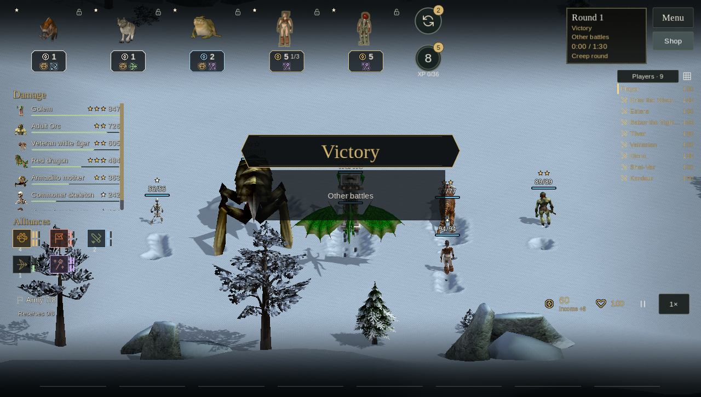

# Allods Challenge experiment — 18 October 2026

Development work on `fix/creature-projectiles-wisp`, based on `1fd56251`.
This is an unpublished experiment, not a release or a claim of optimal balance.
The [current rules](../arena-autochess-design.md) and
[UI specification](../design/arena-ui.md) describe the implementation.

## Recruitment and evolution

There are **30 recruit chains and 90 distinct original forms**. Tier counts are
**7 / 7 / 6 / 6 / 4**, and recruitment prices are exactly **1–5 gold**. Fourteen
chains can appear in the opening. The initial six offers are different; later
shops roll uniformly within their selected tier, without favoring owned copies.

Every step consumes three copies: a two-star unit represents three recruits,
and a three-star unit represents nine. Forms belong to one chain only. Age-only
steps are excluded; original combat roles, clans and named characters provide
distinct archetypes without inventing models. Final dragons, elementals and
other powerful forms require evolution.

Trials-specific budgets replace the old dependence on campaign prototype power:

| Stat | One star | Two stars | Three stars |
| --- | ---: | ---: | ---: |
| Health multiplier | 1 | 2.2 | 5 |
| Attack/spell damage multiplier | 1 | 1.6 | 2.8 |
| Additional attack rating | 0 | 12 | 24 |
| Additional defense | 0 | 8 | 16 |
| Action-rate multiplier | 1 | 1.08 | 1.16 |

Price, combat role, native attack cadence, armor proportions and spell shape
still matter. Native offensive spells retain their behavior and non-effect
runes, with effect runes rebuilt to the Trials budget. Native campaign records
are not edited. Oversized original figures are fitted to the board, including
their collision radius and particle attachment geometry.

Old roster saves migrate by chain while retaining rank, investment and placement.
The migration validates a deep copy, so it does not modify the supplied save.

## Balance evidence

### Eight complete nine-player tournaments

Four seeds (`7319`, `8316`, `9313`, `10310`) were each played twice, rotating
spending-policy assignments. Each policy occupied 18 seats. All players used the
same recruitment rules, prices and native combat. Smaller average place is better.

| Spending policy | Mean place | First places | Top three |
| --- | ---: | ---: | ---: |
| Economy | 5.78 | 3 | 4 |
| Expansion / leveling | 5.33 | 2 | 5 |
| Evolution / collecting copies | 4.39 | 1 | 9 |
| Tempo | 4.50 | 2 | 6 |

Evolution is competitive in this sample, especially at reaching the top three.
It does not dominate first places, and leveling still wins games. These are
four bot policies, not an exhaustive strategy search or a measure of human fun.
Retain the experiment for human playtesting rather than treating these results
as proof of a final balance target.

Historical 40-family results favored expansion (mean place 4.33 versus 5.11 for
evolution). That comparison is descriptive: the earlier run predates the native
pose-clock and animation-RNG fixes below, so it is not a controlled estimate of
the roster change alone.

### 520 direct native fights

Each matchup ran with seeds `8519` and `10777`, in both team orientations.

| Candidate and opponent | Fights | Candidate wins | Draws | Timeouts |
| --- | ---: | ---: | ---: | ---: |
| Every adjacent star promotion against its previous form | 240 | 240 | 0 | 0 |
| 1-gold two-star against a 3-gold one-star | 168 | 92 (54.8%) | 2 | 0 |
| 1-gold three-star against two 5-gold one-stars | 112 | 21 (18.8%) | 3 | 3 |

Two-star upgrades compete at equal purchase cost. A three-star unit compresses
nine recruits into one slot, but usually loses this isolated 9-versus-10-gold
two-enemy fixture. Slot efficiency, targeting and team composition still matter;
the test does not establish equal value in a complete army. Stronger three-star
forms may need further tuning after human games, especially when the cost of
rerolls and holding copies is considered.

### Expedition cross-check

The same four policies played Standard Expedition at seeds `7319` and `8316`.
Economy ended at waves 27 and 29; expansion at 29 and 28; evolution cleared wave
30 once and lost at wave 30 once; tempo ended at 28 and 29. One of eight runs
cleared the expedition. This checks late-wave reachability; it does not establish
the right difficulty for a new player or validate Veteran/Champion difficulty.

[Summary](allods-challenge-2026-10-18/summary.json),
[complete tournament traces](allods-challenge-2026-10-18/self-play.json),
[direct-fight results](allods-challenge-2026-10-18/star-balance.json), and
[expedition traces](allods-challenge-2026-10-18/expeditions.json) retain the seeds
and results. JSON star ranks are zero-based.

## Interface and native artwork

All 90 portraits are direct low-resolution renders of existing native models,
displayed with nearest-neighbor filtering. No generated replacement creature
designs are used. The [portrait sheet](allods-challenge-2026-10-18/native-portraits.png)
and asset manifest record the source prototypes and files.

The damage sidebar contains only the player's deployed round roster, including
dead units. It has no outer background or border. It shows portrait, native name,
stars, damage and a relative bar above the alliance icons. A frozen round roster
keeps purchases made during battle from changing combat statistics.

The supplied Underlords video and screenshots informed compact rows, alliance
thresholds, round/countdown notices and income/victory/defeat presentation.
The implementation retains the game's serif headings, gold accents, native
icons and creature models. Evolution notices temporarily suppress the central
banner so the two messages do not overlap.

Rendered checks cover English, Russian and German with the corresponding original
text archives. Names truncate with full-name tooltips. Translation coverage is
2,727 remake entries, 141 dynamic wiki keys and 151 dynamic arena keys, with
zero missing entries or placeholder errors.



## Camera and invisible creatures

WASD pans relative to the camera. Right drag rotates and tilts. Q/E rotation,
wheel zoom and Home reset remain available. Movement uses existing modern-camera
speed/inversion preferences, ignores text-entry/modal focus, and runs at the
same real-time speed during normal and double-speed combat. Rounds and scouting
preserve the camera pose.

A reproducible clipping case was found at a 1280×1100 viewport, legal +35-degree
pitch offset and zoom 23. The camera's old fixed 90-meter far plane clipped
models and terrain while 2D health labels remained. The fitted plane is about
142.65 meters at that pose. A diagnostic red material makes GPU visibility
measurable; the production materials are unchanged.

| Renderer | Visible red model pixels, old plane | Fitted plane |
| --- | ---: | ---: |
| OpenGL compatibility | 0 | 3,671 |
| Vulkan Forward+ | 0 | 3,352 |

The test returns from the nine-board overview before checking the fitted view.
It also performs 20 rapid overview/scout/home cycles with frozen models and
five next-round replacements while the home board is hidden. All 420 checks
pass on each renderer. This fixes a demonstrated clipping path; it does not
prove that every possible intermittent visibility failure has the same cause.

[Old clipping](allods-challenge-2026-10-18/clip-before.png) ·
[Fitted clipping](allods-challenge-2026-10-18/clip-after.png) ·
[Eliminated spectator hover](allods-challenge-2026-10-18/spectator-hover.png)

## Co-op and combat lifecycle

- Upgrade notices compare the acknowledged army against the previous roster.
  A real ENet guest sees the notice after the merging purchase and an unrelated
  purchase does not repeat it. [Guest upgrade capture](allods-challenge-2026-10-18/online-upgrade.png).
- Sale previews use host-supplied quotes. The sell command includes the quoted
  value, and the host rejects a changed value. Two-/three-star UI sales credit
  exactly the displayed amount; all 90 forms are also checked directly.
- Public autochess lobbies advertise by default, like campaign co-op. The former
  gate read an option (`net_lan`) that did not exist, and therefore always read
  zero in normal settings. Private solo workers remain unlisted. Default lobby
  discovery and separate-process ENet/WebSocket hosting pass.
- Read-only hover details remain available after elimination.
- The steady animation cache includes the requested action. A network snapshot
  that changes run to idle can no longer reuse the cached running clip.
- Defeat deducts health when the board finishes. Original participants remain
  in settlement even after lethal losses. Income and places settle together,
  without deducting damage twice. Interrupted solo combat restores pre-fight
  health before replaying the round.
- Battles end after 90 simulated seconds; pause and double speed retain their
  existing effect on simulation time.

During verification, private-worker and inline fights differed because native
poses included a renderer interpolation fraction and animation choices shared
unrelated randomness. Trials authority now advances poses on exact 55ms ticks
and uses a stable per-actor animation RNG. Campaign animation selection retains
its original random behavior. The private-worker regression passes 57 checks,
including all nine board winners, survivors, clocks and friendly damage, pause,
double speed, and an empty-army loss that is lethal at the starting bell.

## Regression receipts and reproduction

Environment: Godot 4.7 stable, Ubuntu 24.04, NVIDIA RTX 3090. Rendering checks use
OpenGL compatibility and Vulkan Forward+ with HD texture replacement disabled.
The stock 4.7 HD-upscaler shader issue is outside this change. Expected X11 mouse
grab messages are filtered in the board/network fixtures; script/render errors
otherwise fail those checks.

| Fixture | Passed checks |
| --- | ---: |
| Roster, uniqueness, migration and shop distribution | 1,608 |
| Economy | 591 |
| Recruitment, including 364 native fights | 2,396 |
| Live shop | 126 |
| Battle limits | 9 |
| Online rules | 68 |
| Immediate result health | 11 |
| Replicated action clips | 43 |
| Authoritative sale quotes | 272 |
| Existing creature projectile origins | 182 |
| Camera controls | 26 |
| Challenge UI, each of EN/RU/DE | 26 |
| Real guest discovery, upgrade notice and sale UI | 19 |
| Separate host transports and discovery | 74 |
| Private worker combat parity | 57 |
| Board visibility and spectator hover, each renderer | 420 |
| Online status, timer and scouting UI | 38 |
| Three-round lifecycle, private worker, scouting and pause | 641 |

[Check receipts](allods-challenge-2026-10-18/checks.txt) and
[translation coverage](allods-challenge-2026-10-18/translations.txt) retain the
terminal summaries. The existing issue-19 formation save also restores, enters
combat in 1.7 seconds and finishes within the new battle limit.

Run fixtures with an isolated `XDG_DATA_HOME`, `XDG_CONFIG_HOME` and
`XDG_CACHE_HOME`, pointing `--ei-path` at original game data:

```sh
godot-4 --headless --path game --render-thread safe -- \
  --ei-path=/path/to/original/game \
  --tool=/absolute/repository/tools/benchmarks/arena_bot_tournaments.gd \
  --all-new --games=8 --first-game=0
```

The benchmark accepts `--first-game` so the eight games can be run in separate
processes without changing seed/policy assignments. For rendered fixtures omit
`--headless`, select `--rendering-method gl_compatibility` or `forward_plus`, and
pass a script from `tools/tests`. The star and expedition benchmarks use the same
entry point with `arena_star_balance.gd` and `arena_challenge_runs.gd`.
