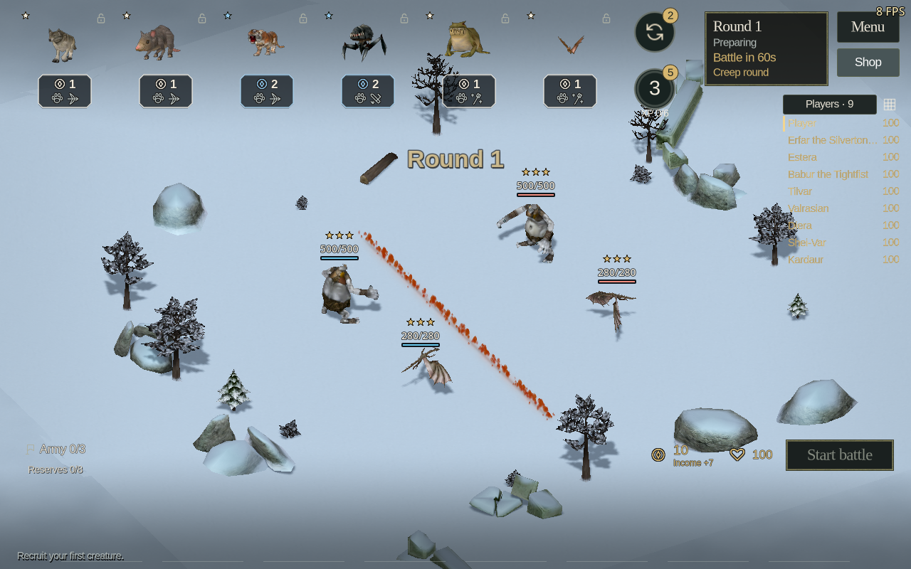

# Autochess deployment movement and figure scale

Local follow-up to the native rank appearances in `e35a8971`, based on published
1.22.0. Branch: `feature/autochess-rank-variants-20261021`. No published release,
tag, artifact or hosted build was changed.

## Behavior

Preparation movement searches around all current creature bodies, including
other movers. After 0.25 seconds without progress it requests a new route with
additional clearance. A completed partial path restores its move command before
retrying an occupied destination. Native courtyard navigation permits longer detours outside
the field; the final deployment point stays exact. Entrance candidates also
extend into the surrounding courtyard and check static terrain and bodies.

Presentation travel runs at 3.5 times native speed, with a 7–14 m/s range.
Movement is substepped to avoid crossing an entire blocking body on a slow frame.
Native movement animations, collision checks, footprints, pause and replacement
commands remain active. Preparation movement does not advance the combat clock
or apply damage. The existing readiness deadline still settles arrivals before
combat if necessary.

Large figure scale now belongs to the actor's arena appearance data and full
records. Each replacement model reapplies that fit, including the locomotion
height factor. Collision dimensions are fitted once. Enemy records use the
authoritative factor instead of recomputing it from an animated pose. This covers
forced refreshes, native body effects, snapshot application and effect expiry.
Temporary native growth effects still change the creature's body build.

The scale regression came from caching the arena fit only on the actor: a figure
replacement created an unscaled model, and the cached flag prevented fitting it
again. An unchanged baseline reproduces 24 failing assertions in the scale
fixture; the corrected implementation passes all 36.

## Validation

The [machine-readable report](report.json) records commands, source and log
hashes, isolated settings and baseline comparisons. Eight successful runs contain
**1,586 checks**:

- Deployment motion: 91 checks covering initial overlap, head-on destination
  swaps, a wall detour crossing the field boundary, six twelve-giant crossing
  patterns, an occupied destination that subsequently clears, slow-creature
  arrival, pause and active retargeting.
- Scale preservation: 36 checks for dragons and cyclopes on both sides,
  authoritative records, model replacement and native body effects.
- Existing formation, rank appearance, creature feedback and equipment animation
  regressions: 1,408 checks.
- Rendered scale and real pointer-input formation fixtures: 18 and 33 checks.
  No script or engine errors were recorded.

The baseline's 944 production source files were verified byte-for-byte against
`bd88efdd:game/src`. It fails the slow-creature arrival deadline and 24 scale
assertions. Constructed overlap and wide-detour scenarios also pass the baseline;
they establish regression coverage rather than reproducing every intermittent
jam. The new recovery policy explicitly replans on presentation time.

The rendered movement fixture uses a fixed 100 ms presentation step to verify an
intermediate position and native locomotion after real pointer input. Otherwise,
the faster movement could finish during the input helper's awaited render frames
on a software renderer. Real-time pause/resume, reserve redeployment, readiness
and the following battle are checked separately in the same fixture.

All runs used isolated profiles with a free cursor, FPS visible, all three audio
volumes zero and the Dummy audio driver. Rendered checks used a private Xvfb
display and original graphics preset on Mesa llvmpipe. These checks establish
behavior on this setup, without qualifying hardware performance or other
platforms. Normal player preferences were not changed.

The translation scanner reports 3,014 entries, 179 dynamic arena keys and zero
errors. This follow-up introduces no player-visible strings. The preceding
[rank appearance validation](../autochess-rank-variants-2026-10-21/README.md)
contains the original palette/lore audit and rendered EN/RU/DE layout checks.
`git diff --check` passes. Three new fixtures are registered in the gameplay
catalog; existing formation fixtures also cover the faster pace.

## Rendered evidence

Before replacement:

After forced replacement, body snapshots and effect expiry:

[Movement with native snow footprints](formation-moving.png).
