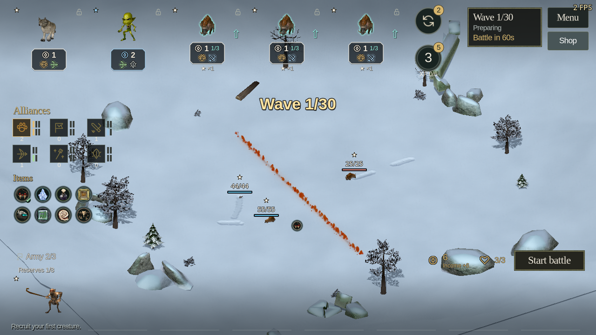
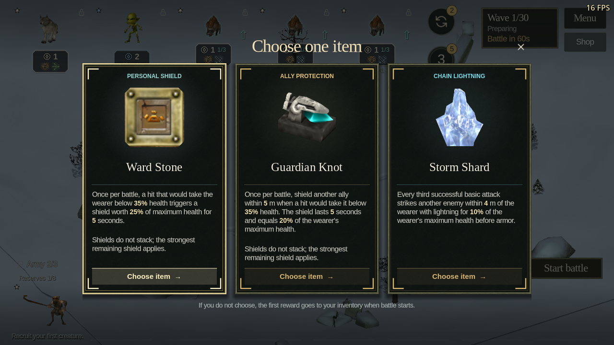
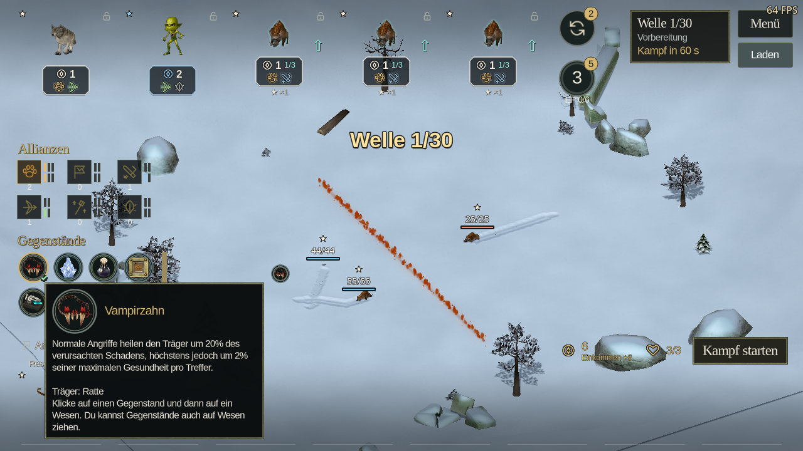
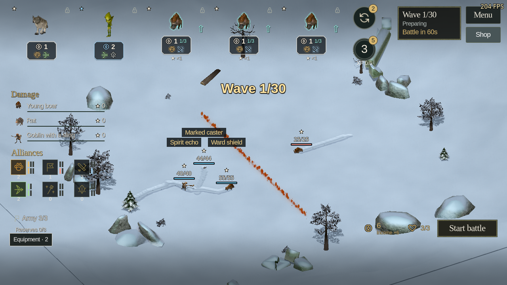

# Autochess equipment and alliances — 23 October 2026

Implemented on `feature/autochess-equipment-alliances-20261023`, based on
`5521491c6980669f1ed46ed18aa70a3af259cd40` (stable 1.24.0 plus the existing
unreleased Agility packaging fix). This is an unpublished source change.
The [research and plan](../design/autochess-equipment-alliances.md) preceded it.

## Delivered behavior

Eight items give each recruit one equipment slot. Rewards offer three distinct,
deterministic choices after rounds 3, 5, 10 and subsequent multiples of five.
Every surviving seat receives the same budget. Free preparation assignments,
occupied-slot replacement, selling, both merge stages, undo and save restoration
conserve owned items. A pending choice goes to the stash when preparation ends.
Old saves start with no items and receive no retroactive awards.

The supplied Underlords recording guided the finished item interface: three
framed reward cards with existing game item pictures over the dimmed board, a persistent icon tray below
alliances, and direct assignment to field or reserve creatures. Players can drag
items or select an icon and click a creature. Circular targets reveal empty and
occupied slots; equipped badges remain visible. Hover and keyboard focus show the
effect and carrier. Replacement, transfers, stash returns and cancellation use
the same ownership rules. Eight direct native item renders are shared throughout.
The cards reuse the original stone and metal textures, with larger artwork,
effect roles, emphasized values and explicit selection actions.

All six alliances now change combat behavior: Beast cooperation and pursuit,
Horde retaliation, nearby Warrior protection, Hunter response to casting,
combined Mage spells, and healing/temporary echoes from Spirits. Distinct
deployed families determine the tier at the bell. Items and membership are
frozen for the current battle, including online and private-worker boards.

Native landed hits and completed spell dispatches own their triggers. Damage
pulses and additional spell targets cannot inflate cast counters. Generated hits
cannot trigger on-hit or on-cast bonuses; original-creature deaths still trigger
their independently capped alliance effects. Echoes carry no equipment, add no
alliance membership, cannot trigger death effects and add no survivor damage.
Their six-second life advances on simulation time.

Shields and guard pools use whole-creature health units, including native head
and limb impacts. The strongest remaining shield applies, and a weaker or
unnecessary item shield is preserved. Elemental item strikes respect native
armor and protection spells. Campaign worlds never install the controller.

The [roster report](autochess-roster-2026-10-23.md) covers Orc warriors and
Woodsfolk seers, their three native visual stages, refreshed portraits and
measured buffs/nerfs. The [UI report](autochess-equipment-ui-2026-10-23.md)
covers equipment interactions, keyboard controls, tooltips and EN/RU/DE layouts.
Save schema 14 migrates existing inventories safely; Autochess protocol 2
requires matching builds. No published version or artifact was replaced.

## Verification

Tests used Godot 4.7 on Linux with original game assets. Every test profile had
a free cursor, FPS shown and all three audio volumes set to zero before launch.
Player settings were not modified.

| Check | Passing checks | Evidence run |
| --- | ---: | --- |
| Native item/alliance effects, higher tiers, head impacts, expiry, recursion and reproducibility | 40 | `combat-effects-final` |
| Native combat at rendered 1×/2× and headless, exact outcomes and effect timestamps | 53 | `equipment-native-headless`, `equipment-native-en-1x`, `equipment-native-de-2x` |
| Final item tray in native combat, frozen badges and localized Spirit echo inspector | 23 | `equipment-native-de-2x-tray-final` |
| Ownership, migration, merge/sale/undo, rewards and invalid inputs | 51 | `equipment-lifecycle-final` |
| Real ENet equipment intents, protocol rejection and host authority | 29 | `equipment-online-final` |
| Existing online regression, both transports | 80 | `online-regression-1` |
| Private worker, nine boards, 2× speed, pause/resume, exact inline outcomes and clocks, echo/effect delivery | 59 | `solo-worker-final` |
| Alliance preparation, economy, evolution and persistence regression | 622 | `alliances-1` |
| Opposing alliance symmetry | 12 | `opponent-alliances-1` |
| Bot strategy regression | 21 | `equipment-bot-planner-final` |
| Native fitted-body formation legality and proximity | 107 | `equipment-bot-formation-3` |
| Dynamic item/alliance/effect names, help and all equipment/screen literal text in EN/RU/DE | 735 | `native-rewards-localization` |
| Direct item UI, real drag input, keyboard controls, cancellation and combat inspection | 366 | `equipment-tray-ui-{en,ru,de}-{720,1080}-final` |
| Input regression after native item artwork and reward framing | 61 | `native-rewards-input-en` |
| Final reward cards, tray layout, long help and health/star clearance | 168 | `native-rewards-{en,ru,de}-{720,1080}-final` |
| Original item pictures at reward and inventory sizes, input transparency and viewport | 58 | `native-rewards-item-art-final` |

The core UI matrix passed 366 checks across three languages at both 1280×720
and 1920×1080. It covers reward selection, actual press/move/release dragging,
field and reserve transfers, replacement, stash returns, invalid destinations,
Escape/right-click cancellation, keyboard access, full-inventory scrolling,
scouting, combat inspection and frozen equipment. Screenshots were visually
inspected for readable wrapping and equipment badge clearance from HP and stars.
The [UI report](autochess-equipment-ui-2026-10-23.md) records separate final
presentation checks for longer shield descriptions and compact formations.
Notice screenshots inject presentation events; native triggering is tested
separately by the combat suite.

The actual rendered combat fixture also matched headless results exactly: winner,
survivors, damage, all native effect events and their timestamps, and 27.665 seconds
of simulation time. Rendered battle wall times were 28.088 seconds at 1× and
14.248 seconds at 2×. This covers one six-versus-six fixture with temporary
Spirit echoes; it is separate from the nine-board worker check.
A final German 2× rerun with the redesigned tray passed 23 checks and retained
the same exact results and native event timestamps. Its measured battle wall
time was 14.271 seconds. The live echo inspector now uses its localized display
name, and the final combat captures show item badges and real effect feedback.

All listed runs exited successfully. Compact results and representative captures
are retained in [the evidence directory](autochess-equipment-alliances-2026-10-23/).
The task's `runs/<run>/` folders retain complete logs and isolated profiles.
Independent reviews covered equipment persistence/online/UI transitions and
combat trigger/replication semantics. `git diff --check` is clean.

## Full matches and balance limits

Four complete nine-seat tournaments used seeds 7319 and 8316 with four rotations
of the economy, expansion, evolution and tempo policies. All 856 native boards
ended by defeat: no timeouts, mean combat duration 22.68 seconds, maximum
73.92 seconds. All eight items appeared. All 856 preparation samples retained
the exact scheduled item budget.

Evolution won three tournaments and economy won one; expansion had the best
mean placement. Every winner used four Mages with Spirit support. This is a
clear composition watchpoint, not evidence of a solved competitive meta. In
the separate equal-cost composition probe, mixed and assault teams each won
nine of 24 fights, casters won six and screened casters won none. The generic
screened formation therefore needs care in interpreting support performance.
The small, correlated fixture samples do not justify another automatic numeric
nerf or establish human win rates. The delivered values are an initial measured
balance pass, with raw comparisons retained for future playtesting.

The full tournaments and summary are in
[tournaments.json.gz](autochess-equipment-alliances-2026-10-23/tournaments.json.gz)
and [tournaments-summary.json](autochess-equipment-alliances-2026-10-23/tournaments-summary.json).
The nine-board worker test checks execution parity and clocks; it is not a claim
about rendered frame rates. Rendered validation here used Linux OpenGL; no new
Windows, macOS or Android package was built as part of this source change.

## Follow-up bot and balance verification

After the item artwork and compact assignment UI changes, the gameplay sources
remain unchanged from the expansion commit. Fresh CPU-only checks passed:
`compact-items-verify-bot-planner` (21), `compact-items-verify-bot-formation`
(107), and `compact-items-verify-equipment` (51), for 179 checks in total.
These cover item selection and carrier suitability, reward ownership, upgrade
purchases, and legal positioning with measured native creature bodies.

`compact-items-verify-composition` reran the 24 equal-cost native fights: mixed
and assault each won nine, casters won six, and screened casters won none. Every
outcome and duration matches the earlier probe; all fights ended by defeat.
This composition probe does not equip items. The equipment-inclusive evidence
remains the four complete tournaments above, and the Mage/Spirit composition
watchpoint remains open. The isolated profiles and fresh logs are under the
same task `runs/` directory.

## Integration with local main

Merged feature `d837dfc8` with local main `fa524009` on 23 October 2026.
Changelog and translation conflicts retain both branches' additions. The shared
recruit pool, eliminated-board handling and original Ogre/Elemental rank rigs
remain active alongside equipment, behavioral alliances and the new recruits.

The integrated code passed [4,885 checks](autochess-equipment-alliances-2026-10-23/merged-main-checks.json):
shared recruitment, equipment ownership and migration, EN/RU/DE localization,
rank appearances, species and recruits, combat effects, online commands, worker
parity, bot decisions and formation, plus native item input and presentation.
The English interaction and German presentation runs used GPU Lab with automatic
GPU assignment. The remaining checks and final editor import were headless.
All runs used isolated muted profiles with FPS shown and a free cursor.

A fresh nine-seat tournament with the shared pool and all current bots completed
31 rounds and 229 native boards. All boards ended by defeat, with no timeouts;
mean duration was 22.73 seconds and maximum 56.21 seconds. All eight items appeared,
and all 229 preparation samples held exactly their scheduled item budget.
The winning evolution-policy team again had four Mages and two Spirits. This
single-seed integration check does not establish competitive balance. Earlier
856-board results above predate integration with the shared recruit pool.
[Raw tournament](autochess-equipment-alliances-2026-10-23/merged-main-tournament.json.gz)
and [summary](autochess-equipment-alliances-2026-10-23/merged-main-tournament-summary.json)
are retained; full logs and profiles are in the task's `runs/merge-main-*` folders.

## Reproduce

Use the game tool entry point with a valid original-data path and an isolated
profile: `godot --headless --path game --audio-driver Dummy -- --no-movies
--no-local-worker --ei-path=<original-data> --tool=<absolute-tool-path>`.
The combat, equipment, localization, online and worker tools are under
`tools/tests/arena_*.gd`. The full-match command uses
`tools/benchmarks/arena_bot_tournaments.gd --all-new --games=2 --first-game=0`,
then the same arguments with `--first-game=2`. Rendered tools use OpenGL
compatibility and the desired window size instead of `--headless`.

