# Autochess equipment, portraits and terrain validation

24 October 2026. Local branch `fix/autochess-portraits-seams-20261024`, based on
stable 1.27.0 (`44d99daa`). No release, tag or published artifact was changed.

## Behavior

- Choose among Zak and nine original companions before a solo or online game.
  The run and network state retain the choice. Computer opponents use distinct
  companions/protagonist identities with their original localized names.
- The viewed board's owner appears as a large transparent bust down to the
  collarbones, angled inward and flush with the bottom edge. The reserve strip
  is shorter; gold, health and battle controls occupy the upper gap between the
  shop and round status, with responsive shop width. Economy text and icons
  use white fill and the Army label's dark outline.
- Creature and company upgrades smile and nod. Battle and match wins smile and
  nod; defeats frown and shake the head. New battles restore neutral expression
  for active players. The overview hides the portrait. Local elimination plays
  the original hero-death cue once, including authoritative network updates.
- Equipment gives fixed stat, damage, healing and shield amounts independent of
  stars. Preparation shows equipment-adjusted stats immediately, including when
  moving/removing items. Trigger percentages remain only for shield thresholds
  and healing suppression. Bot equipment valuation uses the new budgets.
- Item cards have at most two effects and no vertical scrollbar. Wand art uses
  original crafted iron/steel material variants. Unassigned items shine during
  preparation. Army text and its flag have the same dark outline as reserves.
- The courtyard and snow surround share quantized edge vertices. Neighbouring
  overview boards have identical boundary heights; raised snow tapers at joins.
- Combat immediately selects an original fighting track for the watched board.
  The original victory theme remains reserved for the local tournament champion.
- The Curse plays its authored death cycle, then topples forward and settles onto
  the snow. Pausing holds the motion; result presentation finishes it. Quiet
  snapshots show a settled corpse and revival restores the living transform.

## Checks

The [machine-readable report](report.json) records the engine, jobs, counts and
source/screenshot hashes. CPU checks used isolated profiles. Graphical checks ran
through GPU Lab with automatic GPU selection, X11, Dummy audio and a 30 FPS target.
Test profiles keep the cursor free, display FPS and mute all three audio channels.

| Check | Passing assertions |
| --- | ---: |
| Fixed equipment, three star levels, native spell damage, preparation transfers and old saves | 180 |
| Combat effect hooks | 31 |
| Item tiers, budgets and reward compatibility | 166 |
| EN/RU/DE literal and dynamic localization, including ten character names | 1,068 |
| Creature sockets, Curse fall, late snapshots, online corpse and revival | 67 |
| Equipment ownership and reassignment | 51 |
| Bot equipment and formation | 108 |
| Online lobby character choices and seat remapping | 80 |
| Native terrain/surround and adjacent board boundaries | 1,090 |
| All 40 reward cards at 1280×720, glow and music lifecycle | 322 in each of EN/RU/DE |
| Ten transparent portraits, authored expressions, upgrade/battle/match reactions, elimination audio and responsive HUD/details at 1600×900 and 1280×720 | 99 EN; 98 RU/DE |
| Rendered online lobby with a separate authority process, two human choices and scouting | 45 |
| Rendered Curse death and final ground contact | 5 |

All listed runs exited successfully. The existing stock-Godot 4.7
`TexUpscaleTexture` push-constant diagnostic remains in graphical logs. The
repository's existing test logger ignores that specific official-engine issue;
other rendering and script errors fail the tests. Audio remained muted, so the
music and hero-death checks verify selected original audio and transition
behavior, not an audible listening comparison. Item values are an initial fixed-budget tuning
pass, not a claim of competitive balance.

## Original Curse comparison

The [native asset probe](curse-native-assets.log) reads the installed original
`database.res` and `figures.res`. Ancient Curse has flying locomotion, and its ADB
contains `cdeath` with code `0x861d0000`. The animation archive contains eight
clips and only that death cycle; there is no separate grounded death pose.

[REA static evidence](original-death-evidence.json) was collected from original
`game.exe`, SHA-256
`d0fc0bb2acf45f0e59fae89e55c16a59848ffa89fb68feee9f298a680b660ad8`,
using Ghidra 12.1.4. The death-queue builder at `0x550a80` selects the death action;
the transition at `0x548de0` enters the death state and stops locomotion. This
inspection did not establish the original renderer's final corpse orientation.
The 0.8-second topple is a Trials presentation adjustment, not a claim of exact
original-runtime parity. Combat positions, health and random streams are unchanged
by the visual motion.

## Rendered evidence

Reward-card and corpse captures predate the final HUD positioning; those
components are unchanged. The portraits, top HUD and online captures show the
final layout.

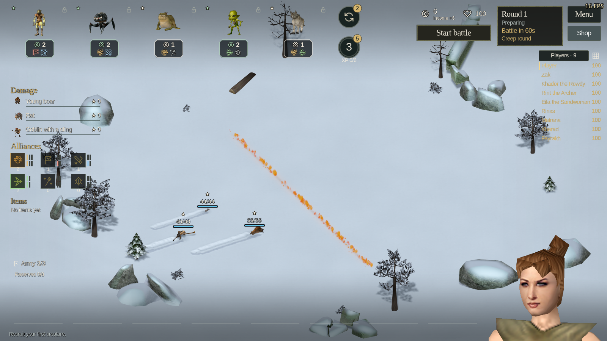

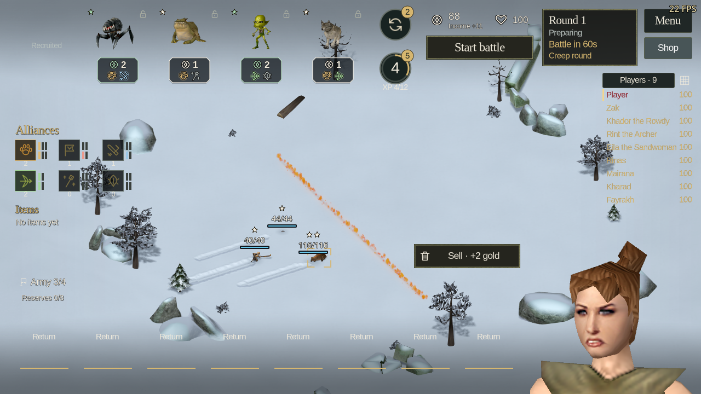

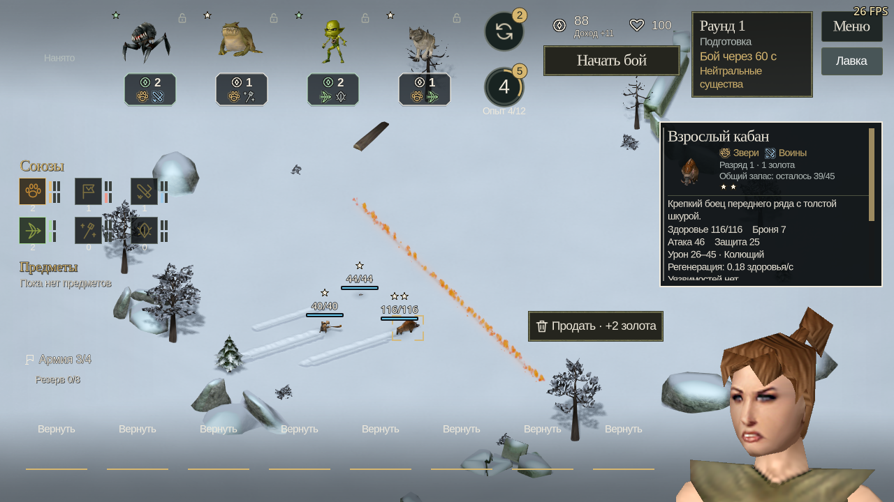

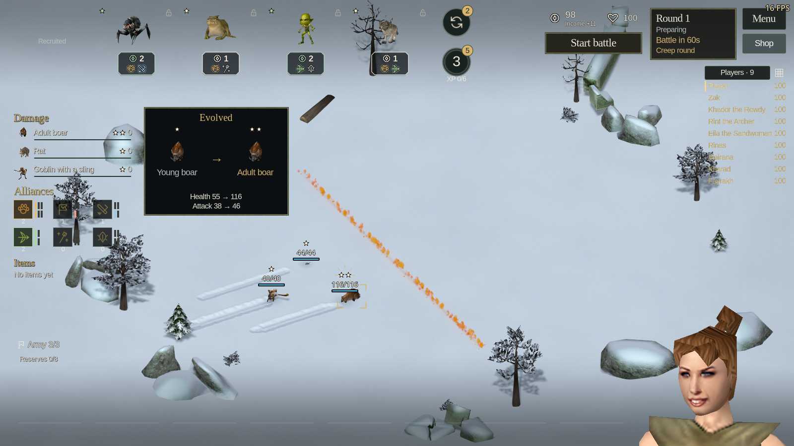

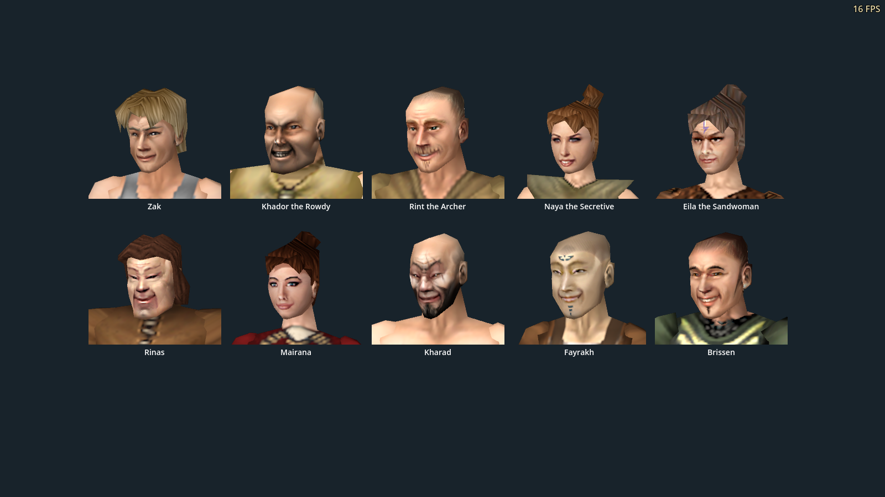

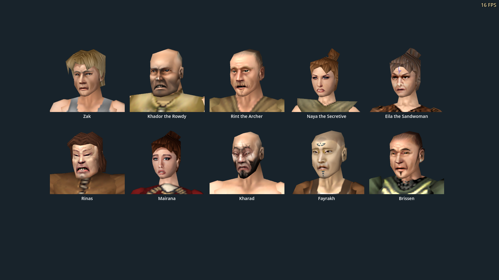

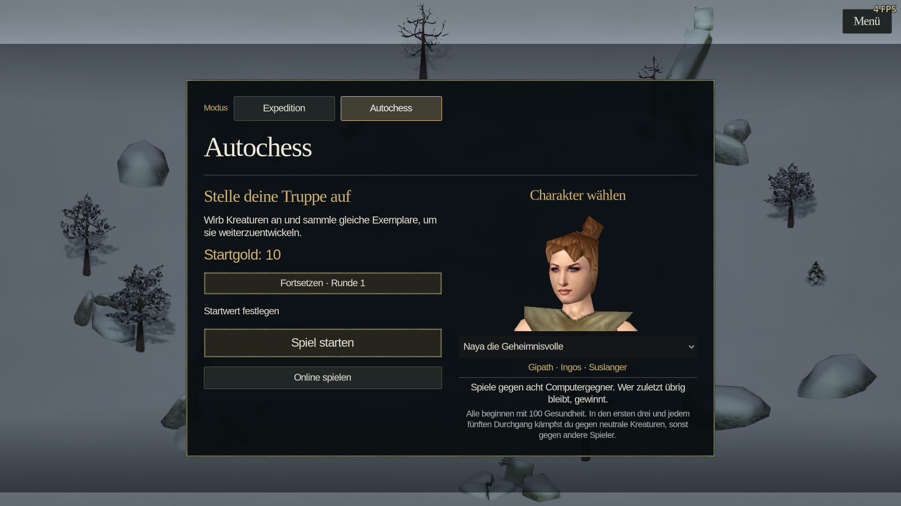

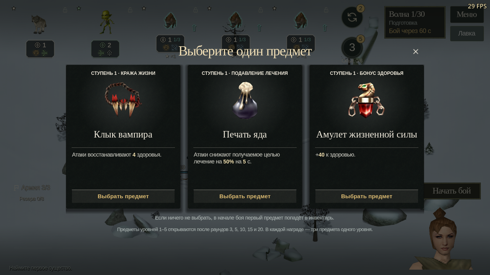

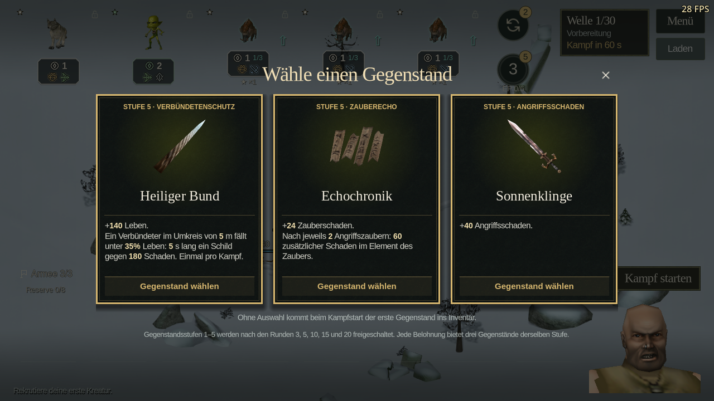

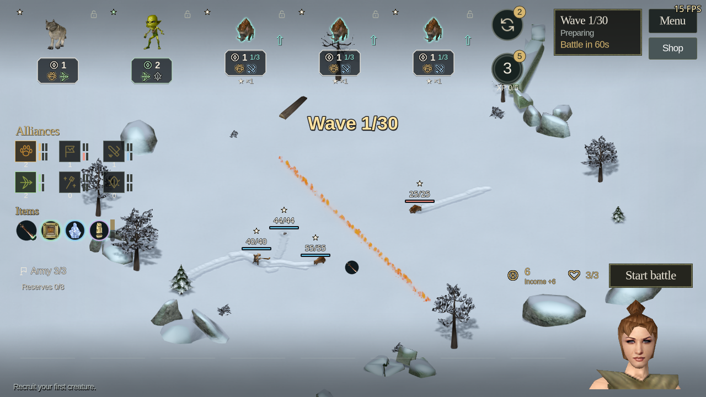

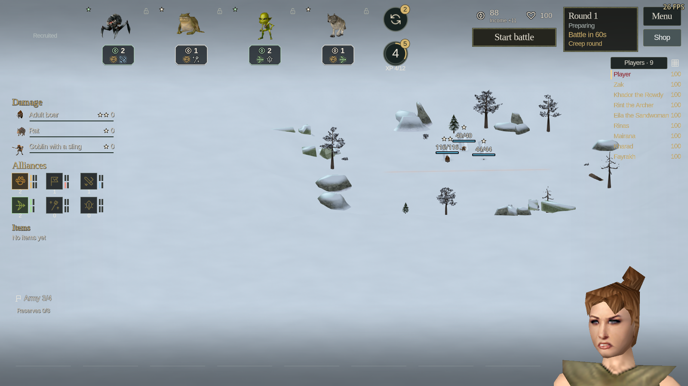

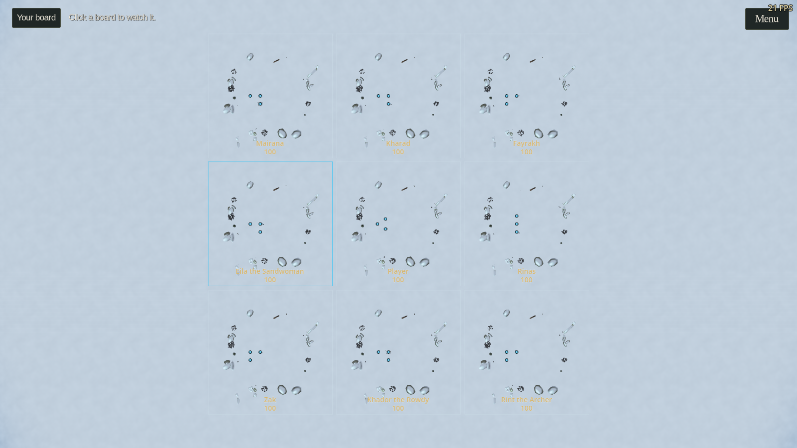

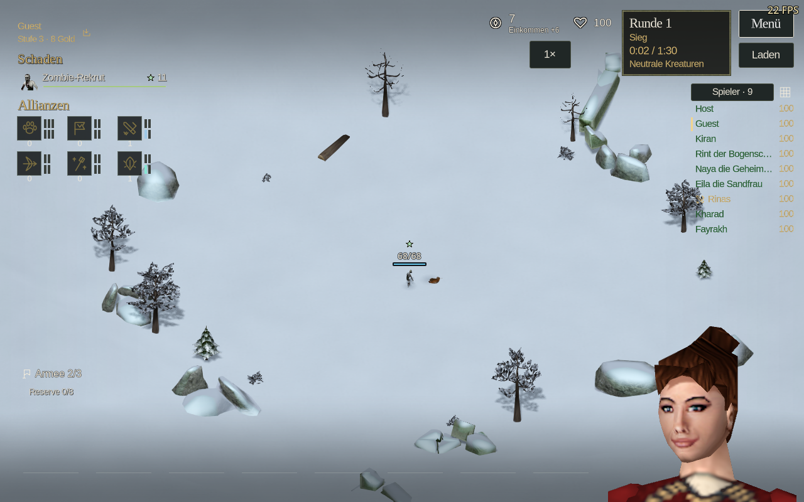

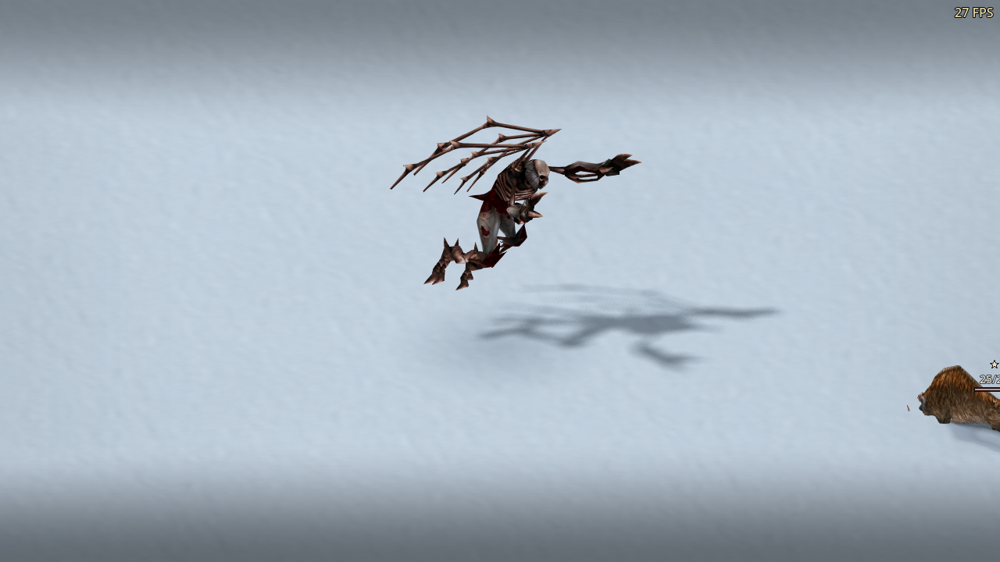

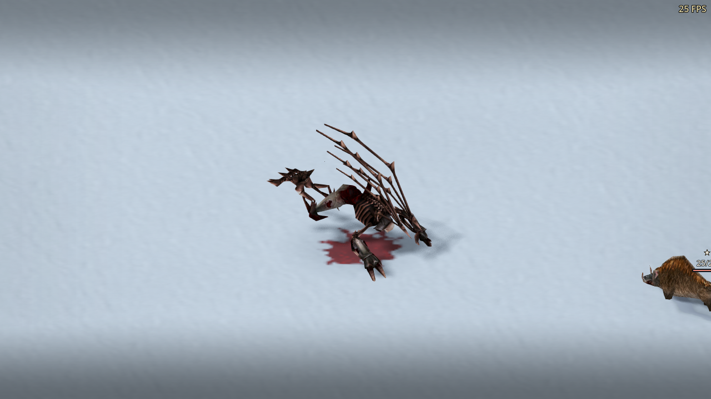
