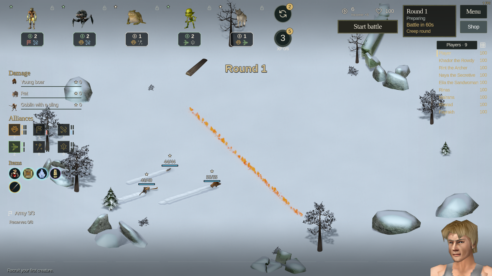
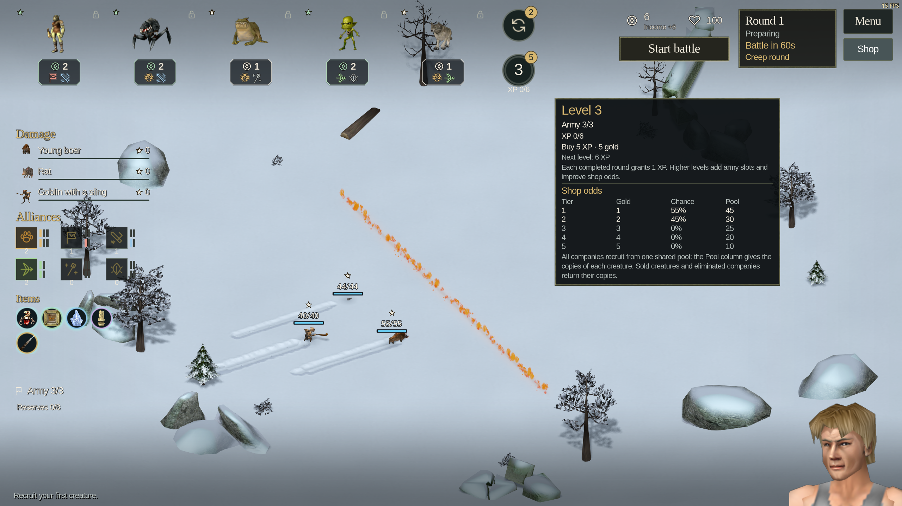
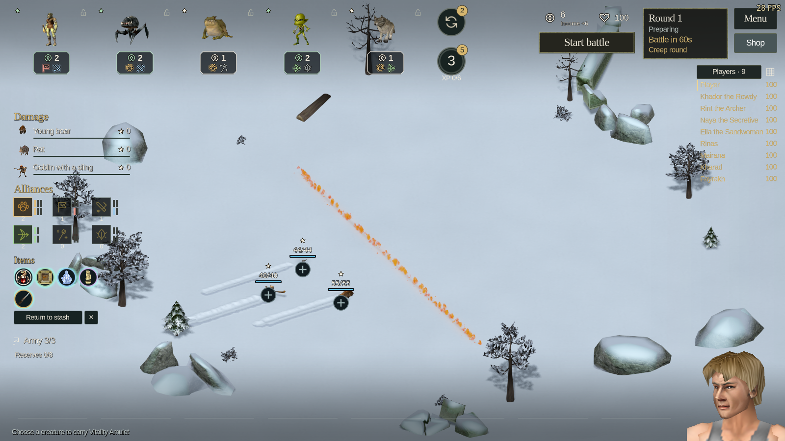
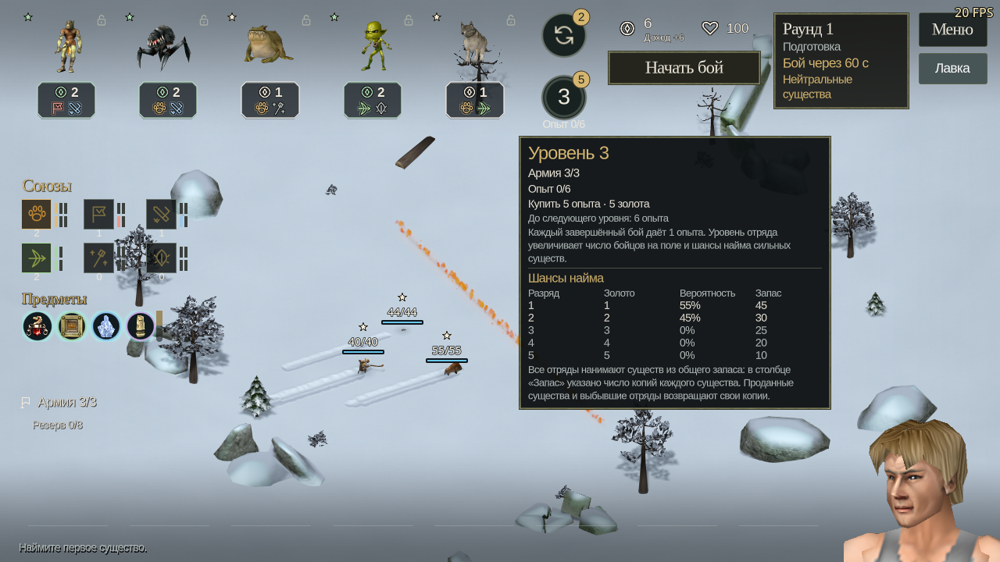
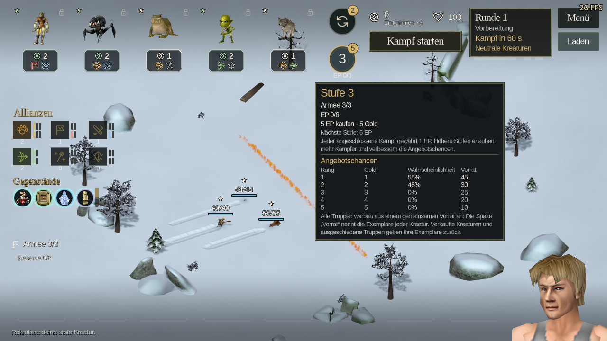

# Autochess portrait and HUD polish

The board portrait occupies a 200 × 200 logical-pixel square, flush with the
bottom and right edges. Battle, match and upgrade expressions expire after
1.8 seconds without restarting on repeated state refreshes. Native heads make
occasional small glances between reactions, using a private visual RNG.

Army uses the same scalable font as Reserves, with no hover fill. Item selection
uses an inner circle, preserving the colored tier rim. Company help contains the
level, XP and shop table in a wider panel beside the portrait; its duplicate
pointer tooltip is suppressed. Existing translated strings are reused.

The rendered fixture passed 62 checks in each of EN/RU/DE at 2560×1440,
1280×720 and 1024×768. It exercises actual Army and level hover, checks the final
paragraph remains visible without scrolling or overlap, samples selected item
corners, observes idle motion and checks all reaction expirations. Tests use
isolated muted profiles in GPU Lab. The earlier portrait regression is also
rerun; exported-build validation accompanies the local package.

[Detailed checks](report.json)

