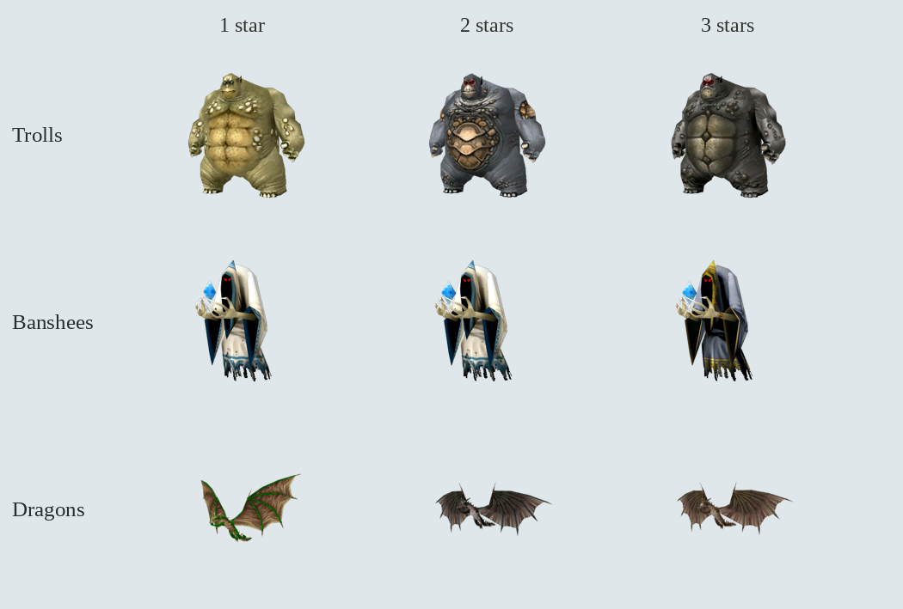

# Autochess native rank appearances

Local implementation based on published **1.22.0**, with its publication
verification commit `bd88efdd`. Branch:
`feature/autochess-rank-variants-20261021`. No release metadata, published tag,
artifact or hosted build was changed.

Sixteen of the twenty-eight recruit families now use alternate original palettes
as they gain stars. Two-palette families reserve their contrasting appearance for
three stars. Three-palette families use one per rank. The remaining families keep
their original appearances and existing star markers.

The [complete contact sheet](all-variants.png) shows all sixteen families.
All images are native model renders, with no generated designs or recolouring.

## Original progression and names

The audit reads `units.udb`, the original rig texture lists, placed MOB records,
and the owned English, Russian and German `texts.res` archives. It uses the
database's actual `base_level`, rather than a number guessed from a prototype ID.
The [native progression record](native-progression.json) contains the selected
forms, source tiers, archive hashes, map examples and localized names.

| Family | One star | Two stars | Three stars | Original tiers |
| --- | --- | --- | --- | --- |
| Trolls | Green | Blue | Black | 10 → 13 → 16 |
| Banshees | Light | Light | Dark | 5 → 7 → 16 |
| Dragons | Green | Blue | Red | 12 → 14 → 16 |

The troll order follows the original green-before-blue hierarchy. The banshee
audit also caught and corrected a reversed light/dark order. All selected name
prototypes now have nondecreasing native tiers across the three ranks.

Equal-tier variants are cosmetic choices. White and black unicorns have the same
original level and combat values; woodsfolk clans also share values at the same
age. Goblin and ogre alternate palettes occur on compatible original rigs without
establishing a separate power tier. Some authored palettes, including the third
lizardman palette, are listed by the original race but absent from the scanned
placed examples. Their use adds native visual variety; a palette index alone is
not evidence of stronger lore or combat values.

Fifteen missing rank-name translations were copied from the original RU/DE
archives, including the green/black trolls, black unicorn, dark bat and alternate
woodsfolk names. Original localized text remains the first source for names.

## Implementation and compatibility

`ArenaAppearance` selects a texture and a localized name from family and rank.
It keeps the canonical combat/save prototype, body complexion, equipment,
animation cadence, spells and existing star budgets. Creep and campaign actors
do not receive recruit rank palettes. Save schema 13 and all canonical recruit
IDs remain unchanged.

Field models, staged opponents, reserves, deployment ghosts, evolution notices,
inspector previews and damage/evolution portraits use the same selection. Rank
changes invalidate retained models and preview figures even when all ranks share
one combat prototype. Full-board replicas detect texture changes, and worker
formation adoption includes rank in its identity. Stable appearances retain their
existing actors and preview render targets.

All 84 active rank portraits were rendered again, and the previously stale
prototype-only manifest was replaced with explicit family/rank records.
The exporter can refresh selected families while retaining other manifest rows.

## Validation

The [machine-readable report](report.json) records source hashes, exact commands,
isolated profiles, log hashes and results. Nine successful runs include:

- Native palette compatibility, ascending original tiers, all 84 rank-name
  translations and save round trips, local promotion and full-board replicas:
  **1,265 checks**.
- Existing species, roster and formation regressions: **3,691 checks**.
- Existing native animation warmup regression: **62,704 checks**.
- Actual field, reserve, ghost, retained preview and inspector/evolution-strip
  checks in EN/RU/DE: **257 checks per language**, with no runtime diagnostics.
- Partial portrait export: 81 unrelated manifest rows retained, with trolls
  ordered green → blue → black.

The translation scanner reports 3,014 entries and zero errors. `git diff --check`
passes. Original localized archives supplied the Russian and German UI runs.
The 1280×800 inspector was inspected in all three languages:
[English](dragons-en.png), [Russian](green-troll-ru.png), [German](dragons-de.png).

All tests used isolated profiles with a free cursor, FPS visible and all three
audio volumes zero, plus the Dummy audio driver. Rendered checks used a private
Xvfb display, OpenGL Compatibility and Mesa llvmpipe on Linux. They establish
appearance/layout behavior, not performance or qualification on other platforms.

The older `arena_combat_budgets.gd` probe is excluded from passing totals. It
assumes a retired roster layout and older regeneration behavior, then errors
when it expects a Curse spell from the current Evileye family. An independent
run with unchanged baseline production scripts reproduced exactly the same
31 ordered diagnostics. Both raw logs and exit conditions are recorded in the
report; this change does not fix or count that obsolete probe as passing.

The two new fixtures are registered in `tools/parity/gameplay_catalog.json`.
Run `tools/parity/gameplay.py --list --case arena_rank_appearance --no-original`
to list the headless case and the three rendered language configurations.
