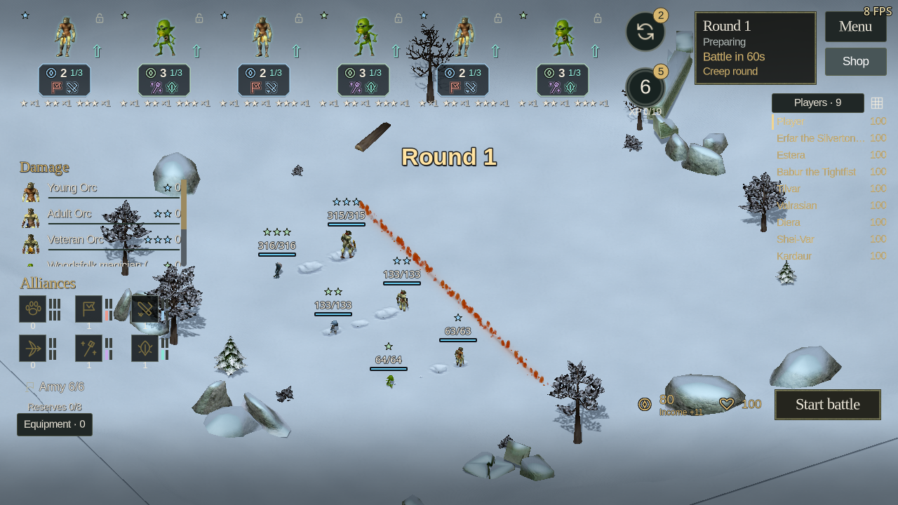

# Autochess recruit and balance checks, 23 October 2026

This check covers the roster portion of the equipment and behavioral-alliance
change. It starts from stable 1.24.0 at
`5521491c6980669f1ed46ed18aa70a3af259cd40`. No release was published by this work.

## Recruit lines and native art

The roster now has 30 recruit lines, distributed 7/7/6/5/5 across the five prices.
The opening pool contains 14 lines. Existing identities remain at IDs 0–27; new
IDs 28 and 29 do not reinterpret schema-13 saves.

| Line | Price | Alliances | Original stages |
| --- | ---: | --- | --- |
| Orc warriors | 2 | Horde, Warriors | Young, adult and veteran Orc; different original outfits, axes and body builds |
| Woodsfolk seers | 3 | Mages, Spirits | Green, White and Black Clan magicians, using their three original leader palettes and increasing native body builds |

Orc shamans remain separate from male Orc warriors. The Woodsfolk caster is an
intentional second role on the Woodsfolk rig: lightning, a different price and
leader headwear distinguish it from the existing ranged hunter. Native roles,
weapons, hit types, animation cadence and no-parry bow behavior remain intact.
All three star ranks retain the same role. Nine ordinary shop copies complete
each final form through the existing merge rules.

Six portrait PNGs were rendered from those original models. The light/dark bat
palette correction from `47b7a868` is also included with matching refreshed
portraits. Rank names missing from the remake catalog were copied from the
original Russian and German text archives, including Veteran Orc and the White
and Black Clan magician ranks.

## Targeted changes to existing recruits

The old report suggested weak final-form Skeletons and Cyclopes and strong
Elementals and Dragons. A fresh comparison confirmed that direction. It did
not justify a Banshee buff, so the Banshee budget remains unchanged.

| Three-star recruit | Change | Contextual score before | After |
| --- | --- | ---: | ---: |
| Skeleton | Health +8% | 36.81% | 41.67% |
| Cyclops | Attack budget +12% | 30.21% | 43.75% |
| Elemental | Health −8% | 69.79% | 52.08% |
| Dragon | Attack and spell budget −8% | 66.67% | 47.92% |
| Banshee | No direct change | 41.67% | 43.75% |

Earlier stars keep their previous budgets. These before/after results use two
frozen copies of the 1.24.0 combat system and its old alliances, differing only
in the four listed adjustments. Each copy ran 240 real native 4v4 battles:
same-price comparisons, three shared-support contexts, two seeds and both sides.
Both samples contain five timeouts. The comparison isolates the numeric changes;
it does not claim they establish the final meta after the alliance rework.

## New recruits under behavioral alliances

The initial 396-battle sample used the new alliance runtime. Orc warriors scored
56.25%, 55.56% and 49.31% across one, two and three stars. Their initial budget
was retained. Woodsfolk seers were too weak, especially after promotion.

A separate frozen 180-battle control and 180-battle candidate compared the seer
with every other three-gold recruit in the same contexts at all three stars.
The candidate raises its health factor from 0.9 to 1.0 and its attack/spell factor
from 1.0 to 1.25. Armor, native weapon speed and the absence of parry are unchanged.

| Seer rank | Initial control | Adopted candidate |
| --- | ---: | ---: |
| One star | 30.83% | 50.00% |
| Two stars | 26.67% | 38.33% |
| Three stars | 16.67% | 35.00% |

Timeouts fell from seven to zero. The promoted seer still needs protection and
does not dominate these generic formations. Its role as a cheaper Mage/Spirit
bridge needs full-match and human play evaluation. All 16 mirrored promotion
duels for the two new lines were won by the promoted form without timeouts.

The repaired equal-price six-unit composition fixture also finishes all 24
battles without timeouts. Mixed and assault formations each win nine, casters
win six, and screened casters win none. This small hand-authored set exposes a
weak screened-caster composition; it is not evidence of an even composition meta.

Scores count a draw as half a win. They are fixture results, not player win
rates. Repeated units and supports are correlated; two seeds cannot establish
statistical confidence. The native frame and animation clocks can affect
outcomes, so the small differences between repeated seer controls are retained
in the evidence. The initial 396-fight suite includes 31 timeouts and is not
described as a fully decisive result. No rendered FPS claim follows from these
headless simulations.

## Correctness and rendered checks

The following current-worktree tests passed with no failures: new recruits
(98 checks), roster (1,525), species and migration (2,181), rank appearance and
replicas (1,354), and combat budgets (915). The stale combat-budget fixture was
repaired to use current Unicorn/Horror identities and float32 healing precision.
It also passes 855 checks against unchanged 1.24.0, so repairing that fixture
does not conceal a new gameplay failure.

Actual preparation-board and inspector checks pass 46 assertions in each of
English, Russian and German at 1280×720 using OpenGL. All six new native stages
are present on the field and all three rank portraits fit the inspector. The
screenshots show the initial seer budget before the adopted numeric correction;
its appearance and layout are unchanged. A subsequent spell-title translation
fix is tracked by the equipment UI checks.

Every run used an isolated profile with a free cursor, FPS shown and all three
audio categories muted. Normal player preferences were not changed.

## Reproduction

Run the native tools through the game's `--tool=/absolute/path/to/script.gd`
argument with a valid original-data `--ei-path` and an isolated test profile.

- Existing outliers: `tools/benchmarks/arena_balance_contexts.gd`
  with `--families=6,19,22,23,27 --ranks=2`.
- New lines: the same tool with `--families=28,29 --ranks=0,1,2`.
- Seer comparison: the same tool with `--families=29 --ranks=0,1,2`.
- Promotions: `tools/benchmarks/arena_star_balance.gd`
  with `--families=28,29 --kind=promotion`.
- Native forms and transactions: `tools/tests/arena_recruits.gd`.
- Board and inspector: `tools/tests/arena_recruits_board_ui.gd`
  with `--lang=en`, `--lang=ru` and `--lang=de` separately.

The retained JSON samples and frozen budget/runtime sources are in
[autochess-roster-2026-10-23](autochess-roster-2026-10-23/).
Run its `analyze.py` to reproduce [summary.json](autochess-roster-2026-10-23/summary.json).

[Russian inspector](autochess-roster-2026-10-23/ru-inspector.png) ·
[German inspector](autochess-roster-2026-10-23/de-inspector.png)
