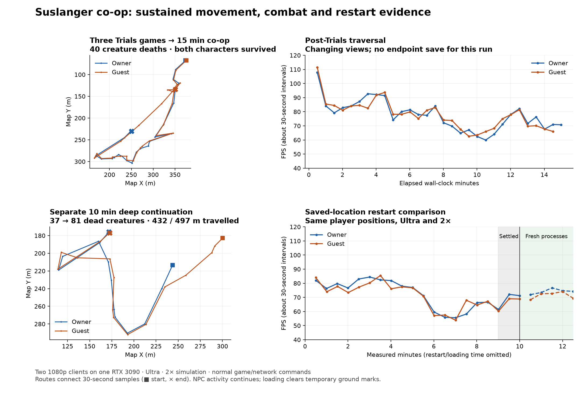
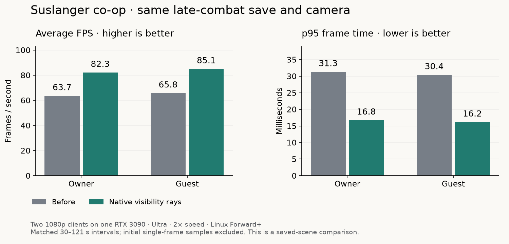
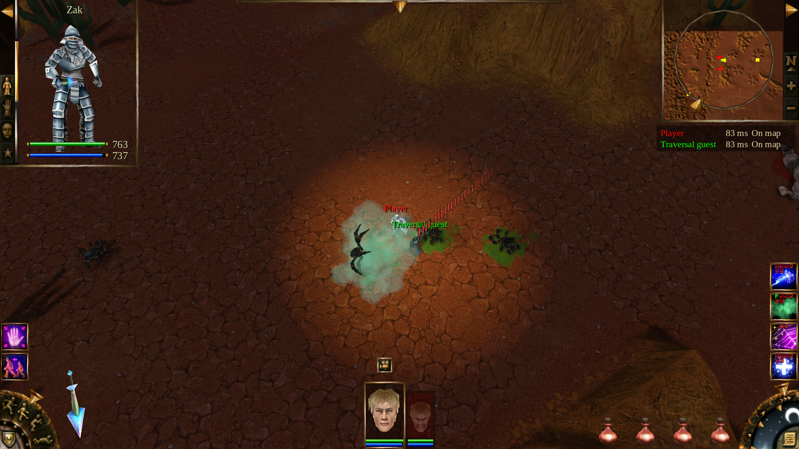

# Campaign controls, presence and sustained performance validation

Local validation on 19 October 2026. The release version remains 1.17.0; these
changes have not been published. Trials roster/balance work is recorded separately.

## Full-game and restart follow-up

A later run played three Trials games from round one to normal player elimination
(rounds 25, 26 and 18), then continued into 15 wall-clock minutes of Suslanger
co-op. Both characters survived, with 40 creature deaths and 779/1,106 m of
movement. They reached about 300 m from the entrance. All prior Trials worlds
were released; engine-reported graphics allocations after their exits totaled
349, 350 and 351 MiB. These totals include renderer-owned allocations, not only
asset caches (see the [isolation follow-up](../session-retention-isolation-20261019/README.md)).
The owner's changing-view intervals ranged from 60–108 FPS and the
guest's from 63–112 FPS. This run did not capture an endpoint save, so it is not a
matched restart comparison. Preparation uses the normal shopping planner and
Ready action; the games end at player elimination, not the last surviving bot.

A separate ten-minute continuation started from the earlier deep-combat save
with 37 dead creatures. It recorded 44 additional deaths, 432/497 m of movement
and 70/67 observed cast actions. It saved the endpoint after a stationary minute,
waited for the server's acknowledgement, then closed both clients and the server.
Fresh processes reloaded all 81 corpses at the same player positions and settled
camera centres. The final pre-close intervals were 71.2/68.8 FPS; the five fresh
intervals ranged from 71.9–76.7/68.3–74.1 FPS. NPC activity continues and temporary
ground marks reset on loading, so this is not a frame-identical comparison.
Neither run reproduces the reported threefold restart recovery. Both use Ultra,
2× simulation, strong equipped characters and normal game/network commands on
the same single-GPU Linux setup described below.

The continuation includes a separate effect-timer fix: ending bursts now use
world-owned timers that stop when their world leaves or a battle settles. The
focused ownership/timing regression passes 34 checks in both editor and exported
runtime. This fixes retained timers and late bursts; it does not establish the
cause of the large FPS report. The full three-game run predates this timer fix.

[Full-game and restart measurements](../session-retention-20261019/summary.json)
and [timer regression evidence](../particle-delay-lifetime-20261019/summary.json)
record the sources, settings and limits. Raw intervals, logs, RSS/graphics samples
and combat screenshots accompany them.

## Sustained co-op gameplay

The rendered benchmark uses two 1920×1080 Forward+ clients and a separate ENet
authority process on Linux with one RTX 3090. Both clients use the Ultra preset,
2× simulation speed, no frame cap and the patched Godot 4.7 engine template used
by the project. Sharing one GPU is a limitation when comparing these numbers with
two separate player computers. No builds or other game tests ran during sampling.

`tools/benchmarks/coop_traversal_session.gd` drives normal movement, attack,
spell-selection and cast commands through the game and network authority. This
is an automated gameplay traversal, not manual play. It walks through Suslanger's
authored enemies, with normal targeting, damage, mana, stamina, pathfinding and
healing. It does not teleport, spawn test mobs, force damage/death or grant
invulnerability. The deliberately strong level-15 fixture has melee/elemental/
astral 100, a diamond crystal sword, mithrill armor, learned recovery perks, and
lightning, acid fog, weakening and healing. Its full stats are printed in the logs.

The owner first completes **three populated nine-board Trials sessions, one
late-round battle per session**. These are not three complete tournaments. Each
session reaches its result and is freed through normal scene teardown. The guest
joins fresh for the campaign, so only the owner carries Trials caches into it.

The pre-fix campaign run lasted 15 wall-clock minutes, about 30 simulated minutes.
It recorded 37 enemy deaths, 77 owner and 76 guest distinct observed cast actions, 677 m
and 663 m travelled, and about 253 m maximum displacement from the entrance.
Screenshots show combat in the southern and western parts of the route. Normal
movement orders steered around blocked fort approaches; `traversal-steering.jsonl`
records them. The original run did not return to the exact entrance before its
time limit, so its end FPS is not a same-view before/after comparison.

The first single-frame sample at time zero is excluded from FPS summaries.
Subsequent rows contain about 30 seconds of wall-clock frame timings. The
`real_casts` counter records distinct replicated cast-animation serials, not
verified successful spell impacts. Camera,
position, distance, observed cast actions, deaths, particles, sounds, scene counts,
graphics allocation and process RSS are recorded alongside FPS and p95 frame time.
Route comparisons are not frame-identical: normal movement and combat timing can
change which target is attacked next.

## Finding and controlled comparison

A saved late-combat state was reloaded in fresh processes. Before the change,
settled owner samples were 61.7–64.7 FPS and guest samples 63.7–67.6 FPS. Restarting
there did not reproduce a threefold recovery. A private instrumented copy then
attributed about 5.8–6.0 ms per frame to `UnitFog._process`, mostly terrain sight
rays for retained enemies/corpses. Instrumentation adds overhead; its FPS is not
used as a production result. Inclusive timings must not be summed across nested
callbacks.

The production change moves the existing `NavGrid.ray` walk to the native helper.
It reads current heights and spans on each call, preserving cell rounding, tree
attenuation, opaque-wall factors and live door/floor changes. It does not shorten
sight range, prune remembered units or cache visibility results. Old native
libraries and unsupported platforms retain `ray_script`.

Reloading the same state with the same camera and settings after the change gave
81.3–83.2 FPS for the owner and 82.8–87.6 FPS for the guest over the comparable
30–121 second intervals. The final 150-second intervals are also retained in the
raw data but excluded from that matched range. p95 frame time fell from roughly
30–32 ms to 16–17 ms.

This establishes a CPU visibility bottleneck and an improvement in that scene.
It does **not** establish an unbounded memory leak or reproduce every condition
behind the reported 90-to-30 FPS slowdown. Graphics and process memory were
bounded during the measured campaign; some reusable resource caches remained
after Trials. The allocation total alone does not establish which resources
remain or whether they are still used.

A post-fix attempt starting with three more Trials battles was interrupted after
movement stalled near the entrance route. It reached six enemy deaths but only
68/87 m of movement. Its stationary stretch is **not sustained-traversal evidence**;
those files are prefixed `interrupted-`. Reloading that state showed valid nearby
paths and no blocked-character flag, so the runtime movement stall remains
unexplained. A separate continuation starts from the original deep-combat save,
without claiming another complete post-Trials traversal.

That continuation completed **600 wall seconds / 1,200 simulated seconds** at
Ultra and 2×. It recorded **28 additional enemy deaths**, 59/56 distinct cast
actions, **544/572 m travelled**, and about **310 m maximum distance from the
original map entrance**. This includes more western encounters than the baseline.
Its changing-view FPS ranged from 63.9–91.4 (owner) and 62.9–88.8 (guest). The owner
returned to its saved starting position; the guest was still returning. The final
intervals were 73.3/70.2 FPS and include travel, so they are not a second matched
stationary comparison. Graphics allocation stayed within 1,043–1,086 MiB for the
owner and 1,037–1,086 MiB for the guest; active effect counts stayed between 3 and 9.
Loaded client RSS rose by about 74 MiB per client while new areas were explored,
ending near 2.5 GiB. That increase alone does not prove or disprove a leak. Both
characters survived. `summary.json` records the measurements and limitations.

## Focused correctness checks

| Check | Result |
| --- | --- |
| Native ray vs retained script, including live edits and fallback | 17,835 checks, zero failures |
| Expansion visibility, two real ENet peers, blocked eyes/body/corpses | 144 checks, zero failures; 24 blocked-eye samples |
| Native perception selection and adapter state | 2,857 checks, zero failures |
| Paused save loading, position/facing and first presentation | 50 checks, zero failures |
| Posture casting and old snapshots during transition | 19 checks, zero failures; old HUD failed six checks |
| Direct spell priority, interaction, running loot and cursor aim wheel | 37 checks, zero failures |
| First/third-person keyboard/mouse regressions | 97 checks, zero failures |
| Training refund accounting and dependencies | 99 checks, zero failures; 5,247 legal orders |
| Co-op single-rank unlearning and loaded item listing | 36 checks per language, EN/RU/DE |
| Save selection and confirmed deletion of owned test fixtures | 25 checks per language, EN/RU/DE |
| Discord local Unix IPC framing/activity/ping/clear | Passed against a real local socket mock |
| Linux and Windows native helpers | Both rebuilt successfully |

The first visibility command mistakenly supplied original-game assets to the
expansion's `gz1h` fixture and could not load its map. The listed successful run
uses the correct expansion assets; no production change was made for that setup
error. All new UI labels/help were checked in English, Russian and German; the
screenshots include maximum-rank refund controls, bulk deletion and Discord help.

## Limits and unresolved reports

- **Discord:** no project application ID exists yet. The Linux socket protocol
  passed, and the Windows transport compiled. Actual Discord profile display and
  Windows named-pipe runtime behavior remain unverified. Setup is documented in
  `docs/integrations/discord.md`.
- **Peasant help:** authored base-game and expansion records plus fear/hit/ally
  delivery checks passed (eight each). The existing implementation already uses
  the original help radius and delay. No peasant production change was made;
  these checks do not reproduce a complete rendered quest encounter.
- **Zak's portrait:** repeated animation updates and complexion comparisons did
  not reproduce nonuniform stretching. Selected and unselected portraits use
  different intended sizes. No speculative portrait change was made.
- **Platforms:** rendered gameplay and UI were tested on Linux. Windows native
  compilation is not a substitute for Windows gameplay validation.

Run benchmark tools with an **absolute, isolated `XDG_DATA_HOME`**. The optional
`--resume-slot=quick --stationary --duration=150 --label=...` mode is only for the
controlled saved-scene comparison after traversal; it is not the sustained test.
