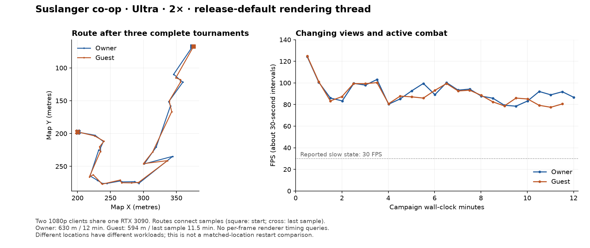
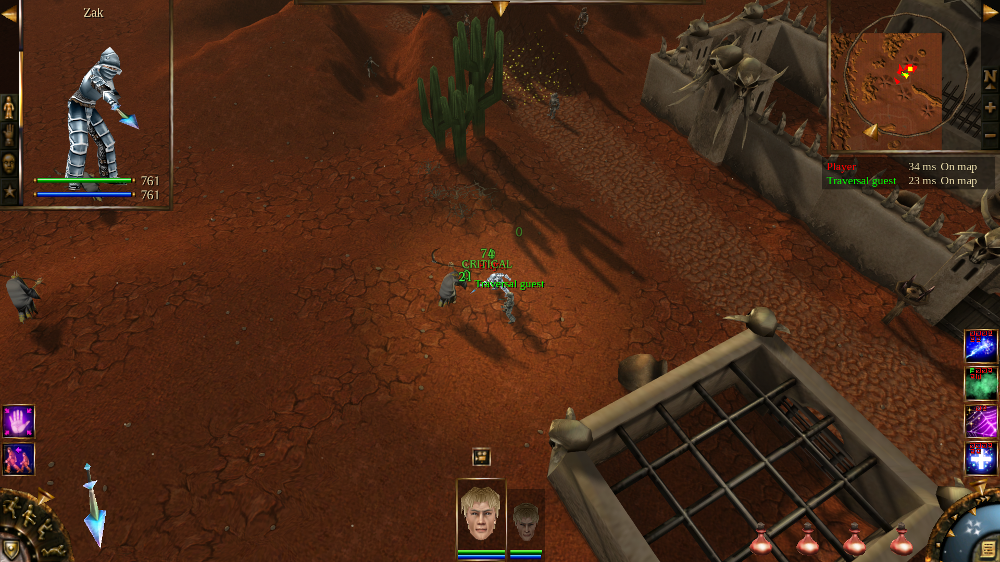

# Full-session check with the release rendering thread

Local Linux/Vulkan validation on 19 October 2026, using production source
`66dda7db`. The reported large restart-sensitive FPS drop was **not reproduced**;
this does not establish that it is fixed on the affected system.

Earlier sustained runs explicitly selected Safe mode. The patched Linux release
defaults to a separate rendering thread; Windows defaults to Safe mode. This
run closes that Linux coverage gap. Both rendered clients confirmed the actual
separate mode. The authority workers retained their normal headless Safe mode.

The benchmark now makes per-frame renderer timing queries opt-in through
`--render-timings`, because those queries can synchronize a separate renderer.
This run measures delivered frame intervals without those queries. Once-a-minute
screenshots still cause image readbacks and can affect the surrounding interval.

## Workload and results

The same frontend process played three complete nine-player Trials tournaments,
ending through normal elimination at rounds **25, 26 and 18**. Purchases used
the existing bot planner; damage, economy and combat were unchanged. Each scene
returned to **17 nodes**, with **zero tracked old worlds alive** after teardown.
The first empty scene had 16 nodes. All prior authority workers terminated.
Remaining renderer allocations were about 350–352 MiB after each game; these
are allocation counters, not resident VRAM or evidence of retained live worlds.

It then ran **12 wall-clock minutes** of Suslanger co-op with two rendered
clients and a private authority, using Ultra, 1920×1080, 100% render scale and
2× simulation. Both clients shared one RTX 3090. Equipped level-15 heroes used
ordinary game/network commands, authored enemies, weapons, Lightning, Acid Fog
and Weakness. Health, mana and damage remained active. No invulnerability,
teleports, deleted enemies or direct effect spawning was used.

| Observation | Owner | Guest |
| --- | ---: | ---: |
| Last recorded sample | 720.00 s | 690.95 s |
| Distance travelled | 630.4 m | 593.6 m |
| Maximum sampled distance from entrance | 251.0 m | 253.7 m |
| Last sampled health | 648.2 | 763.0 |
| Observed cast-action serials | 89 | 82 |
| 30-second interval FPS range | 78.5–124.4 | 77.5–124.9 |
| Time-weighted interval FPS | 91.8 | 90.2 |
| Last interval FPS | 86.8 | 80.5 |
| Maximum sampled ending-effect timers | 2 | 1 |

The owner observed **42 additional dead units** by the end. Both players see
the same world deaths, so the counts must not be added together or interpreted
as individual kill credits. Cast serials establish observed cast animations,
not guaranteed spell impacts. Both heroes remained alive in all recorded
samples. The guest started a few seconds later and was closed during owner
shutdown; its periodic rendering log continues after its last full traversal
sample, but there is no terminal guest-health sample.

Near the end, a live destination of `[140, 280]` sent the party farther west
through normal movement while retaining target selection, combat and healing.
The fights continued along the way; the destination was not reached before
the timed run ended. The steering record is retained and the temporary control
file was removed after exit.

There were **zero script/engine errors**. The only warnings were the engine's
standard separate-thread notice, once per rendered process. All six observed
frontend/authority processes had terminated after the run.

## Interpretation and evidence

The first sample covers almost no time and is excluded from FPS statistics.
All post-startup traversal samples report 2× and the separate rendering thread.
The initial guest sample at 0.002 seconds records 1×; it is excluded from FPS
statistics. By its first 30-second sample, simulation has advanced 59.95 seconds.
Views and combat loads change during the route: the initial and final intervals
are not a matched-location restart comparison. This run does not validate
Windows/Direct3D 12, other hardware, a higher resolution or supersampling.

[Summary](summary.json), [source and runtime hashes](source.json),
[raw run log](run.txt), [process snapshots](default-thread-processes.jsonl),
[live steering](default-thread-steering.jsonl),
[owner samples](traversal-default-thread-owner.json), and
[guest samples](traversal-default-thread-guest.json) retain the observations.

