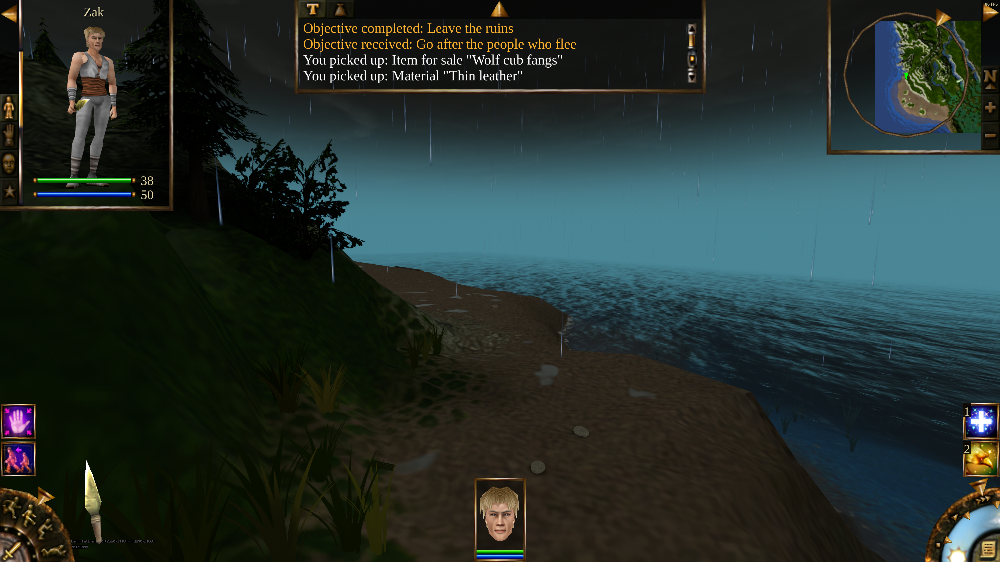
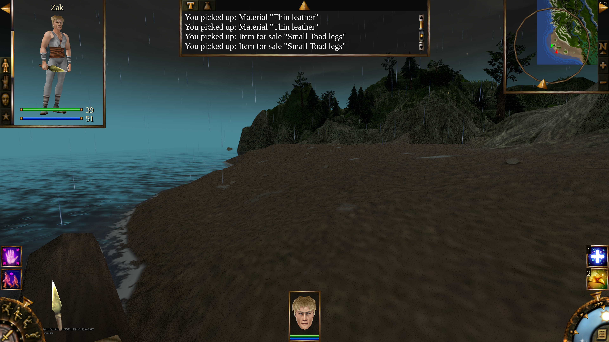
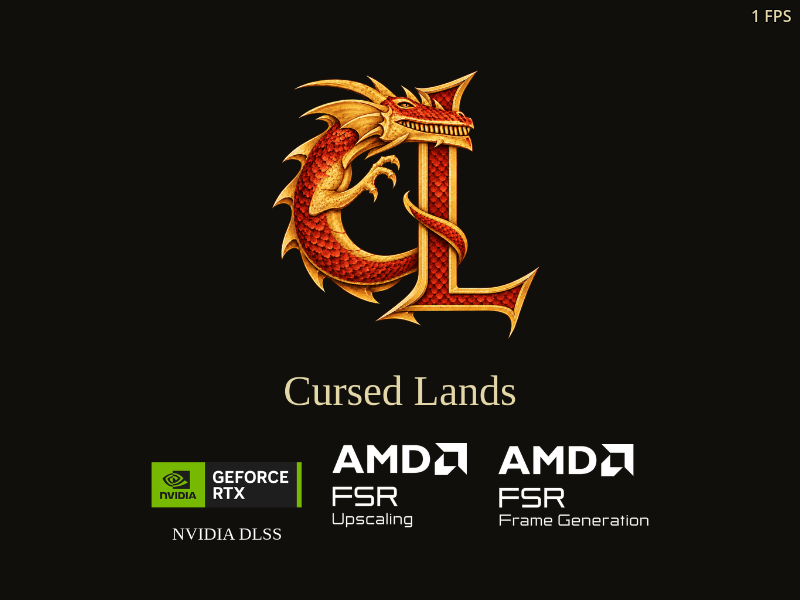
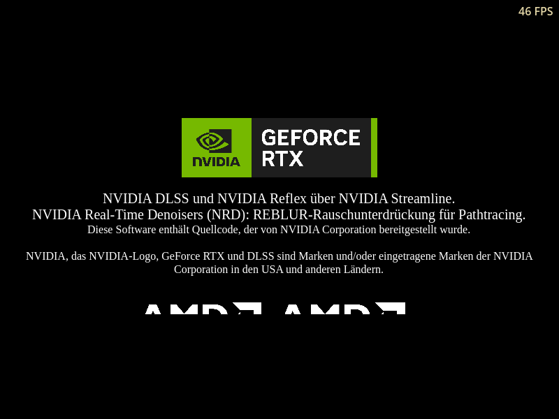

# DLSS restoration validation — 2026-10-24

The local `1.28.0-experimental.3` Windows export restores DLSS SR/DLAA alongside
NRD without reintroducing the sustained post-combat slowdown. A complete
recording-derived traversal used the actual player and separate simulation
process, walked 127.23 metres, fought and looted five authored enemies, and
completed with no PT or responsive NRD dropouts. DLSS evaluated every one of
the 15,137 sampled frames. Cold-loading hitches remain; this is not a claim
that all frame-time spikes have been eliminated.

This is an unpublished review build. NVIDIA mark-placement approval, native
Windows qualification and NVIDIA frame-generation hardware qualification are
still outstanding. See [attribution requirements](../branding/graphics-sdk-attribution.md)
and [integration details](../integrations/nvidia-dlss.md).

## Build provenance

The runtime was properly exported from commit
`7a574589831319be092ee2c14182686d98cb03be`, game tree
`7f28df063ba60da2b35b7282e59a23984744c24a`. Later documentation changes do not
change the executable or PCK; packaged `BUILD-INFO.json` separately identifies
the validation commit.

| Artifact | SHA-256 |
| --- | --- |
| Windows EXE | `fa964f4669922f71cd218fab373e30510bc78b64df94d87c4c8723abb99bea04` |
| Windows PCK | `05b3e9bd4fc09c3ea442d75a6888fa588cd221796eb6d902811be2f5378c76f3` |
| Windows engine template | `07a622ab315d44be24342d9668f3b38898692f4a68ffb69a877c558e72446a18` |
| Linux executable | `900844d32a705b811a2b940b26e813defcae21f3763687aeb9c8eb99c896ebfa` |
| Linux PCK | `ee397fbe1717446d9e8b09cbb3037e79a565857e2b8da05b31ff6000cced8b3d` |

The Windows engine retains the qualified stable 1.27.0 engine's twenty patches
and adds `restore-dlss.patch` last. The source audit checked 8,210 base source
files: all 17 changed existing files and 12 added integration files replay
exactly from that patch. The 24 installed Streamline headers match the pinned
2.14.16 archive. Linux uses the unchanged qualified stable engine.

The final exports contain 1,448 PCK resources and the exact 426 compiled game
scripts, matching native NRD libraries and shader manifests, and no original
game data or test fixtures. The Windows EXE has the approved icon at all six
embedded sizes (16–256 pixels), file version 1.28.0.0, the qualified DirectX
Agility runtime and the pinned signed production NVIDIA DLLs. Full unmodified
SDK notices are present, including NRD at the root and in `licenses/NVIDIA/NRD`.

Evidence: [package audit](dlss-restoration-2026-10-24/package-audit.json),
[engine source audit](dlss-restoration-2026-10-24/engine-source-audit.json),
[build command/result](dlss-restoration-2026-10-24/build-result.json).

## Test environment and scope

GPU Lab assigned an RTX 3090 or RTX 3090 Ti automatically. Sustained traversal
ran as a heavy job with a private virtual display; no desktop display or GPU
environment was overridden. Each isolated profile kept the cursor free, FPS
visible and all game audio muted. Existing player profiles were untouched.

Windows rendering tests ran through Wine 9, DXVK 2.6.2, VKD3D-Proton 3.0.1 and
DXVK-NVAPI 0.9.2 on NVIDIA driver 580.178.04. The private Wine prefixes contain
the host driver's NGX bridge. Wine's virtual display initially exposed no
Vulkan UUID for its Win32 adapter, preventing the SDK from resolving the real
GPU. The harness queries the GPU Lab-assigned Vulkan device and associates
that actual UUID with the private Wine display adapter using SetupAPI. It does
not override GPU architecture, driver version or SDK feature capability.
Helpers and per-test mappings are retained with the evidence:
[Vulkan identity query](dlss-restoration-2026-10-24/gpu_identity.c),
[Wine adapter mapping](dlss-restoration-2026-10-24/wine_gpu_map.c).
These helpers and Wine bridges are not shipped in the game.

The SDK reported SR and Reflex available and NVIDIA FG unavailable on RTX 30.
FG's unsupported state therefore remains a tested outcome, not a simulated
success. Native Windows, RTX 40/50 FG, HDR, XR and multi-window rendering have
not been qualified here. No DLSS Ray Reconstruction or Multi Frame Generation
is included.

## Regression results

All 14 retained suites completed with exit code zero, no unexpected diagnostics
and no failed checks (2,873 assertions total). Full result data and exact
runtime/fixture hashes are in [test provenance](dlss-restoration-2026-10-24/test-provenance.json).

| Coverage | Checks | Outcome |
| --- | ---: | --- |
| Final Windows DLSS SR/DLAA rendering | 58 | Off, DLAA, Quality, Balanced, Performance, motion, resize, camera cut and forced redraws pass |
| Final Windows FSR rendering | 191 | FSR SR and FG pass; 1,670 generated-frame dispatches |
| Final Windows slow owner loading | 5 | Local simulation survives 125-second synchronous owner load, resumes and saves |
| Final Windows DLSS + NRD traversal | 76 | Five encounters, 127.23 m, no traced-lighting dropouts |
| Screen controls in NVIDIA / AMD sessions | 750 / 750 | EN/RU/DE layouts, choices, availability and SDK exclusivity pass |
| Linux Screen controls | 714 | Unsupported NVIDIA controls and normal settings pass |
| Windows / Linux attribution | 100 / 93 | Package flags, artwork, credits and three-language layout pass |
| Apply and restart in NVIDIA / AMD sessions | 28 / 28 | Saved ownership, restart postponement and localized prompts pass |
| Native NRD in a NVIDIA session | 17 | Dispatch, resize, light reset, progressive mode, failure fallback and disposal pass |
| Linux headless NVIDIA / FSR fallback | 13 / 50 | Unsupported requests retain ordinary rendering and can be removed |

The first four suites ran on the final candidate. Earlier settings and
attribution suites remain applicable: the packed UI scripts, translations,
credits and artwork are byte-identical. The final candidate only changes
`local_host.gdc` and generated main-scene metadata in its PCK compared with
the earlier candidate; the native renderer was rechecked by the final SR,
FSR and combined traversal suites. See [resource comparison](dlss-restoration-2026-10-24/ui-provenance.json).

Translation coverage also passed for 3,315 entries, 167 dynamic wiki entries
and 183 dynamic arena entries. The new remake strings were inspected in all
three languages at narrow and ordinary window sizes. The fixture changes the
remake language directly; legacy original-game strings visible in some
captures still come from its English source archive.

## Failures found and repaired during qualification

The first combined campaign run exposed two real loading regressions. It is
not counted as a passing traversal or used for performance claims.

1. Loading can force several renders within one simulation tick. Reusing its
   Streamline token caused `eErrorDuplicatedConstants` (27), disabling DLSS.
   Each forced render now receives a fresh token and the required markers.
   The regression check makes 12 draws in one tick and observes 12 successful
   SDK evaluations with no error. Normal rendered frames retain their usual
   marker lifecycle.
2. A cold Windows shader load could exceed the local simulation's 120-second
   heartbeat timeout while the owner was still connected and pumping ENet.
   The owner check now retains that authenticated live peer. Existing
   disconnect handling and the pre-authentication timeout remain in place.
   A separate 125-second synchronous-loading test resumes world simulation
   and saves successfully; the final cold campaign traversal also passes.

The final SR fixture records 1,132 successful SDK evaluations including warm-up;
each active sampled mode contributes 120 evaluations for 120 frames. DLSS also
survives a 1600×900 resize, camera cut and switching back to ordinary AA.

## Recording-derived traversal

`tools/tests/path_trace_recording_route.gd` follows ruins → eastern opening →
downhill path → beach → southern shore using ordinary move, attack, loot and
self-heal commands. The real player moves under the normal separate simulation
process; the fixture does not substitute camera travel, inline simulation,
teleportation or invulnerability. It fights the wolf, two boars and two toads,
introduces rain after the wolf, switches views, pauses/resumes and looks back
uphill. It is an automated approximation of the recording route, not an exact
replay of every recorded input.

The RTX 3090 Ti run uses 3840×2160 output, DLSS Quality at 2560×1440 input,
PT Low with a 1280×720 trace buffer, responsive NRD and the fixture's documented
Ultra-preset overrides. Sampling is uncapped. Screenshot readback and the
following settling frames are excluded. The ordinary harness starts at 30 FPS
before the benchmark explicitly uncaps itself.

| Phase | Median frame ms | 95th percentile ms | Worst frame ms |
| --- | ---: | ---: | ---: |
| Ruins, held | 13.506 | 17.666 | 125.328 |
| First eastern opening | 13.967 | 91.221 | 4451.896 |
| Walking downhill | 13.068 | 19.080 | 155.620 |
| Wolf combat | 14.062 | 17.624 | 23.640 |
| Slope after combat | 11.576 | 15.339 | 21.580 |
| Beach after combat | 16.651 | 21.342 | 156.110 |
| Shore toad combat | 21.065 | 29.989 | 161.926 |
| Shore after five kills | 14.638 | 18.855 | 157.204 |
| Paused at shore | 12.369 | 14.762 | 26.943 |
| Intentional still-scene accumulation | 12.673 | 15.855 | 19.564 |
| Looking back uphill | 12.115 | 16.648 | 66.790 |

The run finished in 396.26 seconds including loading and setup, with 18,635
successful DLSS evaluations overall, `last_error=0`, zero inactive PT frames
and zero inactive NRD frames during responsive accumulation. The last two
phases intentionally select the still-scene filter, which bypasses NRD.
All 15,137 sampled frames have corresponding DLSS evaluations.

There is still a 4.45-second first-opening hitch and occasional approximately
150–170 ms spikes. The steady post-combat sections do not reproduce the
previous sustained collapse. These figures are observations of this run, not
a matched DLSS speedup comparison: the GPU, reconstruction resolution and
combat timing differ from the earlier baseline. See the
[earlier traversal diagnosis and fix](path-tracing-traversal-2026-10-24.md).

Full route, positions, per-phase counters and timings:
[recording route JSON](dlss-restoration-2026-10-24/qualified-dx12-dlss-nrd-traversal.json).

## Captures

Rainy slope after the first two encounters:

Final beach view after five encounters:

Proposed Windows splash and German NVIDIA credits, inspected at 800-pixel width:

Further captures in the evidence directory include DLSS Quality and resize,
the beach, EN/RU credits, Linux NRD credits, Russian settings and the German
restart prompt. Credits are selected from package contents, so they remain
present when the technology is disabled or the GPU cannot use it.
