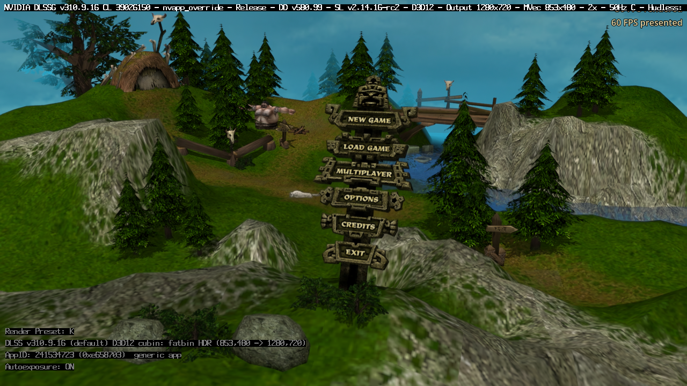
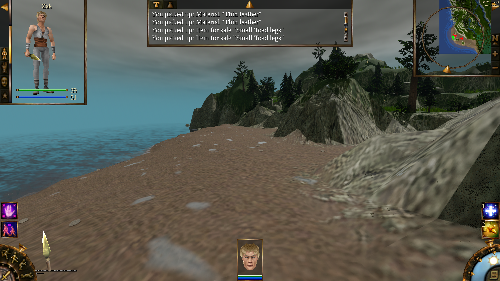

# Native DLSS-G on RTX 30: local validation

The optional `1.28.0-experimental.4` package runs NVIDIA DLSS-G through
[dlssg_for_sm86 0.4.0](https://github.com/sdli1995/dlssg_for_sm86/releases/tag/0.4.0).
This is the native NVIDIA runtime/model route, not DLSS-to-FSR. It passed
controlled motion, resize and toggle tests on RTX 3090 Ti and a full
recording-derived campaign traversal with PT and NRD on RTX 3090.

This remains an unpublished experiment. The Linux NVAPI bridge logs unsupported
Reflex synchronization calls; native Windows, latency, frame pacing across
refresh rates and other RTX 30 models are not qualified. Counts below are
SDK-reported presents, not physical monitor scanout measurements or a matched
FG-off versus FG-on performance comparison.

## Build and dependency identity

The properly exported Windows EXE and PCK come from commit
`97cf35670997d2a27c069e0e6046e9222dad9f6a`. The export embeds all six approved
CL icon sizes, version 1.28.0.0, the current Agility runtime and 426 compiled
game scripts. Native NRD and its shader manifest match the source. No original
game data or test fixtures are included.

| Artifact | SHA-256 |
| --- | --- |
| Windows EXE | `0ee74a29967a1e63cee1635702f3d9c388614fd3849808c3a234df1728cde115` |
| PCK | `b46edcbc4af7135f5587bec39f302d03ec8b208d318389cdd483eb38107d74c0` |
| Upstream SM86 archive | `5865360c3295038f0ff979d303bb7eb9437eec09fbc08686967d3b5d41d9c019` |
| Upstream WINMM proxy | `c86bd90c0fbaf3db0b5cc17c5bbece40eb34a6a3327fe2c0dd8ab455ba985203` |
| Mod's NVIDIA DLSS-G 310.9.16 runtime | `cadee1aa6db3907babdc3285da2aebc4553d92b89c38ba3eae8abd8bba1bea72` |

The mod package adds files without changing any of the base package's 345
payload files. It includes the complete upstream notices and MIT license
verbatim; NVIDIA-derived material retains its separate upstream terms. The
game's NVIDIA, AMD and NRD notices remain present. See the
[package audit](dlssg-sm86-2026-10-24/package-audit.json),
[optional-package audit](dlssg-sm86-2026-10-24/optional-package-audit.json) and
[setup](../integrations/dlssg-sm86.md).

Configuration: `Engine=DLSS`, one generated frame, upstream exact consistency
tier (`Optimized=1`), no optional SR INT8 patch. Test copies additionally enable
frame timing logs; the player package uses upstream's ordinary logging.
Upstream's bit-identical quality claim for tier 1 was not independently
compared against a supported Ada/Blackwell card here.

## Environment and failed diagnostic attempts

GPU Lab assigned each job automatically and used isolated virtual displays.
The campaign benchmark was a heavy job. All test profiles kept the cursor
free, FPS visible and SFX/stream/voice volume zero. Player profiles and host
driver settings were untouched.

NVIDIA driver 580.178.04, GE-Proton11-11, DXVK 2.6.2, VKD3D-Proton 3.0.1 and
DXVK-NVAPI 0.9.2 were used. The full Proton CUDA Wine relay was copied only
into each test's private prefix. Native NVIDIA SDK DLLs beside the EXE remain
unchanged; the upstream proxy loads its own NVIDIA runtime and SM86 kernels.
Physical GPU identity was checked separately from mod capability overrides.

The initial VERSION proxy did not load in this executable; the documented
WINMM alternative did. Wine 9 then lacked CUDA and could not run the backend.
An exploratory [dlssg-open](https://github.com/dniminenn/dlssg-open) relay also
activated native NVIDIA FG with Proton 11, but it is not in the delivered
SM86 package. Those attempts are not counted as final-package qualification.

Streamline logs `setDynamicMFGParams`, `setReflexTiming` and
`NvAPI_D3D_SetReflexSync` failures through Linux NVAPI even when public SDK
calls and DLSS-G state report success. Repeating the controlled test with
Proton's newer bundled NVAPI also passes but retains these messages. They
are recorded explicitly in [test provenance](dlssg-sm86-2026-10-24/test-provenance.json).
No claim of fully functioning Reflex pacing or input-latency improvement is
made. DLSS-RR/NIS contexts are absent by design and automatic SDK downloading
is disabled.

## Renderer bug found by actual FG testing

Initially, 180 rendered frames incorrectly counted as 360 game presents and
1,080 SDK-presented frames. Empty swap-chain submission batches were emitting
present markers, and configuration queries were accumulating the same
presentation result during frame preparation.

The fix emits presentation markers only for real swap-chain batches and
queries configuration limits only when enabling a viewport. While active,
presentation telemetry is sampled once at the present boundary. The final
export gives these results at a 30-rendered-FPS cap:

| Phase | Rendered / SR evaluated | Game presents | SDK-presented frames |
| --- | ---: | ---: | ---: |
| FG off | 180 | 180 | 0 |
| FG on, moving camera | 180 | 180 | 360 |
| Disabled again | 180 | 180 | 0 |
| Reenabled at 1600×900 | 180 | 180 | 360 |
| Off again | 180 | 180 | 0 |

The SDK counter is sampled only while FG is active; zero in off phases does
not mean ordinary game presentation stopped. All 30 checks passed, with no
failed SDK API call and zero FSR frame-generation dispatches. Upstream timing
recorded 525 successful NVIDIA NGX FG evaluations including warm-up, with zero
failed evaluations. The clean package independently passed 58 DLSS SR/DLAA
checks and retained the normal unavailable-FG result without the mod. Screen
controls passed 750 checks across EN/RU/DE and 800×600 through 2560×1600.

## Real campaign traversal with PT and NRD

The actual player walked **124.05 metres**, fought and looted five enemies,
and reached the southern shore using the ordinary separate simulation
process. The route approximates the recording; it does not use camera-only
movement, teleportation or invulnerability. Rain, view changes, pause/resume
and looking back uphill are included.

All **143 checks passed** in 416.91 seconds including loading. During 9,903
sampled unpaused rendered frames, FG stayed active on every frame and the SDK
reported 19,806 presents. The 469 paused frames had FG suspended and zero FG
counter increments. PT had zero inactive frames; responsive NRD had zero
inactive frames. The final two phases intentionally select the still-scene
filter, bypassing NRD. AMD FG dispatches stayed zero throughout.

The fixture requests a 3840×2160 render target, DLSS Quality and PT Low with
responsive NRD. This Proton virtual display constrained the window: the
backend recorded a 2888×1806 FG output context despite the 3840×2160 viewport
capture. Therefore this is **not qualification of native 4K FG output**.
Results must not be directly compared with the earlier Wine 9/RTX 3090 Ti run.

| Phase | Median rendered-frame ms | 95th percentile ms |
| --- | ---: | ---: |
| Ruins held | 19.416 | 21.114 |
| Downhill | 19.502 | 27.750 |
| Slope after combat | 17.286 | 18.823 |
| Beach after combat | 20.890 | 22.727 |
| Shore after five kills | 20.052 | 21.811 |
| Looking back uphill | 18.348 | 21.304 |

Cold loading still produced a **5.00-second first-opening hitch**. Occasional
approximately 150–163 ms spikes also remain. FG does not remove those stalls
or double simulation/input responsiveness. The steady shore section did not
show sustained post-combat collapse. Full positions, timings and counters:
[route results](dlssg-sm86-2026-10-24/qualified-sm86-dlss-nrd-route-recording-route.json).

## Captured output

A diagnostic run captured 12 consecutive actual NGX `OutputInterpolated`
surfaces and their rendered inputs, with no dropped groups or failed
evaluations. Raw RGBA8 was converted to PNG without rescaling or filtering.
The backend identified physical SM86, `cubin_sm86`, NVIDIA runtime 310.9.16
and a live native route. The diagnostic uses the corrected engine with the
previous PCK; the final export was separately tested above. Its full runtime
and fixture hashes are retained in the provenance.

Generated image, including NVIDIA's diagnostic overlay:

The corresponding [rendered input](dlssg-sm86-2026-10-24/rendered-frame.png)
and [capture manifest](dlssg-sm86-2026-10-24/generated-capture-manifest.json)
are retained. This small visual inspection does not establish artifact-free
HUD handling or image equivalence across all scenes.

Final rendered campaign view after the route, not a generated-frame capture:

