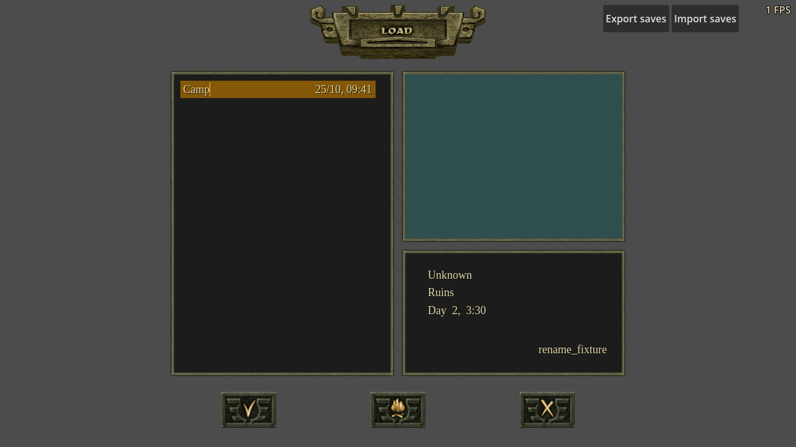
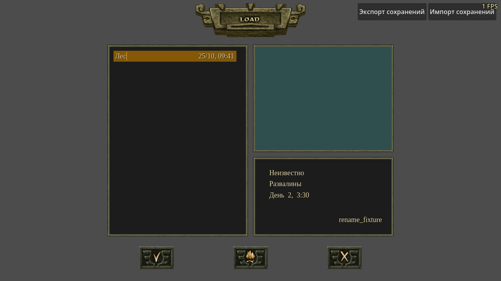
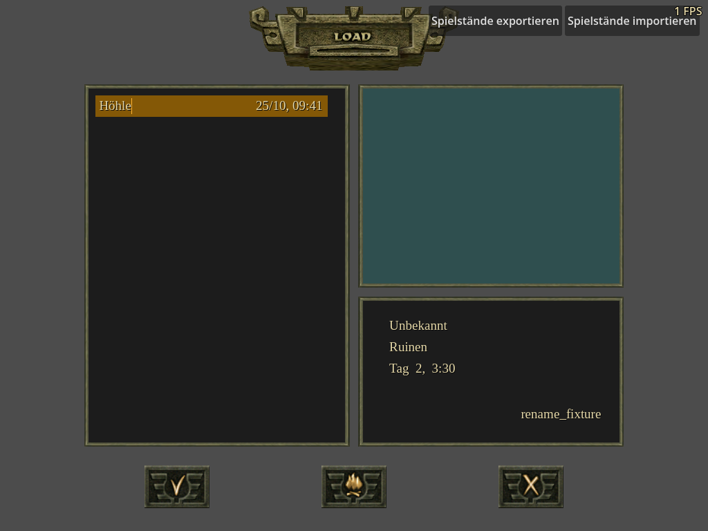
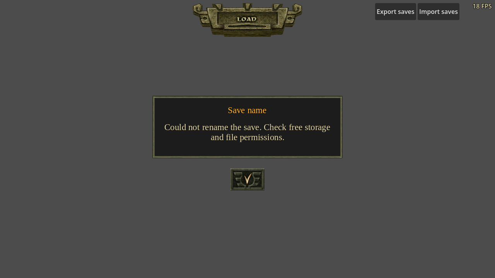
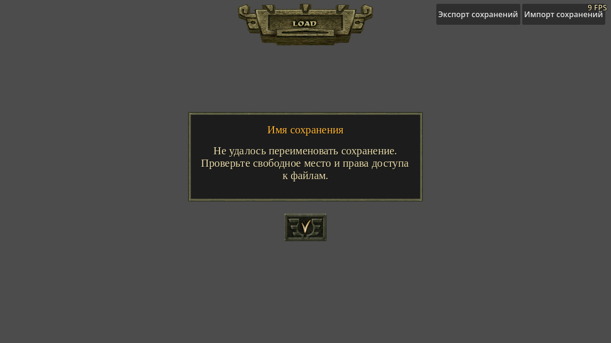
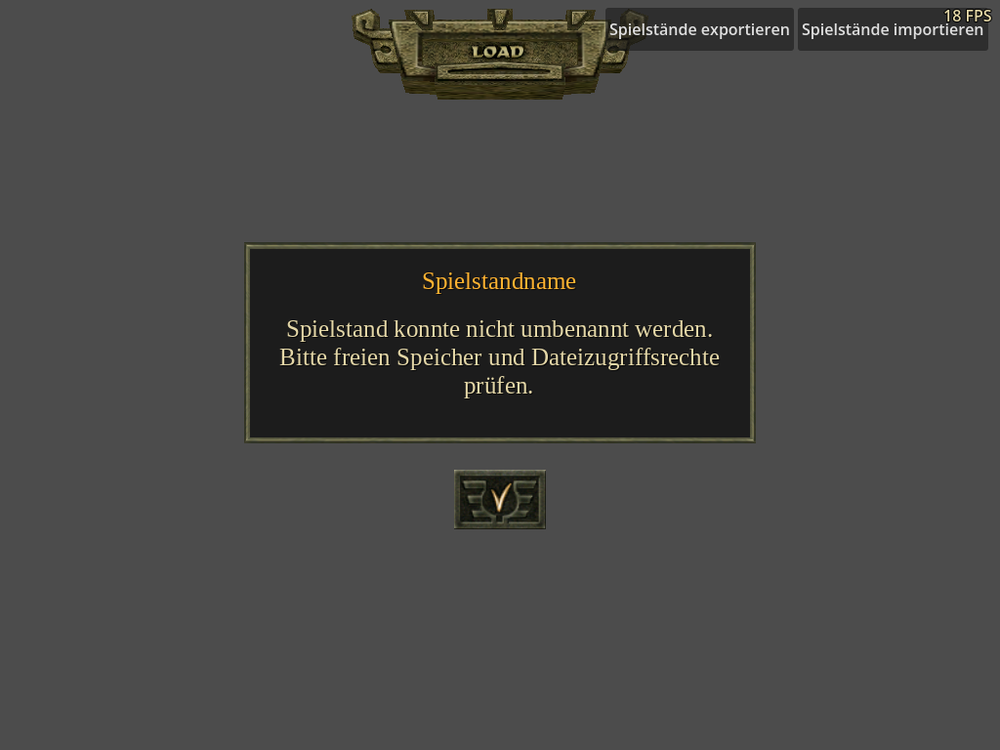

# Campaign follow-ups 113–116 — 25 October 2026

Baseline: published **1.29.0**, commit
`7f2f23bd316b9a2706c6abb4d4e5321da38b3825`.
Work branch: `fix/issues-113-116-20261025`. No publication or issue edits.

| Issue | Confirmed cause and change | Regression |
| --- | --- | --- |
| [113](https://github.com/TheWWWorm/CursedLands/issues/113) | Melee impact assigned standing again, overwriting a newer gait request. Standing remains required when the swing begins; impact now preserves later requests. | Ten lethal swings request crawl/kneel at five offsets. The test checks retained gait and a cross into that posture on authority and replica: **50 checks**; unchanged baseline fails **24**. |
| [114](https://github.com/TheWWWorm/CursedLands/issues/114) | Existing saves could be named only by overwriting. F2 now edits a selected manual save in Load or Save; Enter commits metadata and Esc/selection cancels. Atomic sidecar replacement preserves the saved world, preview, date and slot. | Unicode names, both screens, byte-identical state/preview, retained date, protected/fresh/multiple selection, cancellation and failed-write retry. Baseline rejects the first F2 edit. EN/RU/DE layouts include error dialogs at 1280×720 and 1024×768. |
| [115](https://github.com/TheWWWorm/CursedLands/issues/115) | A surviving enemy selected retaliation during a hit lock but kept its combat flag clear until its attack command could tick. Retaliation now enters readiness immediately. | A surviving, reacting victim rejects ten subsequent rear-strike queries. A different unaware target and a target that has actually left combat remain eligible: **16 checks**; baseline fails **11**. |
| [116](https://github.com/TheWWWorm/CursedLands/issues/116) | The solo owner deduplicated speed selections against its last-sent cache, even when a restored authority clock had changed independently. Explicit speed choices now send immediately, including an unchanged cached value. | Real worker, real HUD dial, restored fast save with stale 1× cache, Ruins/Foothills travel, village return and 5 FPS owner: **29 checks** in headless and rendered modes; baseline fails **2**. |

## Clock evidence

The stronger HUD test first caught the mismatch without changing production:
normal selected **1.969 simulation seconds per wall second**, fast **2.107**.
The retained deterministic stale-cache control measured **1.930 / 2.063**.
After the fix, the headless test measured **0.955–1.012** at normal speed and
**2.025–2.038** at fast speed, including the 5 FPS owner. Logic ticks retain
their existing 55 ms duration. Explicit co-op permission/clock paths are unchanged.
This establishes a concrete synchronization failure compatible with the report;
there was no player save, so it does not prove that every identical-speed
session has this cause.

## Original comparison

The [original evidence](original-evidence.json) identifies the owned English GOG
1.06 executable, Ghidra evidence IDs and bounded Wine observations. Original
strike setup at `0x0054d960` clears backstab eligibility for a combat-ready target;
Aggression entry at `0x005d26d0` sets that flag immediately. Melee impact at
`0x0054f450` does not overwrite a newer gait request. These support the two
combat changes. Save renaming without overwriting is an intentional extension.

Wine 11.20 ran a separate installation and copied prefix through GPU Lab, with
muted audio, free cursor and FPS display. The observed Foothills wolf entered
combat readiness during the scripted attack. Positioning and god mode were
supplied for that bounded comparison. This was not a replay of the intermittent
Orc clip or a complete original campaign playthrough. No original binary,
assets or decompiled source are included here.

## Validation

The [results](results.json) contain commands, source/test hashes, assertion
counts and the exact retained log paths. Raw output and isolated profiles live
in `local/scratchpad/issues-113-116-20261025`, outside release staging.

- Four new headless checks and rendered HUD clock delivery.
- Three rendered save-renaming checks using original EN/RU/DE text archives: **74 assertions each**. The final headless save check has **67 assertions**, including replacement-name editing for damaged saves.
- All **36** previously registered headless checks: **6,706 assertions** passed after combat/save changes. Clock-specific checks were repeated after the clock-delivery change.
- Related worker conservation, village speed, direct-attack stance, cast/posture,
  creature alerts, pack alerts, direct accuracy, save selection and dialogue/
  campaign clock checks. The existing worker conservation fixture has **8,279**
  assertions; village-worker speed has **11**.
- Gameplay runner and regression verdict unit tests: **40 passed**.
- Translation coverage: **3,525 entries**, **0 errors**. `git diff --check` passes.

The existing `zone_speed_retention.gd` check reports 65 successful clock
assertions but encounters a surface-weather nil-index error with enhanced
weather enabled, on both unchanged 1.29.0 and this branch. It is retained as an
existing failure, not counted as a clean pass. Its clock behavior is also checked
with the original visual preset in an isolated profile. Surface-weather
production code was not changed. An initial rendered clock run also lost its
startup confirmation to GPU Lab CLI tail truncation; the fixture now omits the
owner's verbose performance dumps and retains its own measured clock samples.

Windows, Android, browser, internet co-op and full campaign playthroughs were
not qualified by this change. Screenshots below document the tested save UI.

| English | Russian | German |
| --- | --- | --- |
|  |  |  |
|  |  |  |
