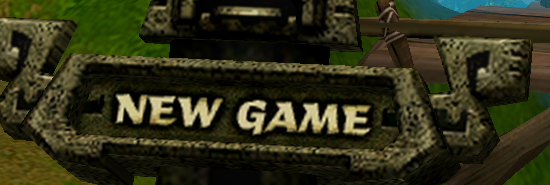
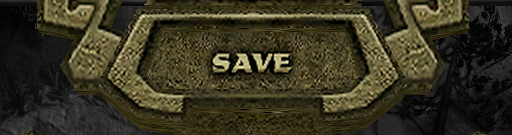
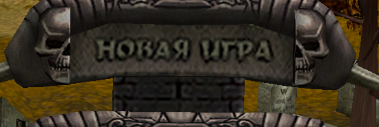
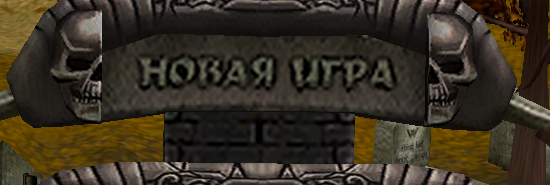
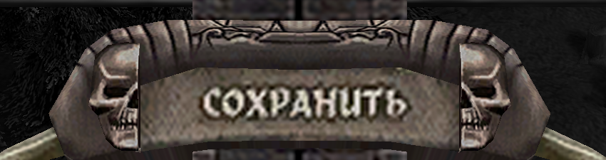
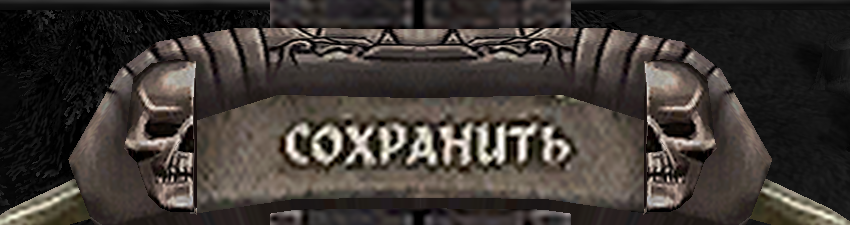

# Original menu lettering at 4K — 26 October 2026

The main-menu signpost, actual in-game Escape signpost and Options board now
recover contrast in the original painted edges before enlargement. The previous
Lanczos-only correction also enlarged the original blur, which remained visible
at 3840×2160. Its existing regression rendered only 1600×900.

The change is confined to `MenuCaptions`. It uses a bounded luminance correction
on opaque native samples, suppresses changes in low-contrast stone grain and
leaves alpha silhouettes alone. Lanczos reconstruction then supplies eight samples
per source texel, capped at 2048 pixels per atlas dimension. Mipmaps, shared
texture lifetime and caller-owned material copies are retained. Authored textures
of 1024 pixels or more retain their original pixels and mipmaps. There is no new
font, label wording, geometry, UV layout, animation or drawing pass.

Original bitmap detail remains finite. This is an improvement to its visible
edges and sampling, not a newly drawn high-resolution typeface.

## Native-pixel comparisons

These are crops of the **same live 3840×2160 scene**, with only its menu texture
bindings switched between the candidate and the old Lanczos-only path. The crops
retain native pixels; no post-capture sharpening or enlargement was applied.

| Surface | Before | After |
| --- | --- | --- |
| Base main menu |  |  |
| Base Escape |  |  |
| LiA main menu |  |  |
| LiA Escape |  |  |

## Regression evidence

`tools/tests/menu_caption_4k.gd` is registered in both regression runners for
both campaigns and EN/RU/DE remake UI text. Painted captions retain the supplied
edition's language. Every case exercises 1920×1080, 2560×1440 and 3840×2160,
including the actual game pause state, repeated opening, Options transition,
hover picking, every signpost hit region and bounded extra menu controls.

The test requires a genuinely sized content viewport and checks the Escape
SubViewport against its displayed height. GPU Lab's physical virtual monitor is
2880×1800, so a fixed content viewport prevents accepting a clamped window as 4K.
The measured image is the native 3840×2160 render, independently of that monitor.

- All six new cases pass: **1,032 assertions**. An unchanged-source PCK fails
  **30 displayed-edge assertions** in the LiA negative control. The comparison
  holds the same material, camera and geometry while switching only textures.
- All six existing caption/artwork cases pass unchanged: **414 assertions**.
  Their existing 0.035 native-color error limit remains intact; measured errors
  across the accepted runs are **0.0132–0.0266**.
- Two additional Vulkan/Forward+ cases pass: **344 assertions**. Across OpenGL
  and Vulkan, native 4K caption-interior gradient energy increases by
  **28.5–63.4%**, across **84 board measurements**. This is a local edge metric,
  not an OCR or reading-speed claim.
- Existing main-menu alignment and presented opening-frame checks pass:
  **130 assertions**. The unchanged animation clock fixture passes all
  **25 assertions** at its existing 60-FPS option. Total passing assertions:
  **1,945**. Regression-verdict/catalog unit tests pass **44 tests**; translation
  coverage reports **3,541 entries and zero errors**.

The old clock fixture has two reopened-duration failures at the runner's 30-FPS
setting on **both the unchanged PCK and candidate**. Its two deferred reveal
frames count toward a fixed 0.10-second duration budget. A scratch wrapper
selects the existing 60-FPS option and calls the original fixture without
editing any assertion or tolerance; all 25 assertions pass. The 30-FPS failures
are retained in the results rather than counted as passing checks.

The first negative-control setup omitted the installer helper library. A second
run with the complete runtime independently reproduced all 30 clarity failures
and the old clock failures without game errors. Both initial and corrected
evidence are retained outside release staging.

## Original comparison and limits

The officially patched LiA **1.02** executable
`9ecd475f5776681b8ffe1a8bb05cf67fe7adcceb62d0949135261ed7d3616c12` was run
with Wine 11.20 through GPU Lab. Its original painted main menu was inspected and
a new campaign entered. [Native main-menu capture](original-main-1.02.png).

The [previous original-code and Wine comparison](../menu-patrol-text-2026-10-25/README.md)
records the actual original Escape/Options screens and the native menu loading
code. The 1.02 `menus.res` is byte-identical to the owned disc archive used by
that earlier 1.00 Wine Escape comparison. The new native suite timed out before
capturing a settled Escape menu, so this report does not claim a fresh 1.02
Escape capture. Wine's unrelated GDI Russian prose used a western code page;
its painted caption textures rendered correctly.

No corresponding native font rasterizer is being emulated: the original draws
the painted atlas. The new edge reconstruction is a remake readability change.
The original executable, seed prefix and reference assets were not modified.

Linux OpenGL and Vulkan were rendered. Native Windows, browser, macOS and
Android were not executed for this change. There are no player-visible string
changes or new options. No remote push, release or upload is part of this work.

[Machine-readable results](results.json) retain PCK/engine/source/test hashes,
case verdicts and limitations. Compressed logs under `logs/` retain the actual
assertions and invocations. Private suite setup, source staging identities and
cleanup records are under the workspace's
`local/scratchpad/menu-clarity-fix-20261026/evidence/` and `local/maintenance/`.
