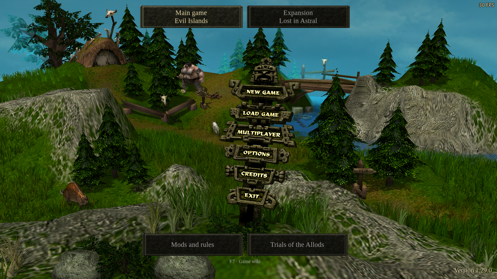
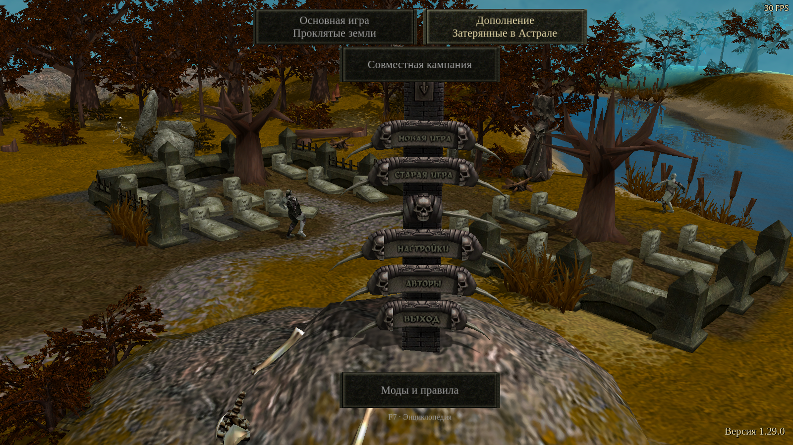
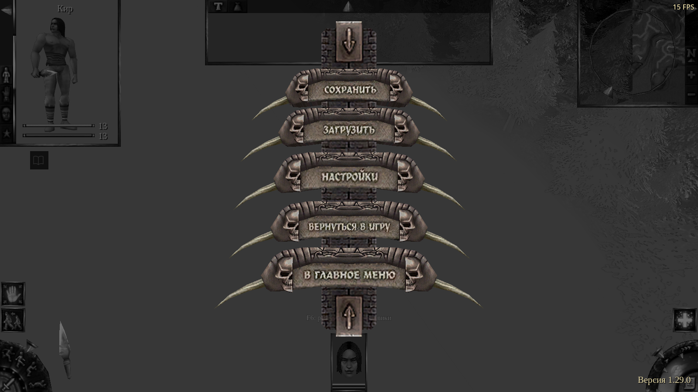
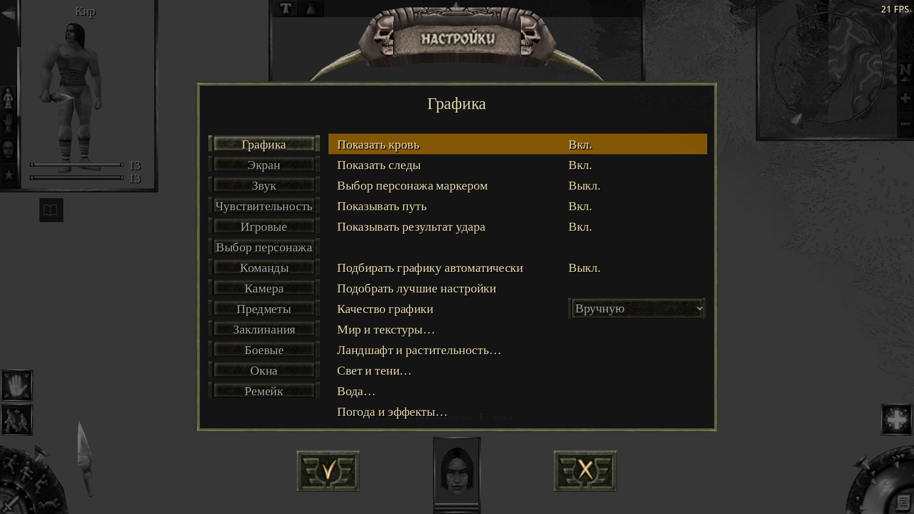

# Original menu motion and caption artwork — 25 October 2026

LiA's main-menu creatures now execute their authored patrol routes and pauses.
The base and LiA signposts retain their original painted lettering, with sharper
enlargement for desktop displays. Campaign choices, utility buttons and the wiki
hint follow the projected pole axis while remaining inside the safe area.

Baseline: `3a59cc10` (includes the fixes and regression coverage for issues 113–116).
No release, upload, issue edit or player-profile change is part of this change.

## Original comparison

The owned LiA `game.exe` has SHA-256
`f04a305b77c84ea29c18ad2996d23072ccef1c0c46876c9b93bae4ce9351d1ff`.
It displays version **1.00**. The remake reads the same menu assets while applying
its existing official 1.01/1.02 data corrections; the Wine observations are not
claimed to be native 1.02 execution.

Wine 11.20 ran the original in a separate copied installation and dedicated
prefix through GPU Lab. Its main-menu undead walked between the cemetery and
water, including stops. A new campaign was entered and its real Escape menu and
Options board were inspected. Their lettering is the painted artwork in
`mainmenu00`/`escmenu00`, including the carved relief, shadows and original Russian
wording. The base edition instead carries its painted lettering in the
`*labels` atlases. No system font can reproduce those images exactly.

Original code inspection corroborates the menu-world ownership:

- `0x004e1b40` loads `ZoneMainMenuNew.mpr` and `.mob` through `0x004f0c30`, sets the
  menu world mode and initializes its hour from local time. REA evidence
  `ev_88ea29871dcfd65ec9156dd83e4349d4d2ee6823d493952e452f7475a919584e`.
- `0x004f0c30` is the server-world map loader and initializes navigation/world
  state. Evidence `ev_5ca87871e3a7f900780f470b76e80be8940e96eb032b017976353d3c379ca53d`.
- The shipped menu MOB supplies four LiA actors with patrol routes, waits and
  logic model 2. This is asset evidence; the exact native patrol constructor was
  not independently decompiled for this change.

The remake previously loaded decorative `EIUnitModel` instances and forced idle.
It now owns a `GameWorld` in menu mode, using existing unit AI, navigation and
animation. It creates no campaign Session or script VM. Local time, weather,
original signpost geometry/UVs, hover animations and input regions are retained.

The caption change reconstructs the original atlas with Lanczos once, retaining
mipmaps and caller-owned materials. It never replaces glyphs, labels, colors or
stone backgrounds. The derived texture is cached on its native texture resource,
so it follows archive lifetime and survives pause/reopen without extra viewports.
Original artwork still limits the available detail; this is sharper resampling,
not a newly authored high-resolution font.

| Base main menu | LiA main menu |
| --- | --- |
|  |  |

| Actual LiA Escape menu | Options opened from Escape |
| --- | --- |
|  |  |

Wine's unrelated GDI text used the prefix's western code page and displayed
Russian prose incorrectly. Its painted signpost textures displayed correctly.
The comparison is evidence for signpost appearance and motion, not a complete
native localization qualification.

## Regression coverage

Both `tools/regressions.json` and `tools/parity/gameplay_catalog.json` register:

| Test | Failure exercised |
| --- | --- |
| `menu_patrols_*` | Actual menu ownership; all shipped actors; first patrol leg, travel, authored waits, AI control and original signpost targets. Rendered cases also require normal frame delivery to move actors. |
| `menu_alignment_*` | Projected pole alignment and safe-area constraints at 800×600, 1280×720, 1920×1080, 1024×768 and 720×1280; retained controller targets. |
| `menu_captions_*` | Original glyph/background fidelity plus stronger edge contrast than bilinear enlargement; real main-menu hover, actual paused single-player Escape, repeated opening, every hit region and transition into/out of Options. |
| `menu_wind_ready` | Existing wind fixture, including publication of the incoming menu's weather before its first process tick and direct-map preview ownership. It caught a missing compatibility path during this change; that path is retained. |

The caption cases run both campaigns with EN/RU/DE remake UI text. Painted
captions retain the supplied edition's language. Original EN/RU/DE text archives
are additionally exercised by the existing fitted-interface regression.

Negative controls use the unchanged baseline: patrol **1 failure**, alignment
**15 failures**, caption clarity **14 failures**. The fidelity guard also rejects
the replaced-typeface atlases: native-scale color errors of 0.167/0.262 exceed
its 0.035 limit, while the retained artwork measures approximately 0.010–0.019.
Neither an unchanged blurry atlas nor sharper lettering in a different typeface
can satisfy both guards.

## Retained evidence

Raw logs, isolated profiles, Wine captures and the original-analysis evidence
bundle remain in `local/scratchpad/menu-motion-text-20261025`, outside release
staging. No original executable, extracted atlas or decompiled source is included.
The [result record](results.json) identifies commands, test/source hashes,
assertion counts and known baseline limitations. [Capture hashes](captures.json)
identify the unchanged screenshot files retained here.

## Validation and limits

All **13 registered menu cases pass: 6,689 assertions**. This includes the
6,069-assertion existing wind fixture after restoring its direct-map initialization
path. The six selected checks for issues 113–116, campaign feedback and dialogue
clock delivery also pass (**209 assertions**). Gameplay-catalog and regression
verdict unit tests pass (**40 tests**); translation coverage reports **3,525
entries, zero errors**.

Related checks cover first-frame reveal at different frame rates, paused/fast
animation clocks, interrupted slides, repeated real in-game Escape openings,
Options/load/save board transitions, the build-version footer, startup animation,
localized fitted layouts, extra-button text sampling and material ownership.
The original tests' assertions and tolerances are retained. The material fixture
now keeps FPS visible as required by the development-profile policy.

Three limitations were reproduced on the unchanged baseline and are retained as
failures rather than counted as clean passes:

- The full live-graphics material fixture exceeds the 420-second OpenGL budget.
  Its ground-contact transition alone took **212.8 seconds** on the candidate
  and **211.3 seconds** on the baseline. Neither run completed the fixture.
- Forward+ completes all **46 material assertions** per campaign, but the second
  menu creation emits an existing resident-HD-texture push-constant error. The
  unchanged baseline emits the same error. An isolated run forcing the existing
  CPU image-upscale fallback passes all **46 assertions** in both campaigns with
  no game errors. Only the test process uses that diagnostic fallback; production
  upscaling code and options are unchanged.
- `menu_hidden_viewports` fails its first exact draw-average comparison on both
  builds: startup averages **523.7–523.8**, then **524.0** once settled. All later
  hidden/disabled/closed controls are **524.0**; the always-render control is
  **534.0**, and an open Options board contributes **2** draws. The fixture still
  reports its initial failure. Its assertion was not relaxed.

These comparisons isolate existing renderer/startup qualification gaps; they do
not certify those paths as repaired. Windows, Android, browser builds, internet
co-op and full campaign playthroughs were not qualified by this menu change.
