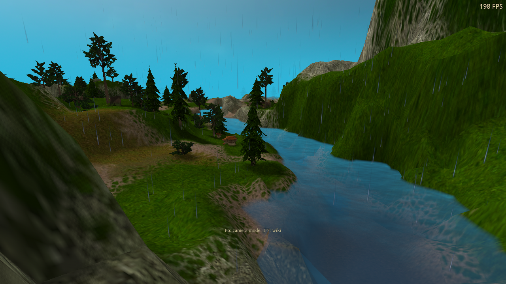
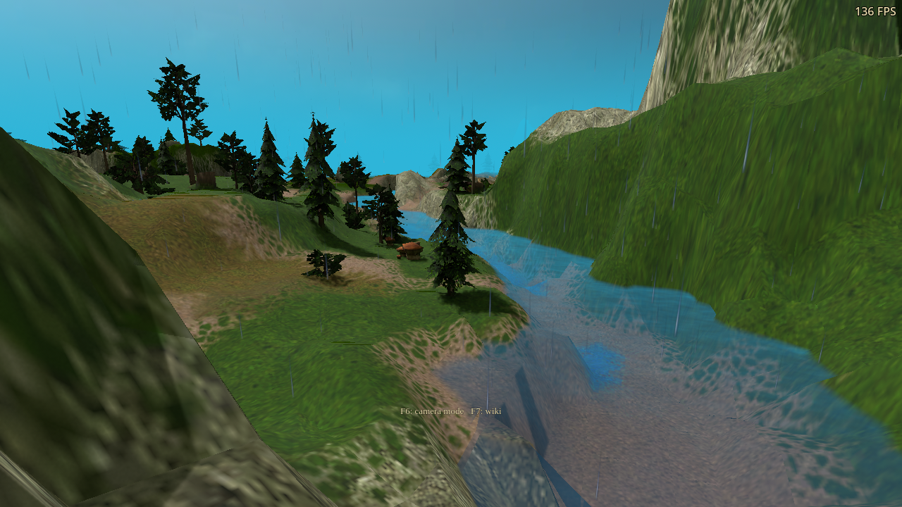
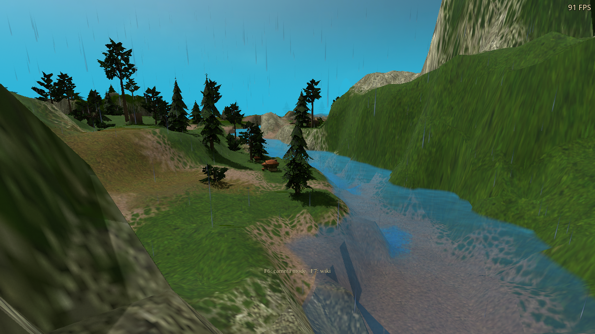
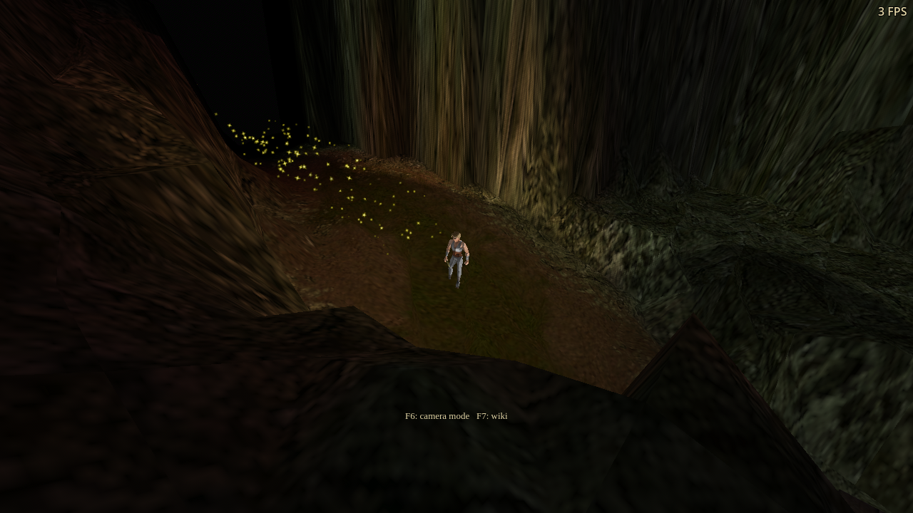
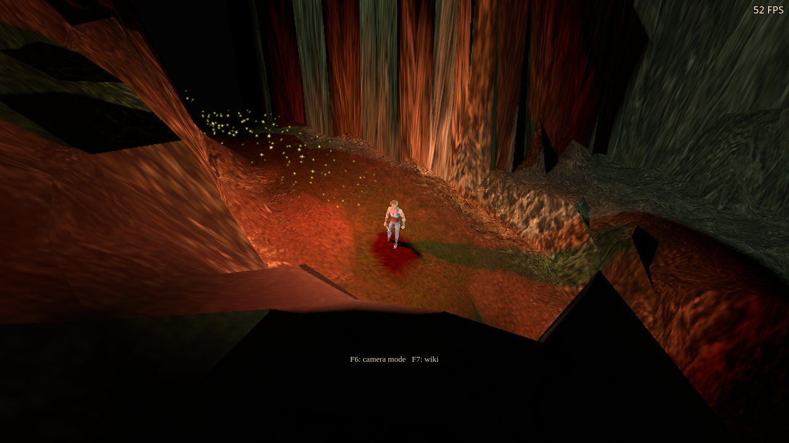
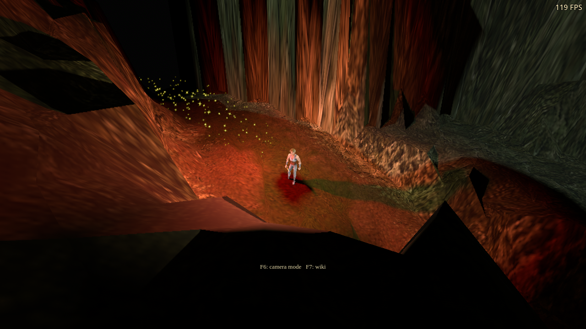
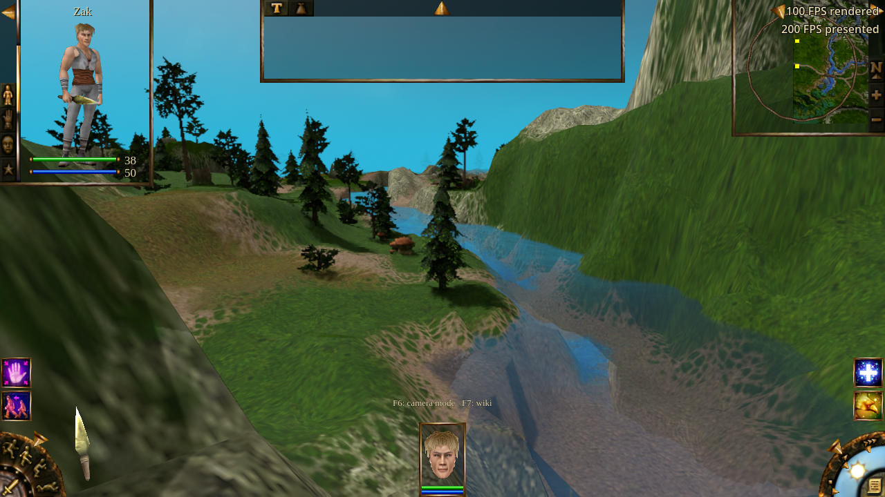
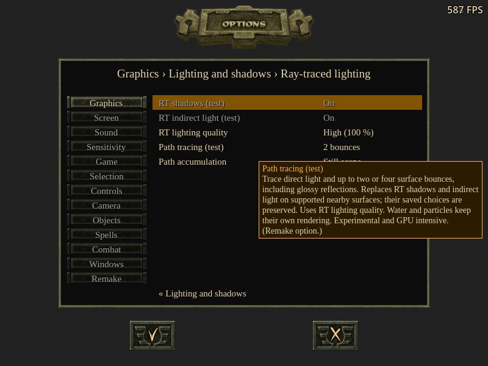
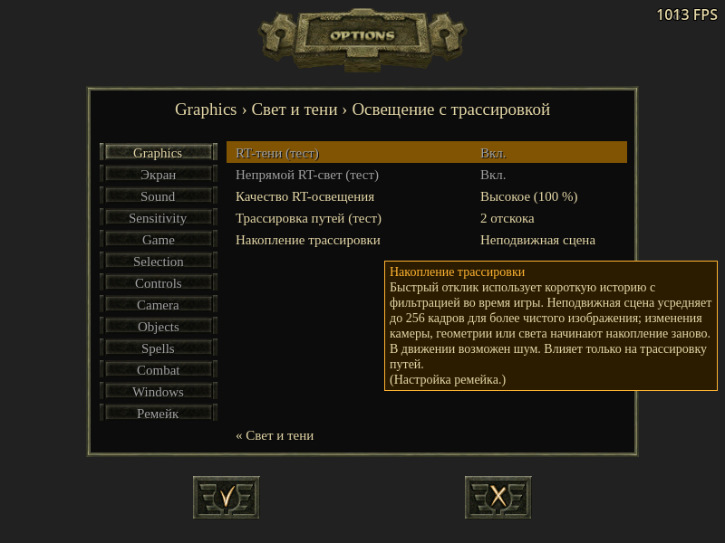
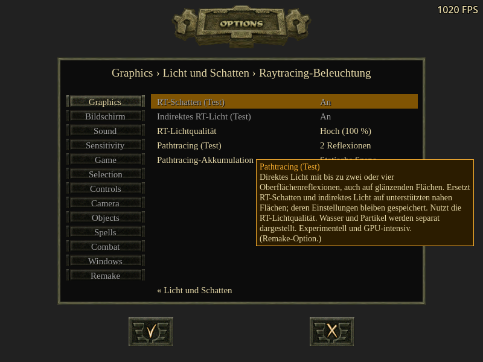

# Path-tracing prototype validation — 2026-10-22

The unreleased prototype traces direct lighting, diffuse transport and rough
glossy reflections through two or four continuation bounces. It retains raster
visibility/composition and separate sky, water, fog and particle rendering.
See [controls and limits](../../integrations/path-tracing-experiment.md).

## Environment and functional checks

RTX 3090, NVIDIA 580.178.04, Ubuntu 24.04.5 LTS, qualified Godot 4.7 engine.
DX12 tests run the Windows export through Wine/VKD3D-Proton 3.0.1; Vulkan tests
run natively on Linux. Every run uses an isolated profile with a free cursor,
visible FPS and muted audio. Native Windows and other GPU vendors have not
been qualified. The [manifest](summary.json) records application/shader/export
hashes, assertions and diagnostics. Raw result files accompany each run.

| Coverage | Result |
| --- | --- |
| Path device, DX12 and Vulkan | 17 assertions each: increasing bounce energy, red emissive transport, glossy metal, progressive history, emitter removal, stable bindings, resize and teardown |
| Alpha, DX12 | 9 assertions: cutout alpha agrees in camera, direct-visibility and continuation rays |
| Outdoor integration, DX12 and Vulkan | 13 assertions each: real material lighting, responsive camera reprojection, 2/4 bounces, still accumulation, camera/resize resets and conventional image restoration |
| Cave, DX12 | 12 assertions: no outdoor sky, real material changes, 2/4 bounces, light-colour updates, animated actor and history invalidation, ambient-effect restoration |
| Material matrix, DX12 | 144 rendered variants, 470 assertions: terrain, objects, characters, foliage, ground contact, water and material/fog/weather/deformation combinations |
| Settings, DX12/OpenGL | 270/269 assertions: Apply/Cancel/persistence, preserved RT choices, unsupported controls, all labels/choices/help in EN/RU/DE at 1280×720 and 800×600 |
| Unsupported renderer, OpenGL | 5 assertions: saved RT/PT settings retain conventional lighting and ambient effects |
| FSR, DX12 | 62 assertions: simultaneous water/path tracing, real generated/presented counters, FPS text, Mirror/RT changes, resize and pause/resume |
| Existing scene and water devices, DX12 | 17 and 25 assertions respectively after changes to shared material descriptors |
| Performance, DX12 | 14 readiness assertions; 16 steady-state samples of 90 frames across two reversed-order rounds |
| Build/localization | Clean final import and Windows/Linux exports; 24 ray shader binaries reproduce with DXC 1.9.2609; 3,042 translation entries, zero checker errors |

The material test exposed a 33-declaration varying limit violation in the
ground-contact variants. Packing the RT-valid and PT-blend flags into one
`vec2` retains the previous 32-declaration budget. The complete material matrix,
final river/FSR/cave/performance tests and conventional-device regressions run
after that correction. Device/alpha tests predate only this material-flag
packing; their ray pipeline and reconstruction sources are unchanged. The
settings test also predates the packing; its menu/localization sources are
unchanged.

The closed-room device fixture accumulates 64 frames at 16 samples per pixel.
Mean red diffuse illumination rises from about **1.100 at one bounce** to
**1.272 at two** and **1.592 at four**, while green and blue remain zero.
A metallic receiver has no diffuse lobe and reflects the red ceiling through
the glossy channel. Removing the emitter clears the accumulated light on the
next history-reset frame. These measurements establish actual multi-bounce
transport rather than a brightness adjustment to the one-bounce mode.

## Timing

The camera is frozen at the outdoor river, with units hidden, water reflections
and frame generation off, no VSync/frame cap, and Responsive accumulation.
The window is 1280×720. The snapshot contains 116,008 unique triangles, 1,285
geometries, 1,420 instances and one selected point light. The table spans the
two round medians; it does not represent a confidence interval.

| Mode | Ray pass + filtering/copies | Whole frame |
| --- | ---: | ---: |
| Conventional | — | 4.922–4.972 ms |
| One-bounce RT shadows + GI, Medium | 0.576–0.601 ms | 6.760–7.310 ms |
| Path, 2 bounces, Low | 0.447–0.467 ms | 7.119–8.923 ms |
| Path, 2 bounces, Medium | 2.263–2.294 ms | 6.924–9.871 ms |
| Path, 2 bounces, High | 8.715–9.173 ms | 10.872–11.274 ms |
| Path, 4 bounces, Low | 0.571–0.573 ms | 7.377–10.344 ms |
| Path, 4 bounces, Medium | 2.977–2.998 ms | 7.377–8.149 ms |
| Path, 4 bounces, High | 10.815–10.983 ms | 12.275–12.362 ms |

[Raw timings](dx12-path-performance-packed/path-performance.json) include
sample counts, p95, separate main-viewport GPU timing and the CPU controller
bracket. Ray timestamps include dispatch, reconstruction and history copies;
they exclude acceleration-structure updates. Main-viewport GPU timing excludes
the separate ray dispatch. Loading, shader preparation and initial scene
construction are outside the timed samples.

This is a shared machine with unrelated CPU-heavy work running during tests.
Whole-frame time is affected by scheduling/CPU work as well as GPU work, so a
lower GPU cost need not produce proportionally higher FPS. The overlapping
Low/Medium frame medians do not imply equal tracing cost. Use the ray-pass
times to compare these budgets; do not extrapolate these short frozen-scene
samples into a gameplay or native-Windows FPS promise. High's full-resolution
four-sample tracing is substantially more expensive than Medium.

## Diagnostics and remaining limits

- The isolated Vulkan device check has no Khronos validation errors or
  warnings. Godot still prints its native-ray shader translator notices for
  acceleration structures and ignore-intersection instructions.
- Wine recorded a page fault after `clean exit` in the alpha and material
  tests despite zero exit codes and successful assertions. Its address and
  signature match the [prior scene/water qualification](../scene-rt-2026-10-22/README.md#diagnostics-and-qualification-limits).
  These shutdown anomalies remain unresolved. Functional passes are not
  claimed as proof of a clean native Windows shutdown.
- The full campaign's pre-existing Vulkan storage-image format warning is
  documented in that prior report, including its RT-disabled baseline. This
  prototype's isolated validation does not requalify the whole renderer.
- DXVK display-metadata/EDID warnings and sample-quality notices remain in
  local logs. DX12-through-Wine testing is not a native D3D12 debug-layer run.
- Cold temporal-shader preparation delays FSR activation. The final test waits
  for the production gate, verifies generated/presented counters, and checks
  the two-line FPS overlay. At an active sample, 90 rendered frames generated
  90 additional frames and approximately 180 presentations. This is functional
  telemetry, not a frame-generation performance benchmark.

The bounded scene, approximate materials, camera-centre primary samples and
custom reconstruction can leave seams, motion noise and light leaks. Water
retains its independent reflection mode. Caves without authored physical light
sources can be dark. This is a development prototype, not a complete campaign
relighting or a production denoiser integration.

## Captures

The outdoor captures use the same camera with conventional lighting, two-bounce
Responsive lighting and four-bounce Still scene lighting. The latter two also
differ in accumulation mode; use the device fixture above to isolate bounce
depth. FPS labels in captures are incidental.

The cave uses a test lamp. Both path captures use the same stationary
accumulation mode; the second adds two more continuation bounces.

The FSR capture shows both measured FPS lines alongside path-traced lighting
and RT water reflections. Settings captures show the new small-window help.

