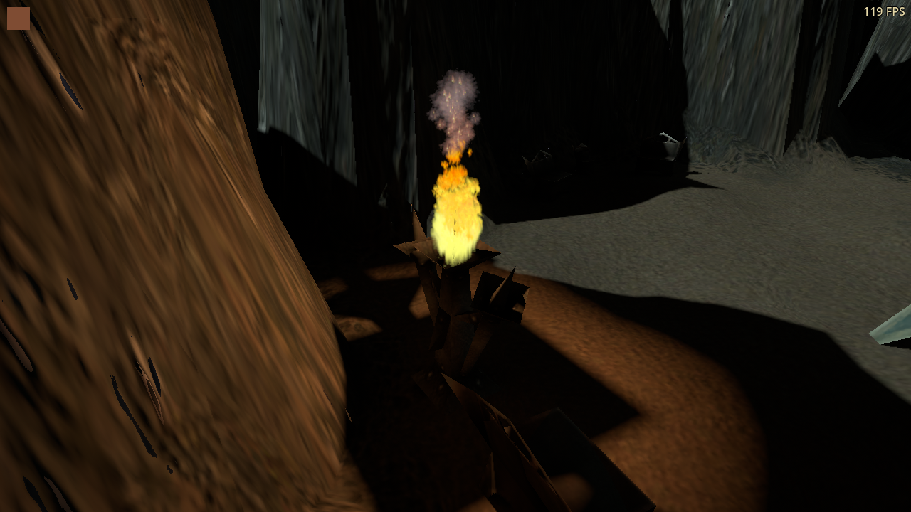
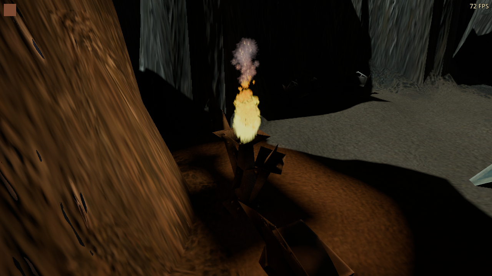

# Path-traced flame lighting and highlight detail

Enhanced torch and brazier lights now have a finite source radius in PT, so
their shadows soften away from contact. An active path-traced view also uses a
fixed, gentle AgX display profile to retain flame and reflection highlights.
This follows the [material and lighting research](../../integrations/path-tracing-materials-and-lighting-research-2026-10-22.md),
the [authored surface pilot](../path-tracing-authored-surfaces-2026-10-23/README.md)
and the [torch-history change](../path-tracing-torch-history-2026-10-23/README.md).

## Visible result

These are matched captures of the original `gz14k` brazier, with campaign
geometry, color textures, other lamps and legacy cave fill retained. Only the
display profile and authored flame-source radius differ. The particles are
frozen for comparison; the camera, material maps and ray budgets are identical.
FPS overlays in these capture sequences are not performance measurements.

| Previous lighting | Authored flame size and display |
| --- | --- |
|  |  |

The previous source leaves sharp bowl/support shadows. The larger source makes
their penumbrae visible while retaining contact shadows. Highlight compression
reduces sampled clipped pixels from approximately 0.48% of the cave image to
zero. This is an image-specific measurement, not a claim that every possible
HDR effect can never clip.

Matched noon, dusk, night, grove and cave views preserve the original regional
colors. Their mean displayed luminance changes by roughly +3% to +14%, without
automatic exposure adapting to camera motion. [Night before](vulkan-river-0-previous.png)
and [night after](vulkan-river-0-current.png) retain readable terrain. Original
low-resolution color art, baked shading, stretched UVs and coarse silhouettes
remain visible; this lighting pass does not replace those assets.

## Display calibration and source contract

The profile uses Godot 4.7's AgX implementation, exposure `1.2`, contrast `1.15`
and AgX white `16.29`. This is Godot's built-in approximation, not a custom LUT
or an assertion of exact Blender color-management equivalence. A rendered
neutral HDR ramp verifies distinct output values for input levels 1, 2, 4 and 8;
the linear control clips all four. Middle grey rises from approximately 0.463
to 0.498 in the 8-bit display output, while black stays black. A Canvas swatch
remains byte-identical. [Reference ramp](hdr-ramp-previous.png) and
[PT ramp](hdr-ramp-current.png) are actual GPU captures.

The controller publishes actual PT activity separately from scene RT GI.
Requested but unready PT, ordinary scene RT and released PT retain linear
mapping and exposure 1. Switching PT off restores the original campaign image.

Enhanced fire records carry a PT radius of `clamp(range * 0.04, 0.08, 0.24)`
metres. The tested original brazier has a five-metre range and a 0.20-metre
source radius, versus the previous 0.04-metre minimum. Explicit larger native
source sizes take precedence. Spell lights and ordinary scene RT keep their
existing size. Disabling enhanced fire removes the authored radius and restores
the original light position and energy.

The metadata feeds the existing angular light sampler at primary and secondary
hits. It does not change the seven-light budget, sample/bounce counts, range,
light color or energy. It deliberately avoids mutating Godot `light_size`,
whose runtime pairing issue is documented in `LocalLighting`. The compatibility
falloff remains unchanged; these are calibrated game-light values, not physical
lumen measurements. A changed source radius invalidates accumulated shadows.

The larger source still benefits from bounded flutter history. The isolated
live-torch comparison reduces normalized temporal variance by approximately
82% versus strict reset, retains about 90% of the original brightness modulation
and clears illumination immediately when extinguished. That test uses GPU
readbacks and supplies no FPS claim.

## Performance and validation

[Run records](runs.json), [interleaved timings](performance.json) and
[source/export hashes](summary.json) accompany this report. The RTX 3090
comparison uses four continuation bounces, a 1280×720 output, four interleaved
passes per profile/quality and 120 sampled frames after each 40-frame warmup.
Medium traces at 960×540 with two samples; High traces at 1280×720 with four.
The scene, geometry and materials remain fixed, with real flame flutter in both
cave profiles. Loading, shader warmup and image readback are outside timing.

| Backend and view | Medium frame ms, previous → current | High frame ms, previous → current |
| --- | ---: | ---: |
| Vulkan, outdoor | 6.20 → 6.15 | 17.96 → 17.81 |
| Vulkan, cave brazier | 8.82 → 9.16 | 27.28 → 27.56 |
| DX12 through Wine, outdoor | 8.00 → 8.02 | 21.81 → 21.62 |
| DX12 through Wine, cave brazier | 11.47 → 11.78 | 36.41 → 35.54 |

Values are medians of per-pass medians. The largest Medium increase is about
0.34 ms (3.8%) in the Vulkan cave; outdoor timing is effectively unchanged.
Small positive and negative differences are not general speed claims. High
remains substantially more expensive, especially in the cave. These frozen
views with hidden units are controlled comparisons, not a full-game FPS floor.
DX12 uses the Windows export through Wine/VKD3D, not native Windows.

Source size reuses existing ray work and the display curve uses the existing
tone-mapping pass. There are no new screen buffers or shader resources. The
authored maps retain their previously documented texture-array cost. The raw
records separately measure PT dispatch/reconstruction/copies and the main
viewport; the latter excludes the separate PT dispatch.

Separate follow-through measurements put the three authored prop maps at
4.46 → 4.65 ms PT time on Vulkan and 5.72 → 6.37 ms through DX12/Wine in the
representative prop scene: approximately +0.20 ms and +0.65 ms. This is a
measured cost for the visual change, despite replacing the old four-read relief
with one map lookup; changed normals/material response also change traced
paths. These results do not justify claiming the maps are faster.

With the new flame radius held fixed, bounded flutter history measures
7.67 → 8.01 ms PT time and 8.82 → 9.29 ms frame time at Medium on Vulkan.
At High the corresponding frame increase is approximately 0.27 ms. Its noise
improvement therefore has a small, measurable rendering cost. These component
comparisons use different runs and should not be added into a whole-game total.

The final reports contain 297 passing assertions across 15 clean process exits.
This includes the rendered HDR and UI checks, actual campaign mode restoration,
flame-source handoff, OpenGL fallback, five matched campaign views on both
backends, live flutter/noise/extinction and benchmark resource checks.

The original unmapped-surface timing runs remain excluded because separate
Godot processes overlapped them. Their functional checks pass. Those
numbers are retained in `vulkan-unmapped-cost.json`, `dx12-unmapped-cost.json`
and `excluded-unmapped-contention.json`, and excluded from `performance.json`.
The observed competing renderer started after the lighting and mapped-prop
measurement windows. The [GPU observations](gpu-observations.json) distinguish
the initial executable-name monitoring from the later Godot lifetime check and
broader monitoring. Ordinary desktop applications remained running throughout;
these are interleaved comparisons on this desktop, not exclusive-device lab
measurements.

The subsequent [GPU 1 control](../path-tracing-gpu1-control-2026-10-23/README.md)
closes this pending qualification on an RTX 3090 Ti using a private display.
It adds 132 passing assertions across native Vulkan and DX12/Wine, with no
observed positive activity from unrelated clients on that GPU. The largest
median frame increase is 0.229 ms (3.2%); Vulkan is effectively unchanged.
The addendum records the expected NoScanout refresh-rate diagnostic and keeps
these different-GPU measurements separate from the RTX 3090 tables above.
Previously excluded timing records remain excluded.

Every run uses an isolated test profile with cursor confinement off, FPS visible
and all three audio volumes zero. No player-visible option or string was added.
There is no release, version change or publication associated with this work.

## Remaining asset work

The original cave inventory includes zones without torch records. Removing
their legacy directional fill requires deliberate replacement sources and
navigation/readability checks per zone. That broader relighting is not implied
by this finite-source calibration. Selective cleanup of painted lighting,
additional mixed-material masks, emission maps and mesh/UV improvement remain
content-authoring work beyond this pilot.
