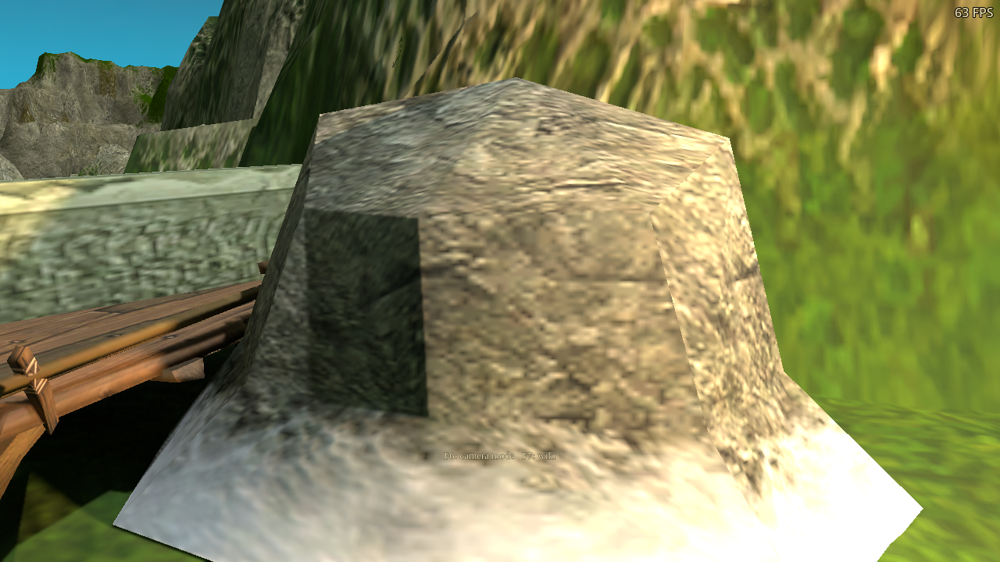
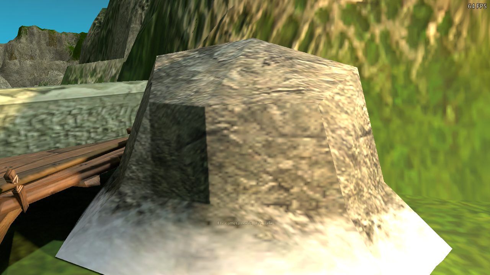
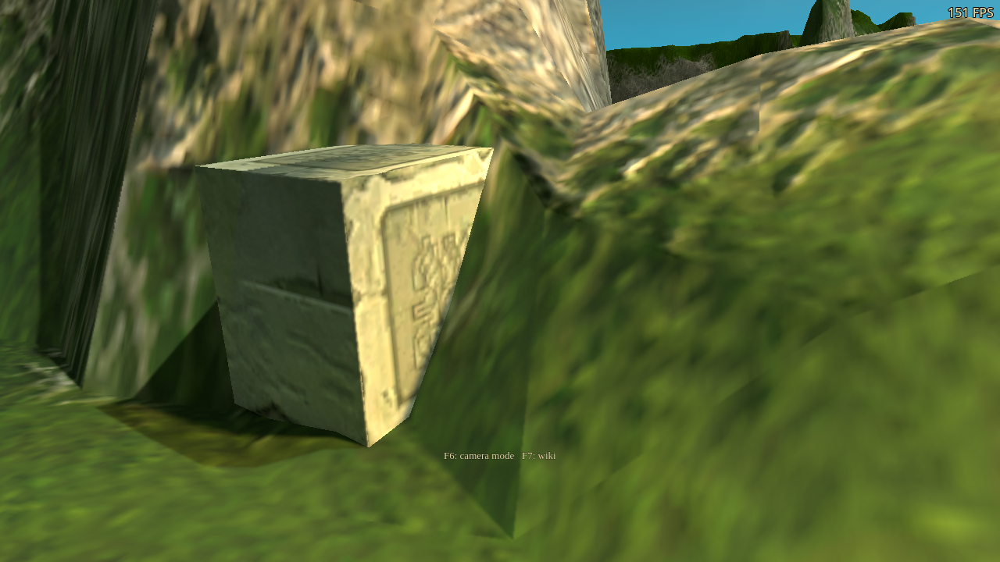

# Authored surface maps for world props

The object renderer and path tracer now share authored normal and roughness
maps for three original texture atlases. The maps replace brightness-derived
relief on matching objects. Original color textures and geometry are retained.
This implements another part of the [material and lighting research](../../integrations/path-tracing-materials-and-lighting-research-2026-10-22.md).

| Atlas | Authored response |
| --- | --- |
| `bridge00` | Grain follows diagonal beams, horizontal boards and vertical stakes. The bone ornament stays smooth and dielectric. The live fixture uses the original `stbr1` bridge. |
| `stone03` | Irregular stone detail and bounded fissures, with a smooth, rough snow fringe. |
| `columnruins01` | Masonry joints and restrained stone grain, preserving the original carved decoration. |

## Visible result

These are actual game captures at 1280×720, Medium tracing quality, four
continuation bounces and responsive history. The fixture places scaled original
figures in the campaign renderer and toggles their maps in both raster and ray
shading. Close views add the same fixed warm inspection light to each image.
That light is part of the test; this checkpoint does not change campaign lights.

| Existing relief | Authored map |
| --- | --- |
|  |  |
|  |  |

The gain is modest at ordinary gameplay distances. Original low-resolution
color, painted lighting, stretched UVs and coarse silhouettes remain visible.
Normal maps change surface shading; they do not supply new geometric shape or
replace the color art. The matched [wide view](vulkan-props-authored.png) and
[DX12 view](dx12-props-authored.png) preserve this context.

The GPU guide identifies changed surface normals at the same geometric depth.
The close-view comparison measures displayed color on those pixels, excluding
unrelated background and the FPS overlay. Vulkan observed 66,837 sampled
changed-normal pixels on the rock and 13,567 on the carved stone. Corresponding
mean absolute color differences were about 0.020 and 0.0077 on a 0–1 scale;
DX12 produced closely matching results. These establish a visible response,
not a perceptual quality score.

## Data and integration

Each 512×512 linear RGBA8 map stores tangent-normal XY, perceptual roughness
and metalness. Positive normal Z is reconstructed. These particular surfaces
are dielectric; the GPU fixture also verifies nonzero metalness. The format is
separate from equipment's legacy highlight/roughness/metalness map and from ORM.

The baker creates height and surface data mathematically; it does not copy
original color pixels. Original MMP hashes identify the atlas layout. A changed
source texture falls back to the existing response instead of using mismatched
regions. The source recipes are in `tools/build_surface_detail_maps.py`; the
pixel hashes, source hashes and generator hash are in
`game/assets/materials/surface-detail/provenance.json`.

The runtime uses D3D image rows, with row zero at V zero. The bake converts its
inspection coordinates before deriving the normal gradient. Validation checks
bone and snow regions against the actual decoded game images. The read-only
`surface_detail_inventory.gd` tool exports local runtime-order previews and
original mesh/UV bounds. Original atlas previews are not included here.

Import settings preserve RGB even when alpha/metalness is zero: lossless data,
generated mipmaps, no alpha-border repair, no premultiplication, no automatic
normal-map compression and no sRGB sampling. The checked-in `.png.import`
sidecars are required for this contract.

Raster and ray hits derive a UV tangent frame without an extra vertex stream.
Mirrored UVs, reflected/nonuniform instances and back faces are covered. The
normal stays in the visible geometric and viewing hemispheres; degenerate UVs
retain the base normal. Detail fades with distance and minification, and
unresolved highlights broaden. This conservative fade does not implement
variance-prefiltered microfacet normals.

The existing Surface materials option controls the feature. A map replacement
or enable change invalidates the material snapshot, including the controller's
render-thread descriptors. No player-visible option or string was added.

## Cost and performance qualification

Mapped props use one filtered data lookup in place of the existing four color
lookups used for relief. Sample/bounce budgets, ray payload size, bindings and
screen-sized buffers are unchanged. This does not guarantee a speedup: faded
legacy relief could use no extra lookup, and the new normal/roughness can change
the sampled paths.

All three maps add approximately 4 MiB to the ray texture array when loaded,
including mipmaps. Their raster textures require approximately another 4 MiB.
The fixture's ordinary array grew from 74 to 77 layers. The existing 192-layer
limit remains; broader material coverage needs an explicit texture budget.

**The original checkpoint's timings remain unqualified.** Another independent
game benchmark repeatedly used the same RTX 3090 during the measurements.
The saved timing windows are retained with overlap observations in
[summary.json](summary.json), but are excluded from performance claims. The
spare RTX 3090 Ti could not present a window through the desktop setup used at
that time. FPS overlays in the captures are not benchmark results.

Later follow-through: the [authored-lighting qualification](../path-tracing-authored-lighting-2026-10-23/README.md)
contains fresh measurements without the competing game benchmark. In the
representative prop scene the maps cost about +0.20 ms PT time on Vulkan and
+0.65 ms on DX12/Wine. The original contended measurements above remain excluded.
The subsequent [GPU 1 control](../path-tracing-gpu1-control-2026-10-23/README.md)
uses a private RTX 3090 Ti display and completes the outstanding unmapped-scene
comparison on both backends. It qualifies the incremental program cost in that
frozen scene; wider material coverage still needs its own budget and evaluation.

## Validation

The final data-map GPU fixture passes 47 checks on native Vulkan and 47 on the
Windows DX12 export through Wine/VKD3D. The timed campaign fixture passes 23
on each; the final visual-only fixture passes 19 on each, with animated rain
and input disabled for consistent captures.
They cover import/export, source fingerprints, data channels, raster/ray normal
agreement, UV and instance reflection, nonuniform transforms, back faces,
degenerate UVs, minification, distance fading, disabled settings and live map
toggles through the actual scene controller.

The unchanged-material regressions pass 69 terrain checks, 13 foliage checks
and 16 equipment checks. The material shader suite draws 144 variants and
performs 470 assertions in each of its cold- and warm-cache runs, including
option and fog combinations. The focused OpenGL object fixture passes nine
checks over four actual production-shader draws. The broader OpenGL suite
timed out during unrelated shader compilation and is not qualified here.
The [run records](runs.json) and summary keep final results and process exits
separate from diagnostic trials.

The shader build manifest verifies all 18 backend binaries; all nine SPIR-V
stages pass validation. The map generator verifies the committed decoded
pixels. Every game run uses an isolated test profile with a free cursor, FPS
visible and all three audio volumes zero. DX12 results qualify the exported
backend through Wine/VKD3D, not native Windows performance.

The later [torch-history](../path-tracing-torch-history-2026-10-23/README.md) and
[authored-lighting](../path-tracing-authored-lighting-2026-10-23/README.md) checkpoints
address flame stability, finite source size and exposure. Color-art cleanup,
broader material coverage and per-zone source placement remain content work.
