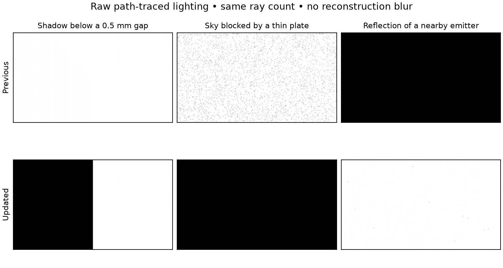

# Path-traced contact lighting — 2026-10-22

Unreleased follow-up to `172a8780`. The path integrator now retains nearby
occluders and reflected surfaces that the previous fixed ray displacement
could skip. This changes path-traced lighting; water retains its separate
reflection renderer. No option, player-visible text or published release changed.

## Change

The previous secondary rays started 15 mm off their triangle and ignored the
first 2 mm of the ray. The updated origin uses a floating-point error bound
for the actual triangle and instance. Hit positions are reconstructed with
barycentrics; normals use the inverse transpose, preserving nonuniform scale
and shear. The bound includes intersection, reconstruction and both transform
errors, following [NVIDIA's DXR analysis](https://developer.nvidia.com/blog/solving-self-intersection-artifacts-in-directx-raytracing/).
The same origin is used for direct visibility, emissive sampling and BSDF
continuations. Secondary `TMin` is zero. World-space texture edge lengths are
computed without subtracting translated vertex positions.

Sun visibility retains parallel rays. Point-light visibility connects the
displaced origin to the sampled light, excluding only the last representable
distance. This removes the former 25 mm end-of-ray subtraction, which could
miss a blocker just before a lamp. Geometry beyond the lamp remains unshadowed.

Ray/sample counts, target resolution, reconstruction, image memory and the
96-byte ray payload remain unchanged. The previously unused payload distance
field carries the surface offset. More precise hit/shadow calculations add
shader work; this is a quality improvement, not a claimed speedup.

## Controlled comparisons

The saved comparison packages match the `172a8780` export hashes. Both builds
run the same `path_trace_contacts.gd` fixture at 256×144 with four samples per
pixel and one continuation bounce. Results read raw GPU lighting before any
spatial or temporal reconstruction. Assertions use analytic lit/dark references.
The fixture also checks grazing light, translated geometry, nonuniform scale,
rotation, shear, mirrored instances and large local coordinates cancelled by
an instance translation. Normals and geometry use real acceleration structures.

The first column is a floor whose left half is covered by a plate 0.5 mm above
it. The second is a floor beneath a black plate with only sky illumination.
The third is a smooth metal reflecting a nearby emissive plate. Brightness in
these diagnostic images is raw radiance, not a shaded campaign screenshot.

| Raw lighting measurement | Previous | Updated |
|---|---:|---:|
| Covered floor, 5 mm gap | 0.999928 | 0.000000 |
| Covered floor, 0.5 mm gap | 0.999928 | 0.000000 |
| Sky leakage through a 5 mm gap | 0.999065 | 0.000001 |
| Emissive leakage through a 5 mm gap | 0.884856 | 0.000000 |
| Nearby emissive reflection (expected ≈1) | 0.000000 | 0.999936 |
| Blocked point light, plate 5 mm before lamp | 0.883728 | 0.000000 |
| Unblocked point light, plate 5 mm beyond lamp | 0.898859 | 0.898859 |

The newly blocked regions retain their analytic dark result while uncovered
surfaces remain lit. All twelve normal/grazing self-intersection cases have
zero black pixels and agree with expected lighting within 1%. Four translated,
scaled/rotated, sheared and mirrored contact fixtures also retain their shadows.
The Vulkan and DX12 means agree within 0.001 in every case.

The energy references in the pre-existing emitter and disk-sun sampling tests
now integrate at the physical receiver plane. They no longer bake in the old
15 mm displacement. Historical validation reports and baseline packages remain
unchanged.

## Performance and integration

| Bounce count / quality | Previous RT GPU ms | Updated RT GPU ms |
|---|---:|---:|
| 2 / Low | 0.512–0.512 | 0.522–0.527 |
| 2 / Medium | 2.334–2.508 | 2.710–2.769 |
| 2 / High | 9.671–9.845 | 10.424–10.537 |
| 4 / Low | 0.659–0.659 | 0.674–0.676 |
| 4 / Medium | 3.139–3.144 | 3.361–3.450 |
| 4 / High | 11.763–12.069 | 12.594–12.716 |

Paired-round differences are approximately +0.010–0.017 ms at Low,
+0.222–0.376 ms at Medium and +0.524–0.954 ms at High. Keeping sun
rays parallel avoids finite-endpoint normalization and reduces the overhead
observed in the first implementation. The numbers above are from the final
shader, after that simplification.

Measurements use the same RTX 3090 and Windows custom-engine export through
Wine/VKD3D. The fixed 1280×720 river benchmark disables water reflections and
frame generation, hides units and traces two or four bounces at every quality.
Each of two rounds reverses case order and collects ninety warmed frames.
The table gives the range of round medians for the RT pass, including filtering
and copies, excluding acceleration-structure updates and the main raster pass.
The scene has 116,008 triangles, 1,420 instances and no eligible emissive
triangles. Shared-host timing variation is visible; these are not overall
FPS predictions or a comparison against mirror water reflections.

The final build passes **432 assertions across fourteen recorded runs**.
This includes contacts and glossy reconstruction on both APIs, lighting-energy
quadrature, emissive sampling/MIS, multi-bounce transport, alpha cutouts,
receiver coverage, sampling convergence, outdoor/cave rendering, resizing,
mode changes and production frame generation. The two native Vulkan runs
record no validation errors. Campaign captures:
[river](contacts-final-dx12-path_trace_live/river-path-4-still.png),
[cave](contacts-final-dx12-path_trace_cave/cave-path-4-still.png).

The frame-generation fixture keeps path lighting active alongside water RT,
checks toggles, resize, pause/resume and verifies both FPS counters.
[Results](contacts-final-dx12-path_trace_fsr/rt-fsr.json) record ninety generated
frames and 180 presents during the first interval. The
[HUD capture](contacts-final-dx12-path_trace_fsr/rt-and-fg.png) shows **82 FPS
rendered / 164 FPS presented**; the resized capture shows **89 / 178 FPS**.
These are integration observations, not a before/after performance comparison.

All final assertions pass, with no shader/script errors. The known Wine
shutdown fault recurred after the application's clean-exit message in two
final runs (contacts and grazing-light quality) and the saved baseline contact
run: a read of `0000000241BB6030` at `00006FFFFFC81448`. The other twelve final
runs, including frame generation, did not record it. Per-run diagnostics retain
this separately; passing assertions do not establish clean native-Windows
qualification.

The test profiles are isolated, with a free cursor, visible FPS and all game
audio muted. Translation validation reports 3,042 remake entries and dynamic
keys without errors. All ten native path-tracing binaries reproduce with
DXC 1.9.2609.5. Source hashes match the exported runtime; Windows uses the
qualified custom template and approved icon, retaining the icon-qualified
executable hash. [build.json](build.json) records package/source provenance;
[summary.json](summary.json) records fixture hashes, comparisons and diagnostics.

## Remaining limits

Emissive connections still exclude the last 2 mm before their sampled target
and skip direct samples shorter than 4 mm. This change corrects receiver-side
contacts, not that separate target-side limitation. Error bounds are
conservative: very large local coordinates or poorly conditioned transforms
can require a larger displacement. RTX tests do not qualify other GPU vendors'
intersection precision. Native Windows qualification remains pending; DX12
results here are from Wine/VKD3D, and native Vulkan checks use validation layers.
The existing bounded scene, primary pixel-centre sampling, raster composition,
reconstruction and motion limitations still apply.

Use `--contact-baseline` only against the saved previous package to record
comparisons while skipping the newly improved contact assertions. Normal runs
require all contact and self-intersection checks to pass. Development previews
are updated locally; nothing was pushed or published.
