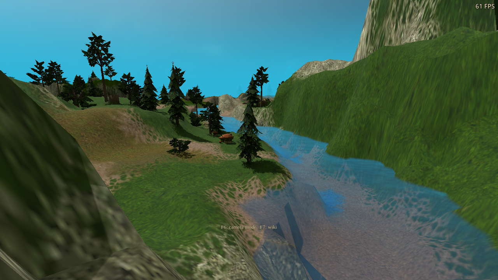
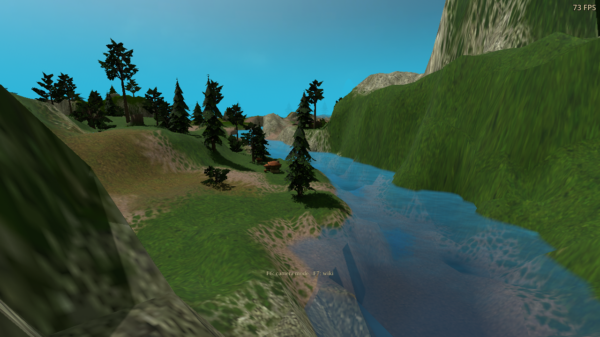
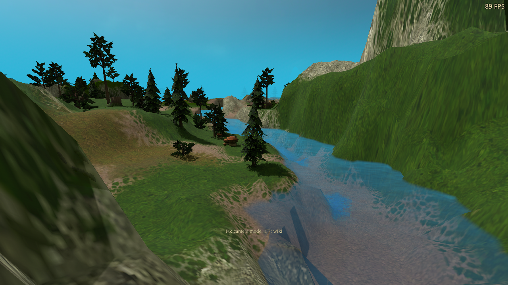
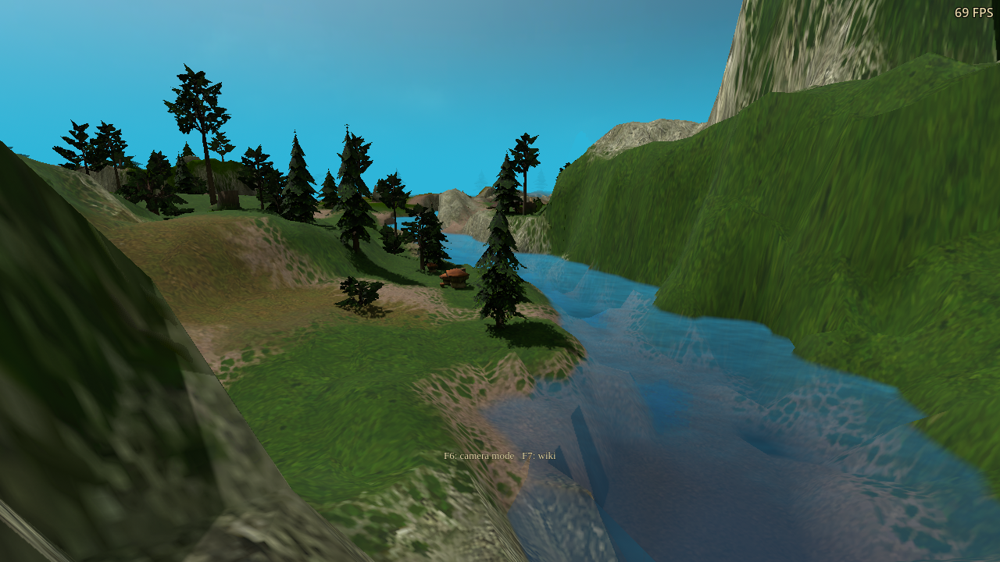

# Outdoor path lighting — 2026-10-22

Unreleased follow-up to `08acf98d`. Outdoor path misses now sample a directional
sky environment. Traced surfaces can use shallow texture relief, and terrain
receivers retain their underwater shading. No new option, translation key or
published release changed.

## Appearance

The original ambient palette was a minimum light level. Previously PT added
that same colour to every escaped path, on top of sunlight and traced bounce
light. The new environment varies between zenith, horizon and ground. It uses
the authored ambient/sun/sky palette, with less daytime fill and restrained sky
colour. Night retains more fill; caves retain zero outdoor sky. Sunlight is
still sampled separately.

The paired DX12 images use the same river camera, 1280×720 window, Medium PT
quality, four bounces and at least 100 stationary frames. Water reflections
are disabled to isolate world lighting. These are unmodified captures;
screenshot FPS readings are not controlled performance measurements.

| Previous | Updated |
|---|---|
|  |  |
|  |  |

[Evening before](daylight-baseline-dx12-outdoor/evening-path.png) /
[after](daylight-tested-dx12-path_trace_daylight_live/evening-path.png);
[night before](daylight-baseline-dx12-outdoor/night-path.png) /
[after](daylight-tested-dx12-path_trace_daylight_live/night-path.png).

The adjustment is restrained: shaded slopes and riverbanks have more
separation from lit grass, and underwater terrain no longer bypasses the
authored depth attenuation. It does not add geometric detail to the original
low-polygon cliffs.

## Implementation and limits

- The continuous sky gradient supplies the environment radiance for both
  diffuse and glossy continuations, following the usual
  [infinite-area lighting model](https://www.pbr-book.org/4ed/Light_Sources/Infinite_Area_Lights).
  It is a low-frequency approximation, not physical atmospheric scattering,
  a sun disk, clouds, or a captured HDR environment. No extra ray is needed.
- Enhanced terrain and known stone/wood profiles supply bounded relief from
  four texture taps. World-space cotangents preserve UV mirroring and scaled
  placements. Distance and minification fades suppress distant shimmer;
  degenerate UVs and inward-facing perturbed normals fall back safely. The
  same terrain/material options control raster and traced detail. A terrain-only
  option change refreshes the lighting snapshot.
- Terrain relief uses the existing 512×512 trace atlas with a conservative
  strength; it does not reproduce every semantic terrain layer or procedural
  normal. Foliage still uses its existing cutout and rough-material model.
  This pass does not add leaf transmission or full PBR texture sets.
- Underwater receiver composition attenuates reflected diffuse/glossy light
  and preserves emission. Since the buffers combine incident light directions,
  it uses the original ambient depth factor. Secondary paths do not simulate
  a water volume.
- The frame grows from 656 to 704 bytes; sky changes invalidate both temporal
  modes. Geometry stride, 96-byte ray payload, samples, resolutions and lighting
  image allocations stay unchanged. Relief uses seven spare material bits.

## Validation

The new analytic fixture distinguishes zenith, horizon and ground with blue,
red and green light. Upward, sideways and downward receivers agree with the
hemisphere integrals; isotropic fixtures retain their expected energy. Relief
checks cover mirrored UVs, nonuniform mirrored placement, degenerate UVs,
minification and distance fades. A separate rendered receiver fixture checks
dry/partially submerged/submerged surfaces and preserves emissive radiance.

Campaign checks cover noon, evening, night, a sky-only colour change, material
collection, a terrain-only option change and conventional-lighting restoration.
Contact-shadow, glossy-history, BRDF/reconstruction and cave regressions are
included. The material matrix draws all 144 production variants. The 15 final
runs pass 1,280 assertions. Run counts, results and exceptions are recorded in
[summary.json](summary.json).

The paired frame-generation test uses the production campaign gate and FPS
HUD with both PT and water RT active. It checks actual generated/presented
frame counts, reflection-mode changes, resize, pause and resume. The former
90-second startup wait expired while a rebuilt engine compiled temporal
shaders with an empty cache. The fixture now allows 180 seconds; all functional
assertions remain. Both packages pass all 62 checks. The updated capture records
90 generated frames and 180 presentations, with 85 FPS rendered / 170 FPS
presented in the [HUD capture](daylight-final-dx12-fsr/rt-and-fg.png).
The previous build exhibits the same long cold startup.
This test change does not shorten product shader compilation.

| Bounces / quality | Previous RT GPU ms | Updated RT GPU ms |
|---|---:|---:|
| 2 / low | 0.531–0.537 | 0.529–0.530 |
| 2 / medium | 2.677–2.806 | 2.747–2.780 |
| 2 / high | 10.152–10.370 | 10.463–10.731 |
| 4 / low | 0.678–0.682 | 0.678–0.681 |
| 4 / medium | 3.399–3.445 | 3.378–3.403 |
| 4 / high | 12.339–12.633 | 12.359–12.567 |

Low/Medium and four-bounce High remain within the observed variation.
Two-bounce High adds about 0.31–0.36 ms in the paired rounds.

GPU timings use the same RTX 3090, rebuilt DX12 engine, frozen 1280×720 river,
enhanced terrain/materials, responsive accumulation, no frame generation and
no water reflection. Each build runs two opposite-order sweeps with 90 measured
frames per case after warm-up. RT timings include tracing, reconstruction and
copies, excluding acceleration-structure updates and the raster viewport.
They are not a claim about whole-game FPS or other GPUs.

One native Vulkan material-matrix run rendered all 144 variants and reported
470 checks / zero failures, then exited with SIGSEGV after logging `clean exit`.
The previous package exited normally, and a repeat of the updated package using
its saved shader cache also exited normally. The cause remains unresolved; the
first run is retained as a diagnostic, not counted as a successful qualification.
All final DX12 runs exited normally. An earlier updated DX12 daylight run and
the baseline frame-generation run logged the same Wine page fault after the
game's `clean exit` message, despite process exit code zero. The updated daylight
run is retained separately as a diagnostic; its repeat passed without the fault.
The baseline frame-generation assertions passed, but its shutdown is not cleanly
qualified. Successful repeats do not establish that either intermittent shutdown
fault is fixed.

DX12 runs use Wine/VKD3D; native Windows remains unqualified. Vulkan runs use
the qualified Linux engine. These runs did not enable Vulkan validation layers.
All development profiles kept the cursor free, FPS visible and all audio muted.

## Build provenance

[build.json](build.json) records source, shader, fixture, package and engine
hashes. Local development executables and compiler/runtime libraries had been
removed, so the Windows engine was rebuilt from the existing qualified source
and dependencies were restored. Both Windows comparison packages use that
same EXE; the baseline PCK was exported from `08acf98d` before production edits.
Linux uses the published 1.23.0 qualified Vulkan executable for both packages.
Historical test packages and measurements were not used as new benchmark runs.

DXC reproduces all ten checked-in path shader binaries. Existing water and
one-bounce shader manifests still verify. The real Windows export embeds the
approved dragon icon in all six exported sizes; see [icon-check.json](icon-check.json).
The local preview is not a release or a native-Windows qualification.
