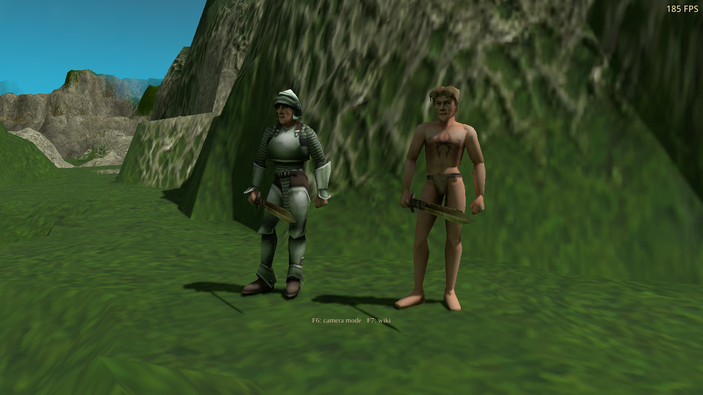
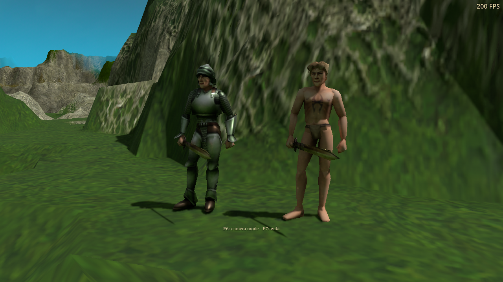

# Path-traced equipment material maps

The PT scene now carries the existing equipment roughness/metalness maps through
collection, the render-thread handoff and native hit shading. Armor and weapons
reflect their surroundings differently from skin and cloth. Original redress
alpha and layer order define the regions; base-color brightness does not.

This is the first implementation step following the
[material and lighting research](../../integrations/path-tracing-materials-and-lighting-research-2026-10-22.md).
Authored prop/terrain normal maps, broader emission-map support and lighting
stability remain outstanding. This checkpoint does not complete that wider work.

## Visible result

The comparison uses original equipped figures in the campaign renderer. Both
images use identical geometry, textures, lighting, camera and tracing settings;
the saved `a56d4484` hit shader supplies the reference. The original color
texture's painted highlights remain visible in both images.

| Previous hit shader | Equipment maps enabled |
| --- | --- |
|  |  |

The GPU material guide confirms thousands of sampled character pixels acquire
metalness, while the previous shader reports none. The exposed character stays
dielectric. A subsequent material-only edit updates the live scene and settles
without repeated rebuilds. Direct GPU fixtures separately check scalar fallback,
linear data, native/script collection parity and roughness/metalness boundaries.

## Performance and resource cost

RTX 3090, 1280×720 window, Medium RT quality, four continuation bounces,
responsive history. Each row averages two interleaved per-run median timings,
with 120 sampled frames per pass (119 captured timestamp sets on DX12).
Pipeline warmup and loading are excluded. Timings include PT rays,
reconstruction and output copies, excluding raster work and AS updates.

| Character scene | Previous shader | Mapped materials |
| --- | ---: | ---: |
| Native Vulkan | 3.921 ms | 3.740 ms |
| Windows DX12 export through Wine/VKD3D | 5.129 ms | 5.090 ms |

These are scene-specific results. Changed material lobes also change the ray
paths, so this is not a claim that an extra map lookup makes all scenes faster.
An outdoor comparison without visible mapped characters measured 4.389 versus
4.220 ms at Medium and 15.484 versus 15.704 ms at High. Its shader, scene and
resources were alternated in one process. Small differences should not be
treated as a universal speed improvement or a native Windows benchmark.

Mapped surfaces add one filtered lookup using the existing texture array.
There are no extra rays, screen buffers, bindings or payload fields. Unmapped
surfaces retain the scalar path. The live replacement case allocated 81 ordinary
texture layers, approximately 108 MiB including color, foliage and surface data;
the borrowed detailed-terrain atlas is separate. This is total allocation in
that snapshot, not the incremental cost of the change. Surface maps currently
share the existing 512×512 layer format and 192-layer limit, so broader asset
authoring still needs a deliberate memory policy.

## Qualification

[summary.json](summary.json) records 352 passing checks, source hashes, commands,
profiles and clean process exits across these suites:

- Surface-map GPU fixtures on Vulkan and DX12: 16 checks each.
- Original equipped-character integration on Vulkan and DX12: 16 each.
- Detailed-terrain GPU fixtures on Vulkan and DX12: 69 each.
- Foliage GPU fixtures on Vulkan: 13.
- Shared water material collection and GPU behavior: 120.
- Interleaved outdoor material performance: 17.

Both shader backends were rebuilt from the same source. The build manifest
verifies all 18 binaries and all nine Vulkan stages pass SPIR-V validation.
Each game run used an isolated profile with free cursor, FPS visible and all
three audio volume settings zero. No player-visible options or strings changed.

Early live trials caught a missing map-index field in the controller's
render-thread handoff. The final integration fixture explicitly verifies that
handoff and actual rendered material codes, in addition to the collector-only
checks. Failed diagnostic trials are not included in the passing count.
