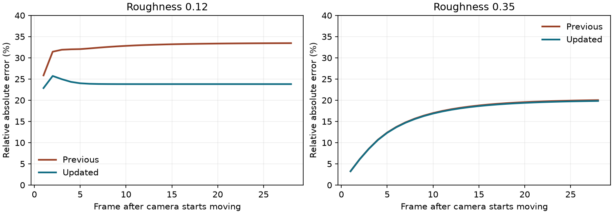

# Path-tracing glossy reconstruction validation — 2026-10-22

Unreleased follow-up to `62da42b9`. All comparisons use the same RTX 3090.
DX12 runs use the Windows executable through Wine/VKD3D; the Vulkan motion
run uses the qualified native Linux engine with validation layers. These
results do not qualify native Windows or other GPU vendors.

Glossy reconstruction now considers roughness, reflection direction and its
own history confidence. Diffuse history remains independent. Material guides
use separate roughness and metalness fields, including fractional metalness.
Ray counts, quality resolutions, bounce limits and the twelve image targets
are unchanged. See the [integration document](../../integrations/path-tracing-experiment.md)
for the algorithm, resource budgets and remaining limits.

## Moving highlights

The native fixture renders a metallic plane with a directional point sun,
without sky or other incoming light. Its current unfiltered specular output
is deterministic, so it provides a reference without Monte Carlo noise.
After sixteen stationary frames, the camera translates 0.04 m per frame for
twenty-eight frames. The metric is each frame's sum of absolute reconstruction
error divided by its sum of reference radiance, averaged over those frames.
Measurements use the floating-point outputs in the central 480×280 region
of a 640×360 image. Spatial blur and temporal lag both contribute to the error.

| Surface roughness | Previous relative error | Updated relative error | Reduction |
| --- | ---: | ---: | ---: |
| 0.12, polished | 32.68% | 23.91% | 26.9% |
| 0.35, broader highlight | 16.60% | 16.47% | 0.8% |

The polished result is an improvement in this controlled fixture, not a claim
of a 27% improvement across every material or campaign scene. Broad highlights
retain most of their existing history and change little in this test. Vulkan's
polished error is 23.90%, agreeing closely with DX12.

Raw results: [previous](glossy-verified-baseline-motion/path-glossy.json),
[DX12](glossy-verified-dx12-motion/path-glossy.json),
[Vulkan](glossy-verified-vulkan-motion/path-glossy.json).
Last moving frame: [previous](glossy-verified-baseline-motion/highlight-0.12-filtered.png),
[updated](glossy-verified-dx12-motion/highlight-0.12-filtered.png),
[reference](glossy-verified-dx12-motion/highlight-0.12-reference.png).
PNG previews clamp HDR radiance to 0–1; measurements include values above one.

## History, materials and stationary noise

Known input histories exercise the actual compute pipeline independently of
the ray integrator. A smooth perspective receiver reduces its glossy confidence
from eight frames to approximately one when the view changes, while its diffuse
history stays at eight. The same motion on a rough receiver retains roughly
7.8 frames. Orthographic translation preserves the unchanged reflection direction.
Normal changes can reject glossy history inside the diffuse normal tolerance.
Invalid diffuse and glossy histories no longer invalidate one another, and an
unrelated depth layer still rejects both. Progressive checks verify exact
129-frame continuation, the full 256-frame limit and camera-motion resets.

The native mixed-material fixture checks five roughness/metalness combinations.
The previous summed guide encoded both `(0.2, 0.4)` and `(0.6, 0.2)` as `1.0`.
Their new guide values differ, and the filter rejects history across that
material change. Guide precision is six roughness bits and five metalness bits;
integrator material precision is unchanged.

A second native fixture uses a uniform environment and an orthographic grazing
view of a roughness-0.35 metal. It runs one path sample per pixel for thirty-two
stationary frames. The constant expected signal separates sampling variance
from spatial highlight variation. Both builds produce the same results within
rounding: raw red variance **0.052768**, filtered variance **0.001836**, a 96.5%
reduction, with eight-frame confidence. The comparison script also verifies
that updated variance and mean bias have not regressed against the saved build.

This does **not** mean the filter conserves energy. The independent hemisphere
integral is **0.868462** and the raw mean is **0.868576**, but the filtered mean
is **0.921467**: approximately **6.1% too bright** in both builds. An initial
energy-preservation assertion exposed this existing clamp bias and failed on
both builds. The final fixture records bias separately and checks the native
integrator against the independent integral. Removing this bias remains work
for a later denoiser improvement.

Noise captures: [raw](glossy-verified-dx12-motion/stationary-noise-raw.png),
[filtered](glossy-verified-dx12-motion/stationary-noise-filtered.png).

## GPU cost

The frozen river comparison uses a 1280×720 window, hidden units, water
reflections and frame generation off, and responsive accumulation. Two rounds
run in opposite orders, with ninety measured frames per case after warm-up.
The scene contains zero eligible emissive triangles. Values below are ranges
of the two median GPU times for rays, reconstruction and copies, excluding
scene builds, acceleration-structure updates and the main raster viewport.

| Mode | Previous RT pass, ms | Updated RT pass, ms |
| --- | ---: | ---: |
| 2 bounces, Low | 0.470–0.476 | 0.476–0.479 |
| 2 bounces, Medium | 2.315–2.483 | 2.357–2.509 |
| 2 bounces, High | 10.149–10.861 | 10.040–10.213 |
| 4 bounces, Low | 0.610–0.617 | 0.619–0.623 |
| 4 bounces, Medium | 3.181–3.190 | 3.164–3.191 |
| 4 bounces, High | 12.351–12.535 | 12.065–12.081 |

The additional filter arithmetic leaves GPU cost broadly similar in this
scene. Changes are not consistently faster or slower across modes, and whole
frame timing varies with CPU/scheduling load on the shared host. This is not
evidence of a general FPS gain. Full timing distributions:
[previous](glossy-baseline-dx12-performance/path-performance.json),
[updated](glossy-verified-dx12-performance/path-performance.json).

## Integration and diagnostics

The updated build passed **238 assertions across ten recorded runs**. Checks
cover the new motion/material fixture on both APIs, existing
multi-bounce energy and emissive sampling, grazing GGX energy, sloped history
and receiver coverage, outdoor and cave rendering, animation, resizing,
switching to conventional rendering, and production frame generation.
Campaign captures: [river](glossy-verified-dx12-path_trace_live/river-path-4-still.png),
[cave](glossy-verified-dx12-path_trace_cave/cave-path-4-still.png).
Frame-generation results and both FPS counters are retained in
[results](glossy-verified-dx12-fsr/rt-fsr.json),
[HUD](glossy-verified-dx12-fsr/rt-and-fg.png) and
[resized HUD](glossy-verified-dx12-fsr/rt-and-fg-resized.png).
The first FG interval generated ninety frames and observed 180 presents; its
HUD showed **88 FPS rendered / 177 FPS presented**. These are observations
from this run, not promised gameplay rates.

All runs use isolated profiles, a free cursor, visible FPS and muted audio.
No player-facing text or options changed; translation validation passed all
3,042 remake entries and dynamic-key coverage. All ten path shader binaries
reproduce with DXC 1.9.2609.5. Production source hashes match the exported
runtime. Windows was exported using the qualified template and approved icon;
its executable is byte-identical to the previously icon-qualified export.
Package/source hashes are in [build.json](build.json), with fixture hashes,
per-run checks and crash diagnostics in [summary.json](summary.json).

The native Vulkan motion run emitted no validation errors, and the recorded
updated runs had no shader errors, script errors or failed assertions.
The previously recorded Wine shutdown fault recurred after the application's
clean-exit message in the closed-room device run; it reads `0000000241BB6030`
at `00006FFFFFC81448`. The final FG run did not show that fault.
Per-run diagnostics distinguish it from in-game assertion, shader and Vulkan
validation failures. Passing assertions and a zero runner exit code do not
establish clean native-Windows qualification. Baseline Wine display warnings
also remain.

This is still a custom prototype filter. It reprojects the primary surface,
without object motion vectors or reflected-hit motion, and rejects incompatible
glossy history rather than tracking the reflected object. Faster response can
expose more sampling noise during movement. The clamp bias above, material
authoring, thin geometry, transmission and content outside the bounded scene
remain limitations. Water retains its separate renderer. No release was published.
