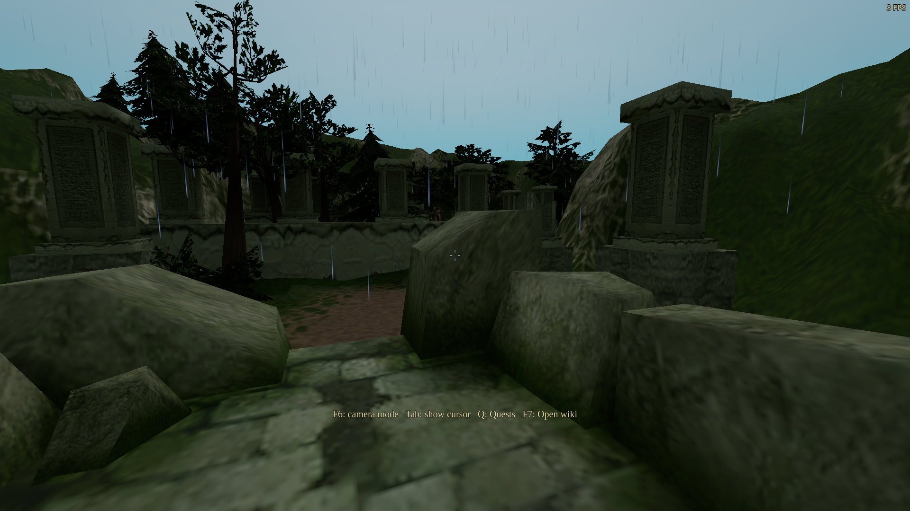
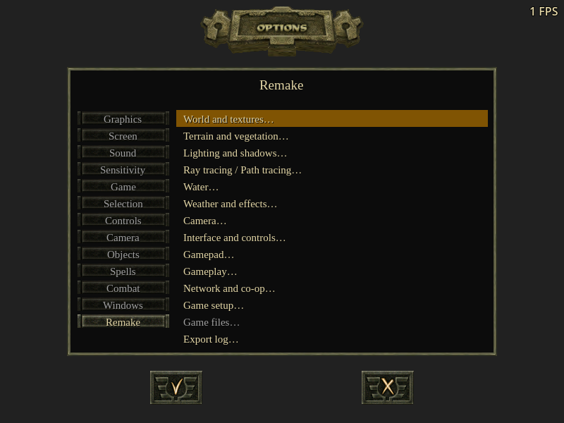
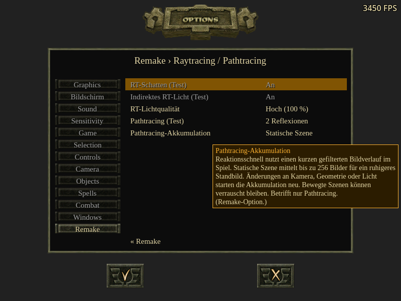

# NRD integration and travel performance — 2026-10-24

## Qualified source and packages

Local preview: **1.28.0-experimental.1**, based on published stable 1.27.0.
Implementation commit: `fabaadea280053dd7174dd7998ae299a9ed27582`.
Game tree: `5fb4d00cc15d85b3b91503bfcd1d180a833ada3c`.
No public release, tag, hosted build or player profile was changed.

The Windows EXE was exported again with the approved icon and numeric file
version 1.28.0.0. Its six icon sizes match the approved artwork pixel for pixel.
Linux and Windows retain their qualified Godot 4.7 engine code. The Windows
DirectX Agility runtime and associated notices were verified. Both PCKs contain
all 424 application scripts, the NRD manifest and lazy descriptor. The external
NRD libraries match the committed binaries. No original game assets or test
profiles are included. Exact hashes are in
[package-audit.json](path-tracing-nrd-2026-10-24/package-audit.json).

All GPU work used isolated GPU Lab jobs with automatic GPU selection. Benchmarks
used exclusive heavy jobs; ordinary checks used automatic scheduling. Profiles
were separate, audio muted, the cursor free and FPS displayed. Windows tests ran
the Windows package through Wine/VKD3D on Linux; this is not native Windows or
RTX 4090 Laptop qualification.

## Performance

The supplied 1.27.0 report shows a single retained world, nearly steady memory,
and frame rate falling toward 6 FPS during play. The late paused sample recovers
to about 50 FPS. Its clock scale is 55/27. The older report segment involving
multiple worlds is not evidence of that problem recurring in the latest run.
The recordings were inspected as visual evidence, not as instructions.

Profiling found repeated synchronous GPU readbacks in
`ArrayMesh.surface_get_arrays()` during nearby scene reconstruction. Reading
hundreds of retained mesh buffers serializes gathering with rendering. Mesh
arrays, blend arrays and normalized texture images now survive neighboring
snapshots in a bounded, invalidated CPU cache. Lifted terrain sectors are also
reused. The live gathering target is 1.5 ms; an indivisible mesh or first texture
readback can exceed it.

The matched short route used 3840×2160 output, two-bounce PT, Low/50% trace
resolution, responsive accumulation, AA/FSR/frame generation off, full effects,
and live simulation. It traversed nine 24-metre camera legs, 180 frames each.
Both versions ran consecutively on the same RTX 3090 Ti. The measurements below
are **medians of segment medians/p95s**, not a pooled frame percentile.

| Measurement | Published 1.27.0 | NRD + caches | Repeated NRD run |
| --- | ---: | ---: | ---: |
| Frame time, median (ms) | 19.625 | 17.850 | 17.936 |
| Frame time, p95 (ms) | 27.471 | 23.415 | 22.748 |
| RT GPU time, median (ms) | 7.970 | 8.300 | 8.325 |
| Last scene generation | 1 | 15 | 15 |
| Reported graphics memory at end (MiB) | 1567 | 1851 | 1851 |

Typical frame time fell about 9%; NRD itself adds a little GPU time and memory.
The old build repeatedly remained in gathering while travel invalidated its
candidate. The new build completed successive snapshots and retained PT.
The worst short-route frames remained approximately 293–333 ms, so this does
not establish that all compilation/loading hitches are gone.

A second matched run on an RTX 3090 covered five 64-metre legs (320 metres),
600 frames each, in rain at the report's 55/27 clock scale. It reached beyond
the initial RT region. The median of segment frame medians improved from
23.977 to 19.945 ms (16.8%); segment p95s improved from 30.724 to 25.810 ms.
The final snapshot generation increased from 3 to 22. Both completed with
zero inactive PT frames. These are separate measurements on a different GPU,
not additional samples pooled with the short route.

The final packaged Windows soak used the production first-person camera,
3840×2160, rain, 55/27 clock speed, live NPC simulation and a 30 FPS cap.
It completed 243.3 seconds and 512.2 metres of animated player
movement. All 7,200 measured frames kept PT and NRD active; scene generation
reached 16. Segment median frame times ranged from
33.129 to 33.760 ms, without progressive deterioration.
The first segment had a 1,038 ms hitch; later isolated spikes remain visible
in the retained report. Graphics memory ranged from
1986 to 2006 MiB. A capped soak establishes sustained
behavior, not uncapped throughput.

The independent camera route measures scene streaming reproducibly; the soak
uses an animated invulnerable player with normal NPC simulation and movement
orders. Invulnerability keeps encounters from ending the test. Earlier soak
captures exposed clipping from the fixture's synthetic camera. The retained
first-person soak uses `DirectControl.apply_camera()` and the production eye,
body visibility and collision clearance. It does not replace that logic with
a camera at the player's centre. Screenshots/readbacks occur after timed travel.

The controlled routes did not reproduce the reported sustained 6 FPS collapse.
These results demonstrate removal of a measured readback bottleneck, not proof
that every cause of the laptop's slowdown is fixed. The tests do not benchmark
combat with the same save, native Windows driver, or laptop power/thermal state.

## Image quality and behavior

- NRD device tests: 17 checks on each packaged renderer, including actual
  dispatches, stable outputs, resize, still-scene/interactive switching,
  extinguished emission, injected reconstruction failure, one-time fallback and
  native/GPU resource release.
- NRD motion: 42 checks on DX12 and Vulkan, including camera/rigid motion,
  newly visible surfaces, deformation confidence and odd-size resets. The
  custom fallback retains its separate 55-check motion suite.
- Glossy reconstruction: 31 checks per renderer. Moving analytic direct
  highlights at roughness 0.12 and 0.35 have zero relative error against their
  unfiltered reference. Direct highlights bypass indirect NRD specular blur.
  In the uniform rough-metal noise fixture, variance falls from 0.052462 to
  0.000092804 (99.82%), with −0.392% mean bias against an independently sampled
  integral. This is a controlled fixture comparison to raw samples, not a
  percentage improvement across the whole game or over the previous denoiser.
- Lifetime/failure checks: 167 DX12 and 168 Vulkan assertions. Native RT
  lighting/morph regressions: 48 checks. Real campaign routes, camera changes
  and snow footfalls keep PT active.
- Grass: four controlled production-shader checks on each renderer. Blades
  inherit dark/lit ground at their planted roots and reject foreground-wall
  lighting. This approximates ground illumination; individual blades are not
  inserted into the acceleration structure and do not receive new self-shadow
  geometry.
- Real first-person rainy terrain and cloud transitions pass. The rain fade
  preserves history without repeated resets. The screenshot's FPS counter is
  affected by synchronous capture and is not a performance measurement.
- RT/PT options: 300 checks cover direct Remake navigation, keyboard return,
  pending values, Apply/Cancel and EN/RU/DE layouts at 800×600 and 1280×720.
  The wider graphics/menu regression suite passes 438 checks.
- All 16 NRD SPIR-V files pass `spirv-val --target-env vulkan1.2`; both shader
  build manifests verify their sources and compiled binaries. Python build
  scripts compile and `git diff --check` passes.

The initial integration exposed two real defects that were corrected before
qualification: Godot's optional Vulkan re-spirv pass corrupted a temporal
stabilization shader, and feeding analytic direct specular into NRD blurred
sharp moving highlights. Per-shader specialization guards preserve upstream
SPIR-V; a separate direct-specular signal preserves those highlights. Failed
earlier integration runs are not counted as passing qualification.

## Evidence

[Suite summaries](path-tracing-nrd-2026-10-24/summary.json), per-suite JSON reports,
runtime hashes and fixture hashes are retained in the adjacent directory.
Result metadata omits unrelated test-file hashes while retaining the fixture's
transitive local dependencies and the hash of its original complete result.
The retained orchestration scripts use workstation paths; adapt those paths
when reproducing the tests on another checkout.
Early development packs inherited a stable-release metadata file; their actual
runtime hashes and dirty source status are preserved separately. The final
preview runs identify the exported implementation commit above.

For dependency pins, licensing, the Godot boundary and build commands, see
[the integration notes](../integrations/path-tracing-nrd.md).
