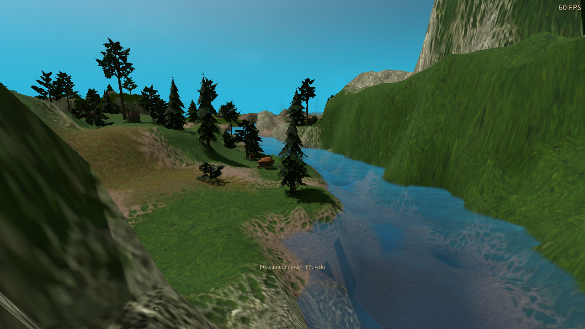
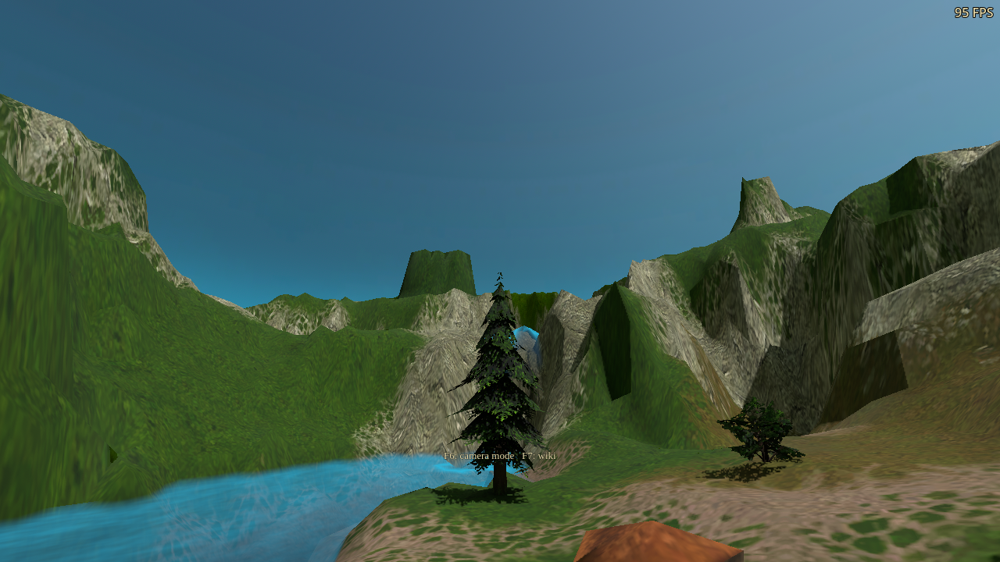
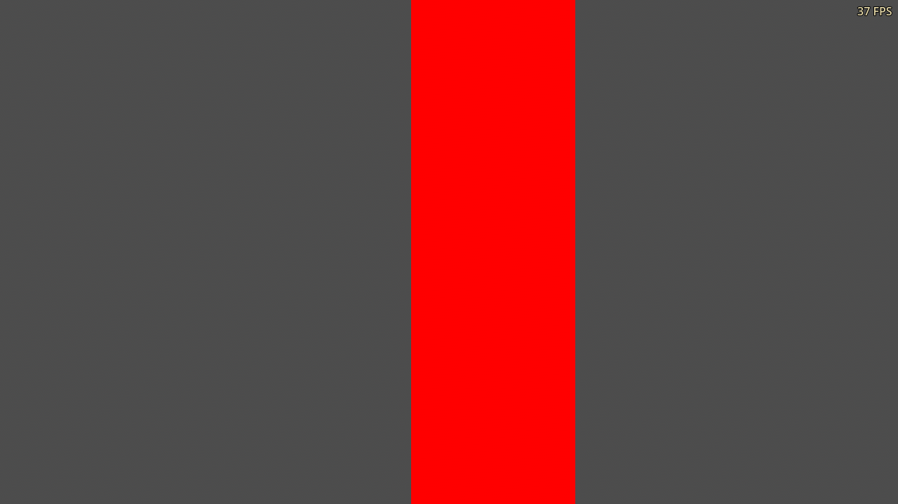
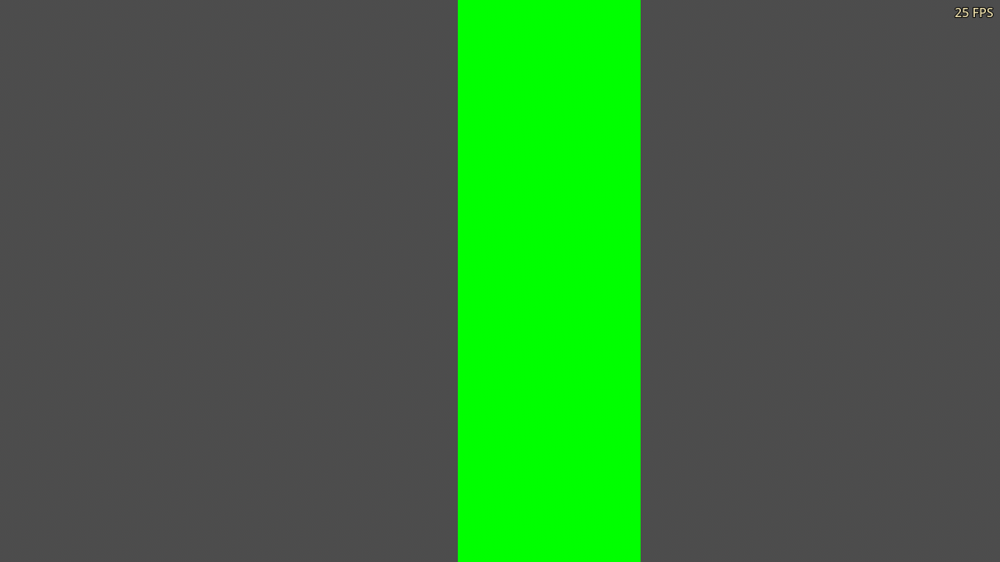

# Outdoor PT surface depth and leaf transport

Unreleased follow-up to `9e9d034c`. This pass improves the material response
and corrects receiver matching on visible back faces. The sky palette and
sunlight exposure retain the previous daylight pass's values.

## Changes

- Raster normals now face the same geometric side as the path-traced hit before
  guide validation. Visible back faces previously failed this comparison and
  fell back to conventional illumination. The depth/plane checks still reject
  unrelated foreground and background surfaces.
- Terrain uses stronger bounded relief with mip-dependent sample spacing,
  retaining broad ridges over 25–65 m. Object relief keeps its previous range.
  Both smoothly limit perturbation near the viewing/geometric hemispheres.
- The existing Leaf backlighting setting controls thin diffuse transmission in
  PT. Authored foliage masks distinguish leaves from solid bark; up to 40% of
  diffuse energy moves to the opposite hemisphere, reducing the reflected
  share accordingly. Sun, local lights, emission and continuation rays share
  that response. Surface materials also enables the existing bark relief mask.

No new menu option or player-visible text is introduced. For the enhanced
surface response, use Terrain detail = Detailed or Natural transitions,
Surface materials = On, and Leaf backlighting = On. Geometry, navigation,
texture artwork and the existing quality/sample settings are unchanged.

The leaf response is a thin diffuse model, not volumetric subsurface scattering.
The terrain still uses texture-derived relief rather than authored normal maps
or the raster shader's complete procedural material model. Original low-poly
silhouettes and stretched atlas artwork remain visible. See the
[implementation notes](../../integrations/path-tracing-experiment.md).

## Matched captures

Both packages use the same DX12 executable, 1280×720 camera views, Medium PT,
four bounces, still-scene accumulation and at least 110 settled frames. Terrain
detail, surface materials and leaf backlighting are enabled in both. Water
reflections are disabled to isolate world lighting. The images are unmodified;
their FPS counters are not controlled performance measurements.

| Previous | Updated |
|---|---|
|  |  |
|  |  |

[Evening before](depth-baseline-dx12-outdoor/grove-evening.png) /
[after](depth-v3-dx12-path_trace_outdoor/grove-evening.png);
[night before](depth-baseline-dx12-outdoor/grove-night.png) /
[after](depth-v3-dx12-path_trace_outdoor/grove-night.png).

The strongest differences are in local terrain relief and back-facing foliage.
Large uniformly lit rock faces still depend on the original mesh and artwork.

## Numerical and rendered validation

The previous package fails all six new back-face receiver cases. The updated
receiver passes all twelve cases across Low, Medium and High, including a
nearby depth discontinuity that must reject another surface. Each updated case
classifies 100% of the measured pixels correctly.

| Previous back face: fallback | Updated back face: traced light |
|---|---|
|  |  |

The white-leaf fixture measures about 0.400 transmitted and 0.600 reflected
under opposite direct lights; its solid-bark half stays opaque. A uniform
white environment gives 0.989 on the leaf and 0.989 on the opaque control.
A red emitter behind the leaf contributes about 0.790, with zero leakage
through bark. An opaque blocker removes transmitted sunlight. The tests also
exercise the disabled setting and the emissive MIS pipeline.

An early implementation failed the energy checks because rejected below-surface
GGX reflection samples were being accepted as transmission. The corrected
sampler rejects those samples explicitly. The failed diagnostic is retained
separately from the final passing runs.

The campaign fixture checks noon, evening and night, stable accumulation,
authored mask collection, a leaf-only option change and conventional-lighting
restoration. The river snapshot uses five additional 512×512 mipmapped RGBA8
mask layers, about 6.67 MiB. The frame remains 704 bytes and the ray payload
96 bytes; no screen-sized image, extra ray per sample or larger sample budget
is added. Transmitted paths can visit more geometry within the existing bounce
limit; the measured cost is below.

The production PT + water RT + FSR frame-generation fixture passes all 62
functional checks with terrain detail, surface materials and leaf backlighting
enabled, but subsequently hits the Wine shutdown fault described below.
Its first 90-frame measurement produces 90 generated frames and 180 presented
frames, with the HUD showing separate measured rates. Disabling FG, switching
water between mirror/RT, resizing, pausing and resuming all preserve PT and the
expected presentation counts. A separate water-only FG run also passes.
[PT and frame-generation capture](depth-final-dx12-path-fsr/rt-and-fg.png).

## Matched GPU cost

Both packages use the same frozen river view at 1280×720 with terrain detail,
surface materials and leaf backlighting enabled. Water reflections and frame
generation are off. Each package runs two sweeps in opposite quality/bounce
orders, with 90 measured frames per case. Values below are the average of the
two per-sweep medians. Raw sweep values are in [summary.json](summary.json).

| Bounces / quality | Previous RT pass | Updated RT pass | Difference |
|---|---:|---:|---:|
| 2 / Low | 0.534 ms | 0.561 ms | +0.027 ms |
| 2 / Medium | 2.848 ms | 3.078 ms | +0.230 ms |
| 2 / High | 10.708 ms | 11.819 ms | +1.111 ms |
| 4 / Low | 0.689 ms | 0.727 ms | +0.038 ms |
| 4 / Medium | 3.585 ms | 3.909 ms | +0.323 ms |
| 4 / High | 12.828 ms | 14.979 ms | +2.151 ms |

These timestamps cover tracing, reconstruction and copies, excluding
acceleration-structure updates and the main raster frame. They are not whole-game
FPS estimates. The additional cost is about 8–9% for Medium and 10–17% for High
in this view; other scenes and native Windows may differ.

## Qualification scope

Sixteen final runs complete without matched script, shader, validation or crash
diagnostics, covering 834 assertions. This includes all 144 material variants,
contacts, glossy/emissive lighting, the cave scene and the new fixtures on both
DX12 and Vulkan. [summary.json](summary.json) lists each run; [build.json](build.json)
records source, fixture and package hashes. Two other final-source runs pass
their rendering assertions but have shutdown faults, and are retained separately
as diagnostics rather than counted among those sixteen.

DX12 tests run through Wine/VKD3D on the RTX 3090. Native Windows is not qualified
by these runs. Vulkan uses the existing qualified Linux engine. Validation
layers are not enabled. All test profiles are isolated, with a free cursor,
FPS visible and SFX/stream/voice audio muted.

The earlier daylight report's intermittent Vulkan/Wine shutdown faults remain
unresolved. The first DX12 quality run passed all 13 rendering assertions and
reported a clean exit, followed by a Wine page fault. One repeat completed
without that fault. The PT + FG run similarly faulted after its 62 functional
assertions and clean-exit marker. The launcher returned zero and its basic
error matcher missed these faults; the independent log scan excluded both
faulting runs from qualification. Their diagnostics are retained in
`depth-final-dx12-path_trace_quality/diagnostics.txt` and
`depth-final-dx12-path-fsr/diagnostics.txt`. This pass does not claim to fix
engine shutdown.

Both Windows packages use the same EXE hash as the previous daylight pass,
including its verified six-size dragon icon. Published tags and artifacts
are unchanged.
