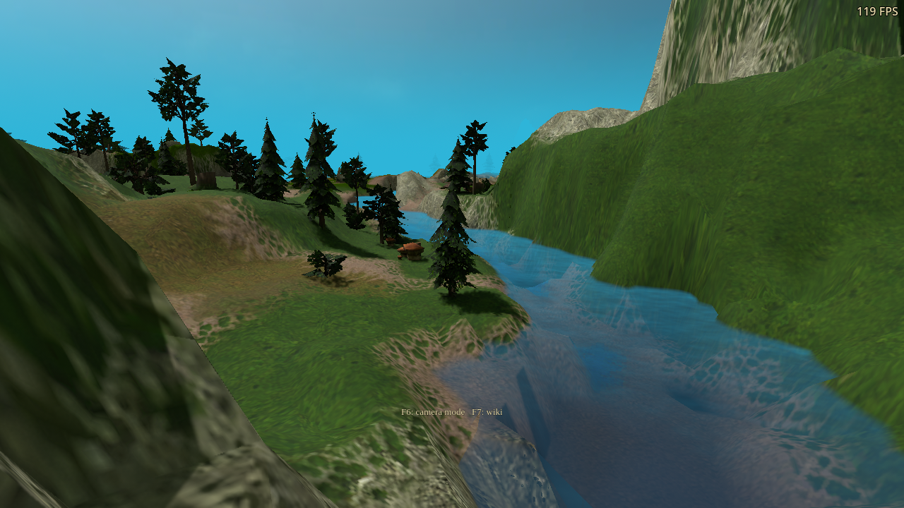
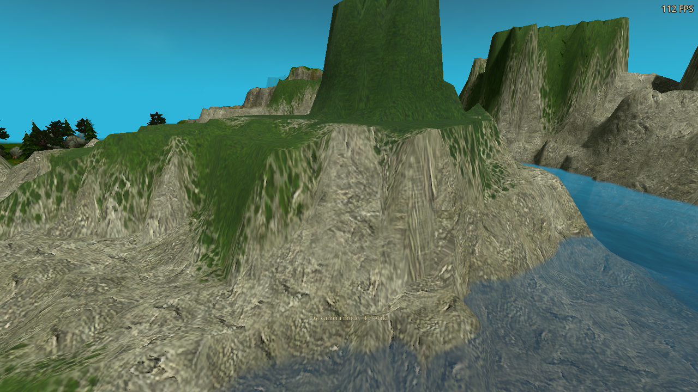

# Path tracing: scene updates and deep-bounce cost

Unreleased follow-up to `5a066d20`. Native scene tracking reduces CPU cost in
both RT lighting and PT. Four-bounce PT terminates some weak continuation paths
with compensated Russian roulette. Terrain materials, primary rays, sample
counts, resolution presets, reconstruction and water reflections retain their
existing behavior.

## Implementation

- Extend `WaterRaytraceKernel` with lighting-specific camera, indirect and shadow
  masks. It checks transforms, visibility, invisible units, replacement meshes
  and freed objects every frame. Baked terrain keeps its original transform.
  Windows x86-64 and Linux x86-64 libraries are rebuilt. Older libraries and
  `--ei-script-water-rt` retain the existing GDScript implementation.
- Keep the first two continuation bounces free of roulette. At deeper bounces,
  select survival from the maximum throughput of both demodulated signals and
  divide surviving weights by that probability. The minimum is 25%, increased
  up to 75% for smooth metallic receivers to limit glossy noise. This is the
  usual compensated [Russian-roulette estimator](https://pbr-book.org/4ed/Light_Transport_I_Surface_Reflection/A_Better_Path_Tracer).
- Cache separate emitter/non-emitter and short/deep ray-generation pipelines.
  The original two-bounce DXIL and SPIR-V files are **byte-identical** to the
  baseline. Mode changes retain acceleration structures and output textures,
  rebind descriptors and reset incompatible lighting history.
- Add diagnostic phase timestamps behind `--ei-profile-rt`; ordinary frames
  retain the existing whole-pass bracket. `--ei-full-paths` selects the original
  full-path reference shader for controlled comparisons. These are development
  switches, with no new player-facing options or text.

## Controlled GPU comparison

RTX 3090, 1280×720 output, DX12 Windows export through Wine/VKD3D. The frozen
river uses detailed terrain, materials, cliff projections and foliage lighting.
Water reflections and frame generation are disabled during timing.

`path_trace_tail_performance.gd` alternates full paths and optimized paths in the
**same process and scene**, preserving the same native CPU tracker, buffers,
acceleration structures, four-bounce maximum and samples. Four rounds reverse
order, with 40 warmup and 120 measured frames per case. The table is the median
of the four round medians. Every round shows a GPU reduction at both settings.

| Four-bounce quality | Full paths, GPU ms | Optimized, GPU ms | Reduction |
|---|---:|---:|---:|
| Medium: 960×540, 2 samples | 6.555 | 5.499 | 16.1% |
| High: 1280×720, 4 samples | 23.187 | 20.416 | 11.9% |

These are PT pass times, including tracing, reconstruction and copies, not
whole-game FPS. Whole-frame medians in this same-session comparison change from
8.882 to 8.213 ms at Medium and 25.247 to 22.578 ms at High. Both sides already
use native scene tracking, so that comparison isolates the GPU optimization.
[Alternating measurements](performance-alternating.json).

## CPU and whole-package comparison

A separate matched before/after sweep has 1,420 instances and 116,008 triangles.
Four-bounce Medium scene-controller CPU time falls from **1.779 to 0.625 ms**
(64.9%); High falls from 1.986 to 0.723 ms (63.6%). RT lighting and two-bounce PT
also use the native tracker. No node/visibility checks are throttled or omitted.

| Case | Before CPU ms | After CPU ms | Before whole frame ms | After whole frame ms |
|---|---:|---:|---:|---:|
| RT lighting / Medium | 1.805 | 0.534 | 7.690 | 6.435 |
| Two bounces / Low | 1.761 | 0.540 | 7.538 | 6.167 |
| Two bounces / Medium | 1.848 | 0.582 | 8.131 | 7.537 |
| Two bounces / High | 1.955 | 0.705 | 19.880 | 21.227 |
| Four bounces / Low | 1.720 | 0.643 | 7.461 | 6.913 |
| Four bounces / Medium | 1.779 | 0.625 | 9.086 | 8.537 |
| Four bounces / High | 1.986 | 0.723 | 24.607 | 23.982 |

Cross-process GPU/whole-frame timing varies with desktop contention. For
example, two-bounce High increases despite using identical shader binaries;
the conventional-renderer control also changes from 5.156 to 5.550 ms. Therefore
these separate runs do not establish a universal FPS gain. The alternating
same-session measurement above is the stronger GPU comparison.
[Before](performance-before.json), [after](performance-after.json),
[aggregated measurements](metrics.json).

The earlier, simpler terrain version `fddeff26` measures 3.739 ms for four-bounce
Medium and 14.423 ms for High in a separate control run. Detailed terrain still
has a substantial cost; this change does not restore the earlier material
budget. [Earlier-material control](performance-pre-material.json).

## Energy, noise and images

The raw estimator fixture compares 256 samples per pixel against the original
package in closed diffuse and metallic rooms, with emissive and point lighting.
Both raw diffuse and glossy channels stay within **0.08%** of the reference
mean; two-bounce DX12 results are identical. Fixed first, middle, last, sparse,
all-seven and disabled point-light cases preserve additive illumination.
[Reference](estimator-reference.json), [DX12](estimator-dx12.json),
[Vulkan](estimator-vulkan.json).

Roulette increases raw variance: in the gray diffuse room it is about 1.63× the
reference diffuse variance; polished-metal glossy variance is about 1.56×.
The initial 25%-only metal candidate was about 3.69× and was replaced by the
more conservative metallic survival floor. This is a real noise/performance
tradeoff, not a zero-cost removal of light. Sampling compensation preserves the
mean rather than truncating dim contributions.

Campaign image comparisons use **responsive** accumulation, with the same
cameras and noon/evening/night settings. Normal/depth and albedo/material guides
are identical. Across five views, mean display RGB error is at most 0.000840 on
a 0–1 scale; 95th-percentile error is at most one 8-bit step. Isolated pixels can
differ more because deep paths remain stochastic. FPS overlays are excluded
from image errors; image/buffer readbacks can stall rendering, so screenshot
FPS is not a benchmark. [Image metrics](image-comparison.json).

| Before | After |
|---|---|
|  |  |
|  |  |

## Validation and limits

786 behavior assertions pass, plus 33 alternating-benchmark guards:

- 271 native/script parity checks on each desktop platform, including camera
  and shadow layers, hidden/revealed/invisible units, baked terrain, replaced
  meshes and freed roots/parts.
- 61 estimator and cached-pipeline checks on each rendering backend, including
  emitter and non-emitter scenes and 2→4→2 bounce changes.
- 18 campaign checks on each backend, covering cliff/terrain option rebuilds,
  natural transitions, daytime changes, accumulation and disabling PT.
- 10 moving-emitter and 14 camera/history/quality-switch checks in DX12.
- 62 DX12 frame-generation checks with four-bounce PT and water RT, including
  generated/presented counters, the FPS HUD, mirror/RT switching, resize,
  pause and resume. [Frame-generation results](frame-generation.json) and
  [FPS overlay capture](frame-generation.png).

All 18 shader outputs reproduce, all nine SPIR-V stages validate, and existing
water/scene shader manifests verify. EN/RU/DE translation coverage reports zero
errors. The Windows EXE is a real export from the qualified template; all six
exported icon sizes match the approved dragon artwork. The exporter's supported
sizes omit the source ICO's additional 24-pixel entry.

The native Windows-helper, camera-history, baseline timing and alternating
benchmark runs finish their assertions/measurements and then emit the same
existing Wine shutdown page fault seen in the previous validation. They are
**not clean process passes**, even though the harness returns exit code zero.
The GPU estimator, campaign material and frame-generation runs are clean.
[Per-run diagnostics and hashes](summary.json) retain this distinction. Native
Windows timing and other GPU vendors remain unmeasured. Vulkan runs natively on
NVIDIA driver 580.178.04. All game sessions use isolated profiles, a free cursor,
visible FPS and muted audio.

Rejected split-hit and light-loop experiments, the superseded shared raygen,
and exploratory fixture/environment failures are recorded in
[experiments.json](experiments.json). This is an unpublished local preview.
