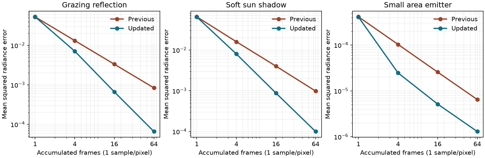

# Path-tracing sample-distribution validation — 2026-10-22

Unreleased follow-up to `4e07cfe5`. The integrator now uses shuffled,
Owen-scrambled Sobol samples for soft-light visibility, BSDF decisions and
emissive-light sampling. Separate fixed purpose slots keep unrelated decisions
independent. Quality resolutions, ray budgets, bounce limits, reconstruction
and lighting-image allocations are unchanged.

Comparisons use the same RTX 3090 and saved Windows/Linux exports of
`4e07cfe5`. DX12 runs use Wine/VKD3D; the native Vulkan sampling and glossy
fixtures run with validation layers. Native Windows and other GPU vendors
still require qualification. See the
[integration document](../../integrations/path-tracing-experiment.md) for the
implementation and remaining renderer limitations.

## Raw lighting convergence

The new fixture reads the actual native integrator outputs before reconstruction.
It averages these raw images on the CPU, so spatial blur and denoiser changes
cannot improve its scores. Each image is 256×144 pixels. The fixture records
one, four, sixteen and sixty-four frames at one, two and four samples per pixel,
using independent references:

- A roughness-0.35 metal at a grazing view, lit by a constant environment.
  Midpoint hemisphere integration supplies expected radiance **0.868462**.
- A vertical disk sun with a half-plane blocker. Disk cross-sections are
  integrated analytically, followed by midpoint quadrature of the visible
  portion for each image column. The expected image mean is **0.492424**.
- A small rectangular emitter over a tiny orthographic receiver. Independent
  area quadrature supplies expected radiance **0.679315**. The tiny view keeps
  receiver-position variation negligible relative to the sampling errors.

The table measures mean squared radiance error (MSE) against those references.
It includes bias as well as variance. Percentages compare the same sample
budget; they are not whole-game visual-quality or FPS percentages.

| Fixture | Previous MSE, 16 frames × 1 sample | Updated MSE | Reduction | Reduction in one frame × 4 samples |
| --- | ---: | ---: | ---: | ---: |
| Grazing reflection | 0.00332522 | 0.00066426 | 80.0% | 46.3% |
| Soft sun shadow | 0.00400810 | 0.00087693 | 78.1% | 50.3% |
| Small emitter | 0.000025710 | 0.000005154 | 80.0% | 75.8% |

At sixty-four frames and one sample per pixel, MSE reductions are 92.1%,
89.8% and 80.0% respectively. Their updated means differ from the references
by −0.012%, −0.040% and −0.036%. A single one-sample frame is largely unchanged:
its MSE changes by +0.5%, −1.0% and −0.9%. Most of the Low-quality benefit
therefore appears as samples accumulate. Medium/High also benefit inside each
frame, with the same two/four samples as before.

A grazing-reflection sequence starting at frame 137 retains a 63.8% MSE
reduction after sixteen frames. This tests a nonzero, unaligned start rather
than only the first power-of-two block. Identical indices reproduce identical
native outputs, the frame-counter limit and wrap remain finite, and an added
zero-energy lamp leaves BSDF samples unchanged in the final build. The check
permits a small half-float rounding tolerance rather than requiring unrelated arithmetic
to be bit-identical. Horizontal and vertical neighbour-error correlations stay
below 0.02 in magnitude at the end of all three fixture families. This is a
limited check for structured errors, not proof of a blue-noise spectrum.

Native Vulkan MSE agrees with DX12 within 1% for every recorded sample budget.
Raw metrics: [previous](sampling-reference-dx12/path-sampling.json),
[updated DX12](sampling-shuffled-dx12/path-sampling.json),
[updated Vulkan](sampling-qualified-vulkan/path-sampling.json).
Sixteen-frame shadow images: [previous](sampling-reference-dx12/shadow-1-spp-16.png),
[updated](sampling-shuffled-dx12/shadow-1-spp-16.png).

An initial candidate scrambled output coordinates without shuffling each
purpose's sample index. It improved the metal and sun fixtures but stalled
on emitter convergence. The new fixture rejected that candidate. The final
implementation independently shuffles indices and scrambles coordinates,
following [Burley's progressive sampling construction](https://jcgt.org/published/0009/04/01/).
The fast Owen permutation is adapted from pbrt-v4 under Apache-2.0; source
attribution and the license are included in all export presets and checked in
both exported native sampling runs.

## Reconstruction and movement

The existing native responsive fixture runs thirty-two stationary frames at
one sample per pixel with eight-frame history. Its filtered variance decreases
from **0.00134104 to 0.00067514**, a **49.7% reduction**. Mean brightness error
remains about **−0.29%** in both builds. The deterministic moving-highlight
fixture has exactly the same DX12 error as before: **21.67%** at roughness 0.12
and **16.75%** at roughness 0.35. The reconstruction shader is byte-identical.

This demonstrates less stationary noise without increasing blur or changing
the existing deterministic-motion result. It does not establish equivalent
gains during arbitrary camera/object motion, disocclusion or changing lighting.
The sampler uses pixel coordinates; surface motion still relies on the existing
history rejection, without object or reflected-hit motion vectors.

Glossy data: [previous](variance-qualified-dx12-glossy/path-glossy.json),
[updated DX12](sampling-qualified-dx12-glossy/path-glossy.json),
[updated Vulkan](sampling-qualified-vulkan-glossy/path-glossy.json).
Filtered captures: [previous](variance-qualified-dx12-glossy/stationary-noise-filtered.png),
[updated](sampling-qualified-dx12-glossy/stationary-noise-filtered.png).

## GPU and resource cost

The frozen river benchmark uses a 1280×720 window, hidden units, water
reflections and frame generation off, responsive accumulation and no eligible
emissive triangles. Two rounds run in opposite orders, with ninety measured
frames per case after warm-up. Values are ranges of median GPU times for
rays, reconstruction and copies. Scene builds, acceleration-structure updates
and the main raster viewport are excluded.

| Mode | Previous RT pass, ms | Updated RT pass, ms |
| --- | ---: | ---: |
| 2 bounces, Low | 0.499–0.507 | 0.518–0.518 |
| 2 bounces, Medium | 2.425–2.470 | 2.600–2.624 |
| 2 bounces, High | 10.127–10.367 | 9.840–11.301 |
| 4 bounces, Low | 0.642–0.645 | 0.661–0.666 |
| 4 bounces, Medium | 3.204–3.609 | 3.307–3.444 |
| 4 bounces, High | 12.260–13.613 | 11.867–12.279 |

Low costs about 0.01–0.02 ms more, and two-bounce Medium costs about
0.13–0.20 ms more in these rounds. Larger modes have substantial variation
or overlapping ranges. This change improves quality per ray; the measurements
do not show a consistent speedup or establish a whole-frame FPS gain.
Timing distributions: [previous](sampling-baseline-performance/path-performance.json),
[updated](sampling-shuffled-performance/path-performance.json).

The sampler adds integer arithmetic but no lookup table, screen-sized image
or additional ray type. Lighting/guide/variance images remain **104 bytes per
tracing pixel**, about **91.4 MiB at 720p High** and **822.7 MiB at 4K High**,
excluding scene textures, acceleration structures, pipeline storage and water.
Ray-generation binary size grows; hit/miss stages are unchanged.

## Integration and diagnostics

The final build passes **419 assertions across fourteen recorded runs**.
Coverage includes sampling and glossy reconstruction on both APIs, grazing
BRDF energy, emissive light transport and MIS, multi-bounce paths, cutout alpha,
variance history, receiver coverage, campaign outdoor/cave rendering, quality
resizing, mode switching and production frame generation. Campaign captures:
[river](sampling-qualified-dx12-path_trace_live/river-path-4-still.png),
[cave](sampling-qualified-dx12-path_trace_cave/cave-path-4-still.png).

Frame-generation measurements and both rendered/presented FPS counters are in
[results](sampling-qualified-dx12-fsr/rt-fsr.json),
[HUD](sampling-qualified-dx12-fsr/rt-and-fg.png) and
[resized HUD](sampling-qualified-dx12-fsr/rt-and-fg-resized.png).
The fixture keeps path lighting active alongside water RT while testing
toggles, resize, pause and resume. Its first interval generated ninety frames
and observed 179 presents; the HUD showed **95 FPS rendered / 189 FPS
presented**. After resizing it showed **87 / 174 FPS**. These are observations
from the integration run, not promised rates or a before/after performance claim.

All runs use isolated profiles, a free cursor, visible FPS and muted audio.
No player-facing controls or text changed. Translation checks pass all 3,042
remake entries and dynamic-key coverage. All ten path-tracing binaries
reproduce with DXC 1.9.2609.5. Source hashes match the exported runtime;
Windows uses the qualified custom template with the approved icon and retains
the icon-qualified executable hash. [build.json](build.json) records source,
shader, export-preset and package hashes. [summary.json](summary.json) records
fixture hashes, counts, numerical comparisons and per-run diagnostics.

The two native Vulkan fixtures have no validation errors. No updated run has
shader/script errors or failed assertions. The previously recorded Wine
shutdown fault recurred after the application's clean-exit message in the
updated grazing-quality run and saved baseline sampling run: a read of
`0000000241BB6030` at `00006FFFFFC81448`. The other thirteen updated runs,
including frame generation, did not record that fault. Per-run diagnostics
retain this separately from assertion and shader failures. Passing assertions
and a zero runner exit code do not establish clean native-Windows qualification.

The new fixture uses the existing `--tool` interface. Use
`--sampling-baseline` against the saved `4e07cfe5` package to record comparable
raw results while skipping new-only packaging and purpose/correlation checks.
This remains bounded path-traced lighting with raster primary visibility and
separate water rendering. No release was published.
