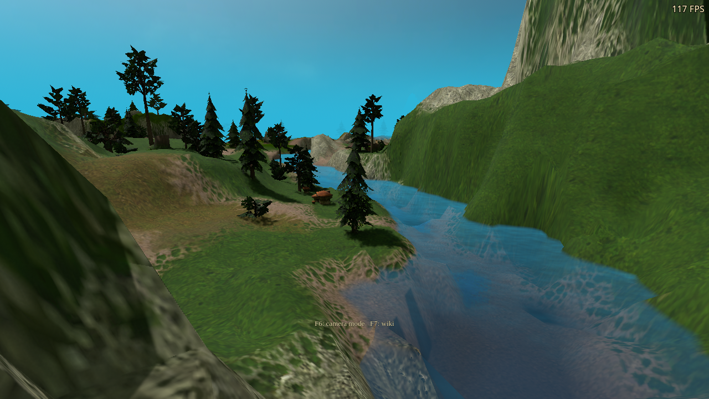
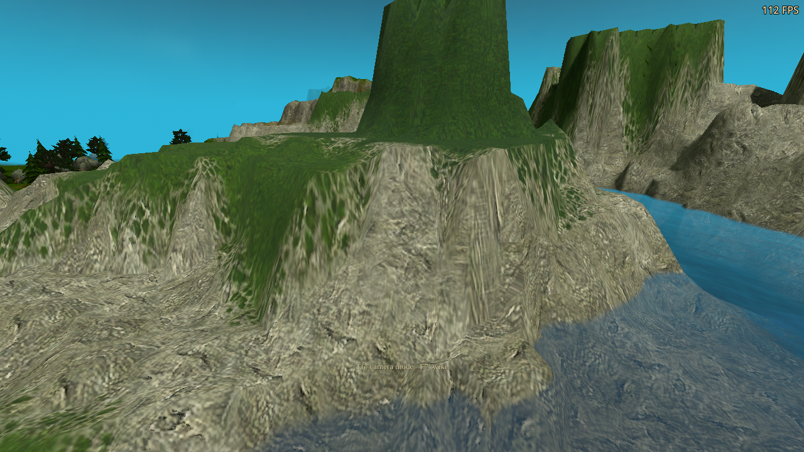

# Path-traced shading and reconstruction optimization — 2026-10-22

Baseline: `1b2c241e` (the preceding scene-update/deep-bounce optimization). Local development build; no release version or published artifact was changed.

## Changes

- Reuse the existing world-space UV density for detailed terrain. Quarter turns preserve vector length. Power-of-two terrain grids use exact bit addressing; other widths retain integer division.
- Replace fourth-power normal weights with multiplication, reuse the linear relief footprint instead of a log/exp round trip, and skip emission conversion when emission is zero.
- Share a 12×12 input neighborhood within each 8×8 reconstruction workgroup. The 25-tap spatial filter, rejection thresholds, temporal accumulation, and variance handling remain the same. All lanes reach the barrier, including partial edge groups. Progressive accumulation bypasses the spatial cache.
- Fully path-traced raster receivers skip conventional light calculations whose result would be discarded. PT receivers also skip an unused material-guide fetch. The radius fade, ordinary RT, and rejected/distant receivers retain their existing lighting.

Resolution, sample counts, bounce limits, ray sampling, and Russian roulette policy are unchanged. All 12 raygen/miss/any-hit binaries match the baseline byte for byte. Hit-shader arithmetic can differ slightly through floating-point reassociation.

## Measured performance

RTX 3090, 1280×720 window, Windows DX12 export through Wine/VKD3D. Medium traces at 960×540 with 2 samples; High at 1280×720 with 4 samples. The frozen river view has 116,008 triangles and 1,420 instances. Units are hidden; water reflections, frame generation, wind, grass, and most optional effects are disabled for timing. Detailed terrain, materials, cliffs, and foliage lighting are enabled. These are controlled scene measurements, not a representative gameplay average.

The strongest comparison alternates the exact saved and current hit/filter programs in the **same process**, sharing the native controller, acceleration structures, images, raygen, and raster renderer. Four rounds reverse the case order; each case has 40 warmup and 120 measured frames. The reference filter SPIR-V is extracted from the preserved baseline PCK and checked against its resource MD5. Both filters therefore use the exporter’s SPIR-V 1.4 target.

| Mode | PT GPU before → after | GPU time saved | Whole frame before → after |
|---|---:|---:|---:|
| 2 bounces, Medium | 5.082 → 4.818 ms | 5.2% | 7.471 → 7.435 ms |
| 2 bounces, High | 20.167 → 18.850 ms | 6.5% | 22.248 → 20.950 ms |
| 4 bounces, Medium | 5.775 → 5.479 ms | 5.1% | 8.318 → 8.075 ms |
| 4 bounces, High | 21.561 → 20.972 ms | 2.7% | 23.645 → 23.223 ms |

GPU timings include tracing, reconstruction, and history copies. Whole-frame timings include other CPU/GPU/presentation work. A cheaper PT pass does not imply an equal FPS gain. The separate-package sweep was mixed, including slower four-bounce whole-frame medians; those measurements and conventional-rendering controls are retained in `performance-before.json` and `performance-after.json`, not discarded.

Isolated hit-shader comparisons saved 1.0–4.9% of PT GPU time across the four tested cases. Reconstruction-only results:

| Quality | Reconstruction before → after | Saved |
|---|---:|---:|
| Medium | 0.239 → 0.185 ms | 22.7% |
| High | 0.417 → 0.314 ms | 24.8% |

The copy pass and other timing regions can absorb synchronization costs; pass medians should not be summed as if they were independently additive. Screenshot FPS values are incidental and are not used for the benchmark. These results do not establish native Windows performance or restore the cost of the earlier, simpler terrain materials.

## Image and behavior validation

Five matched DX12 campaign views cover river, cliffs at noon/evening/night, and natural terrain transitions. Responsive eight-frame history is used for both packages. The normal/depth, material, raw radiance, filtered radiance, and final images are compared. Native Vulkan also runs the campaign with progressive accumulation.

Across the five display comparisons, mean absolute RGB error is at most 0.000524 on a 0–1 scale. The 95th-percentile error is zero in four views and 1/255 in the transition view. Maximum normal-channel difference is 0.00110 and maximum albedo difference is 0.000977; depth and packed material fields are checked in the attached data. Isolated stochastic pixels differ by more (up to 0.349), so these are not bit-identical pictures.

427 behavior assertions passed, plus 187 benchmark guards and 18 baseline campaign checks:

- 69 terrain assertions per backend: independent raster-material comparison, atlas rotations and mips, pair/junction transitions, cliff relief, normal fields, and 16/17/256-wide terrain-grid addressing.
- 15 receiver assertions per backend: saved/current raster pixels agree through full PT, radius fading, out-of-range and depth-rejected fallback, ordinary RT, and disabled RT. Distinct controls ensure the test actually exercises lighting.
- 38 variance and 31 glossy assertions per backend, plus 13 DX12 quality assertions: HDR/rare events, coherent shadow changes, guide rejection, history resets, grazing reflection energy, slope reprojection, and partial compute workgroups.
- 18 current campaign assertions per backend, 10 DX12 emitter assertions, and 62 DX12 frame-generation assertions. The FG run exercises actual generated/presented counts, the extra FPS line, water RT/mirror switching, resize, and pause/resume with four-bounce PT.

DX12 variance/glossy/quality tests used the final hit/filter shaders while a separate compute-copy experiment was present. That copy experiment was reverted. Final campaign, performance, native Vulkan, and FG runs use the original history-copy path.

## Build and runtime qualification

- Reproduced all 18 DXIL/SPIR-V outputs; validated all 9 SPIR-V stages.
- Real Windows EXE export and Linux PCK export completed. The final EXE is byte-identical to the preceding verified export with the approved dragon icon, including all six icon sizes supported by the exporter.
- Translation validation: 3,042 entries, zero errors. No player-visible strings or options changed.
- Every game run uses an isolated profile with a free cursor, FPS enabled, and all audio muted.
- Native Vulkan driver: 580.178.04. Native Windows execution is not available in this environment.

Some DX12 assertions completed successfully and were followed by the known Wine shutdown fault (`0x241BB6030` read at `0x6fffffc81448`), also present in earlier baseline validation. Those are assertion passes, **not clean process passes**. Per-run diagnostics are retained in `summary.json`; final campaign/FG and native Vulkan outcomes are listed individually.

## Rejected experiments

A world-space transform shortcut did not add a repeatable gain. Precomputed per-triangle footprints increased buffer/build cost and did not speed up hit shading. A combined compute history-copy pass was slower than texture-copy commands. All three were reverted. Early filter timings used runtime-compiled SPIR-V 1.5 and are superseded by the exact exported-bytecode comparisons above. Invalid development runs (export overlap, unsupported shader return, synthetic injector formatting) are excluded from qualification.

`metrics.json`, the raw timing/correctness JSON files, `image-comparison.json`, `summary.json`, and `experiments.json` preserve the measurements, hashes, and limitations.

