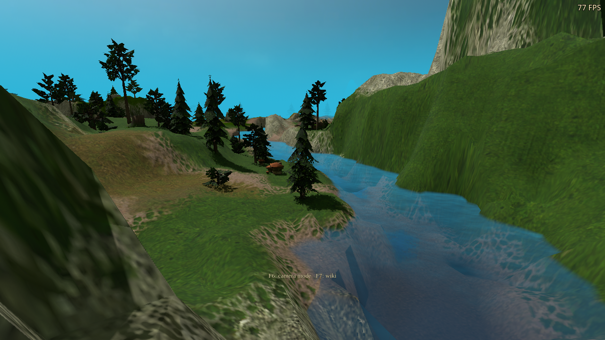
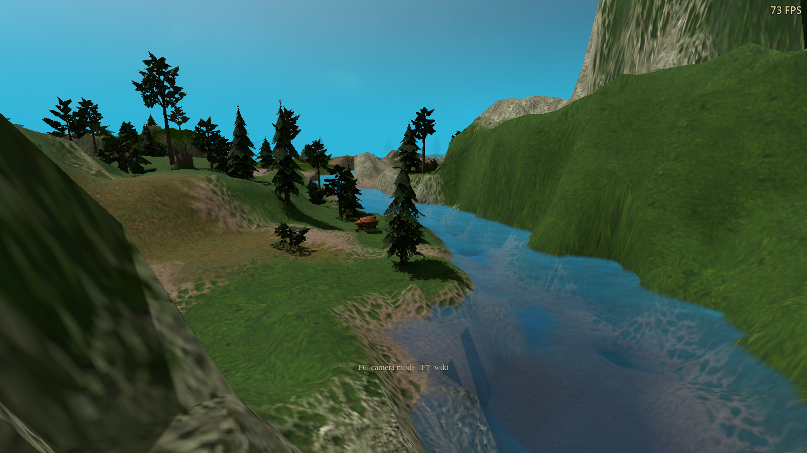
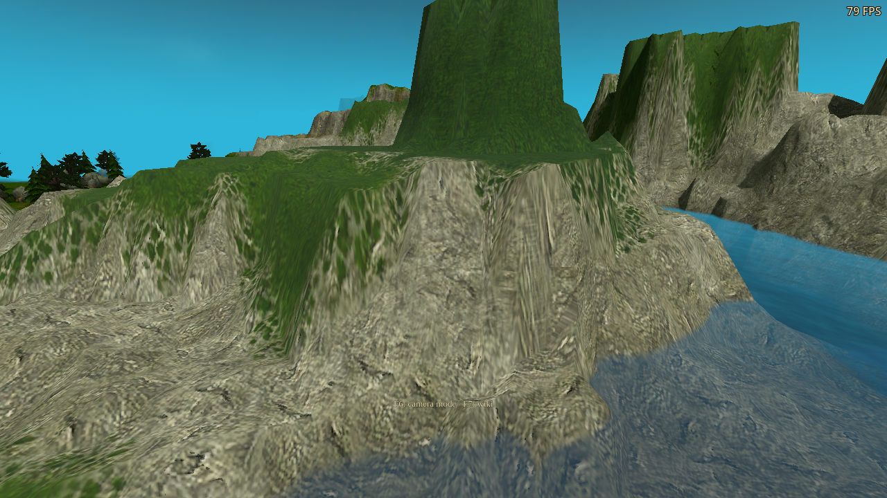

# Path-traced terrain materials

Unreleased follow-up to `fddeff26`. Detailed terrain now supplies its procedural
normal texture, semantic surface response and cliff projection to the path
integrator. Secondary lighting uses the raster terrain atlas, tile rotations,
edge blends and natural transitions. The existing terrain and cliff settings
control these inputs.

This is a local surface-detail and material-consistency improvement. The matched
campaign images show a modest change; large cliff silhouettes and stretched
legacy artwork still need geometry/art work. The increased GPU cost below is
substantial and should be considered before release.

## Implementation

- Retain the existing padded sRGB raster atlas and copy immutable tile IDs,
  traits, cliff guards and transition metadata. Exact IDs come from retained
  triangles, including maps with shifted vertices.
- Use the terrain's procedural normal texture and macro modulation. Rock,
  grass, soft ground and ice have distinct dielectric roughness when Surface
  materials is enabled. Texture brightness does not classify metalness.
- Keep compact painted relief on ordinary terrain. On eligible cliffs, apply
  relief along the vertical rock projection, with distance, footprint, tile-edge
  and hemisphere limits. This remains shading relief; it adds no geometry.
- Match the raster pair/junction transition samplers and cliff eligibility,
  neighbouring-tile and crest guards. Explicit ray-cone mip footprints are an
  approximation to raster derivatives. Raster sharpening and the complete
  raster relief calculation are not reproduced at every traced hit.
- Rebuild when terrain, cliff or material options change or asynchronous detail
  textures become ready. Retained texture ownership lasts until PT disposal.
- Original, detailed and transition closest-hit variants share the existing
  integrator, sample counts, bounce limits, 96-byte payload and image allocation.
  Unused normal projections and duplicate base-colour reads are skipped.

The river snapshot contains 56,145 terrain triangles and 649,028 metadata bytes.
Its normal and macro images add two 512×512 mipmapped RGBA8 layers (about
2.67 MiB) to the trace texture array. The larger padded colour atlas is shared
with raster rendering. No new player-visible option or translation key is added.

## Matched campaign views

Same executable, 1280×720 viewport, camera poses, noon/evening/night lighting,
Medium PT, four bounces, Still scene accumulation and at least 150 settled frames.
Terrain detail, Surface materials, Steep terrain textures and Leaf backlighting are
on in both packages. Water reflections are off for this comparison. The old
package is `fddeff26`; both full PCK hashes are in [summary.json](summary.json).
Screenshot FPS counters are incidental and are not the timing measurements.

| Previous | Updated |
|---|---|
|  |  |
|  |  |

[Evening before](baseline-live/cliff-evening.png) /
[after](d3d12-live/cliff-evening.png);
[night before](baseline-live/cliff-night.png) /
[after](d3d12-live/cliff-night.png).
[Vulkan cliff](vulkan-live/cliff-noon.png) and
[natural-transition view](d3d12-live/cliff-transitions.png).

Raw illumination, normal/material guides and reconstructed EXRs were also
captured by `path_trace_terrain_live.gd`. Still scene uses a spatial radius of
zero in `path_trace_filter.glsl`; these views therefore do not lose detail to
its gameplay spatial filter. This does not establish that moving-scene
reconstruction is perfect. Exposure, sky lighting and denoiser parameters were
not adjusted in this pass.

## GPU cost

RTX 3090, Windows export through Wine/VKD3D, frozen river and hidden units,
1280×720 viewport, responsive history, terrain/material/cliff/leaf detail on,
water reflections and frame generation off. Each value is the median of two
90-frame round medians, with opposite case order. Loading and snapshot builds
are excluded. RT GPU includes dispatch, reconstruction and copies; it excludes
AS updates and main-viewport rendering. These are pass costs, not FPS estimates.

| PT configuration | Previous RT GPU ms | Updated RT GPU ms |
|---|---:|---:|
| Two bounces / Low | 0.562 | 0.888 |
| Two bounces / Medium | 2.956 | 6.050 |
| Two bounces / High | 11.890 | 22.377 |
| Four bounces / Low | 0.737 | 1.491 |
| Four bounces / Medium | 3.631 | 8.013 |
| Four bounces / High | 14.926 | 27.779 |

The material evaluation adds work at primary and secondary hits. Removing
redundant full material evaluations and texture reads reduced the initial
prototype cost, but this final pass still costs roughly twice the baseline
in this scene. Shader variant separation did not by itself produce a measured
speedup. No broad GPU-vendor or native-Windows performance claim is made.

Full measurements: [previous](baseline-performance/path-performance.json),
[updated](d3d12-performance/path-performance.json).

## Validation and limits

The final suite records 292 passing functional assertions across DX12 and
Vulkan; three Wine shutdown faults are separated below.

The new native reference fixture compares traced colours with the actual raster
GLSL samplers compiled independently into a compute reference. It covers four
tile rotations, pair and four-family junction transitions, vertical cliffs,
shifted tile geometry, normal texture response beyond colour relief, semantic
roughness and retained-atlas disposal. Near-cliff samples also check finite,
outward unit normals and nonzero projected relief with noise normals disabled.

The measured DX12 maximum channel errors are zero for tile rotation and shifted
identity, about 0.01758 for the pair transition, 0.000122 for the junction and
0.000244 for the cliff projection. Pair transition noise uses a floating sin
hash, so different shader backends do not produce identical noise. These are
synthetic sampler checks, not a claim of pixel-identical production shading.

Campaign tests exercise all day phases, snapshot identities, cliff-only option
changes, natural transitions, disabling detail and restoring conventional
lighting. Regression runs also cover original-material daylight/relief,
leaf transport, emissive/glossy paths, cave lighting and PT with water RT and
frame generation. The DX12 frame-generation run passes 62 checks: a 90-frame measurement produces
90 generated and 180 presented frames, with the HUD showing separate measured
rendered/presented rates. Resize, pause/resume and mirror/RT switching retain PT.

The final DX12 reference, daylight and device runs pass their functional assertions but
emit a Wine page fault during shutdown after the clean-exit log. This matches
the existing shutdown-fault pattern from earlier passes; it is not counted as
a clean process run. No native-Windows stability conclusion follows from Wine.
Detailed results and process diagnostics are recorded in
[summary.json](summary.json) and the individual run folders.

An intermediate transition shader crashed inside NVIDIA's native Vulkan shader
compiler, before execution. SPIR-V validation alone did not detect this.
Replacing dynamic vector scatter and indexed score selection with fixed
component reductions resolved the failure in the final native reference runs.
The GDB trace is retained under `diagnostics/`. A diagnostic cliff test also
used a 0.03 X-normal threshold that exceeded the smooth synthetic texture's
measured response over most pixels; the final test checks a 0.01 perturbation
on more than half of the samples, plus unit length and outward orientation.
It does not assert a larger visual improvement than the rendered evidence.

One DX12 campaign diagnostic sampled the old active snapshot immediately before
an option-triggered rebuild and failed its readiness assertion; the subsequent
metadata assertion passed. The final fixture requires the current topology to
remain active for 30 frames before capture. Both the failed run and the corrected
wait's qualification runs are retained.

Qualification uses a real Windows executable export with the custom DX12
engine template, plus a native Linux Vulkan export. The EXE is byte-identical
to the previously icon-verified baseline and contains the six exact approved
icon image payloads. All 14 PT shader binaries reproduce with pinned DXC;
all SPIR-V modules pass `spirv-val`. Existing water/scene manifests also verify.
Translation coverage passes: 3,042 remake entries, 141 dynamic wiki keys and
179 dynamic arena keys, with no errors. Every run uses an isolated profile,
free cursor, visible FPS and all three audio volumes at zero.

Native Windows and AMD/Intel GPUs remain unqualified. Arbitrary object normal
maps, geometric displacement, new rock meshes and a complete physical relight
are outside this material pass. It remains an experimental PT renderer.
