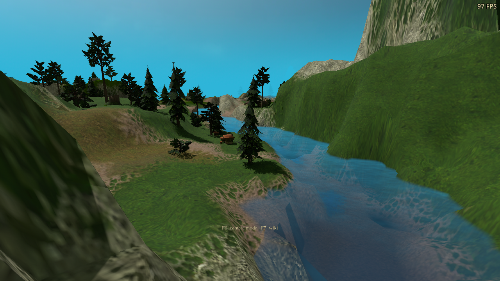
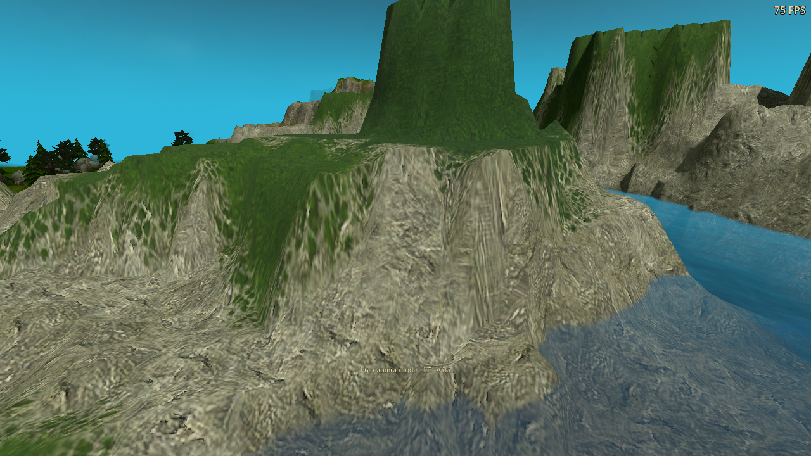

# Path-traced terrain optimization

Unreleased follow-up to `cc0b4670`. Terrain material evaluation takes less GPU
time while keeping the existing terrain detail, cliff projections, procedural
normals, transitions, ray counts, bounce counts and resolution presets.

## Implementation

- Replace variable integer division/remainder in atlas tile addressing with a
  bounded floating-point row calculation. The half-integer bias keeps the
  six-bit tile index away from division boundaries, including non-power-of-two
  atlas grids.
- Compute a texture mip once per ground/cliff projection and reuse it for its
  donor and relief samples. Ray footprints are isotropic; quarter turns and
  mirrored donors preserve their length. Padded tiles share a constant gutter
  limit. Unpadded tiles retain their per-tap edge limit.
- Check the complete cliff relief fade before fetching its four gradients.
  Fully faded, unresolved or tile-edge relief contributes zero and needs no
  texture samples.

Only the detailed and transition closest-hit binaries change. Original-material
closest-hit, ray generation, visibility, denoising and frame-generation code are
unchanged. The detailed DXIL library shrinks from 36,000 to 31,108 bytes; the
transition library from 57,004 to 48,560 bytes. Terrain metadata remains 649,028
bytes for this river scene, with the same atlas and image allocations. No new
player-visible strings or options are introduced.

## Matched performance

RTX 3090, 1280×720 output, Windows export through Wine/VKD3D. Frozen river,
hidden units, detailed terrain/materials/cliffs/leaf lighting on; water
reflections and frame generation off. Two opposite-order sweeps per package,
90 measured frames per case after warmup and a stable current material
snapshot. Each table value is the median of those two round medians.

| PT configuration | Before GPU ms | After GPU ms | Reduction |
|---|---:|---:|---:|
| Two bounces / Low | 0.899 | 0.745 | 17.1% |
| Two bounces / Medium | 6.405 | 5.036 | 21.4% |
| Two bounces / High | 24.603 | 18.810 | 23.5% |
| Four bounces / Low | 1.459 | 1.035 | 29.1% |
| Four bounces / Medium | 8.650 | 6.767 | 21.8% |
| Four bounces / High | 31.011 | 22.755 | 26.6% |

These are **PT pass costs, not total-frame FPS**. They include ray dispatch,
reconstruction and copies, and exclude acceleration-structure updates and main
viewport rendering. Measured whole-frame medians for four-bounce Medium changed
from 11.193 to 9.343 ms, and High from 33.395 to 25.177 ms. CPU load and desktop
contention affect whole-frame timing; Low does not gain FPS proportionally to
its small GPU saving. Native Windows and other GPU vendors remain unmeasured.
The material features still cost more than the earlier, simpler terrain path.

[Before measurements](before-performance/path-performance.json),
[after measurements](d3d12-performance/path-performance.json), and
[package/source hashes and checks](summary.json).

The early ablation runs had variable desktop GPU contention; their initial
12 ms result is not the final comparison baseline. The idle second GPU could
not present the DX12 window through Wine, so that attempt was terminated and
its timings rejected. A diagnostic variant that skipped small normal weights
was also rejected; full normal detail is retained. Exploratory measurements are
preserved in [experiments.json](experiments.json).

## Image comparison

The same camera poses, world times and Medium/four-bounce Still scene settings
are used before and after, with at least 150 settled frames per view. Screenshot
FPS indicators are incidental, and excluded from image error measurements.

| Before | After |
|---|---|
|  |  |
|  |  |

[Evening before](before-live/cliff-evening.png) /
[after](d3d12-live/cliff-evening.png);
[night before](before-live/cliff-night.png) /
[after](d3d12-live/cliff-night.png);
[natural transitions before](before-live/cliff-transitions.png) /
[after](d3d12-live/cliff-transitions.png).

In the river view, only ten display pixels change outside the FPS region, by
at most one 8-bit channel step. Across all five views, the largest mean display
RGB difference is 0.000174 on a 0–1 scale. Maximum normal-guide channel difference
is 0.0004883, with no depth changes. The material guide's maximum RGB difference
is 0.002930, and at most two pixels move by one packed roughness step. Floating
arithmetic and stochastic transport prevent a strict bit-identical guarantee.
[Full image metrics](image-comparison.json).

## Validation

The final runs pass 218 functional assertions: 60 material-reference checks on
each backend, 18 campaign checks on each backend, and 62 DX12 frame-generation
checks. Those five functional suites exit without matched fault diagnostics.

The reference fixture compares traced material colour against the unchanged
raster GLSL sampler. It covers tile rotations, nonzero atlas rows, a 3×3 atlas,
the last tile of an 8×8 atlas, padded/unpadded coarse mips, pair and junction
transitions, cliffs, shifted terrain identity, procedural normals, material
roughness, projected relief and atlas disposal.

Campaign checks cover noon/evening/night, cliff and terrain option changes,
natural transitions and disabling PT. Frame-generation checks exercise PT with
water RT, actual generated/presented counters, the FPS HUD, resizing, pausing and
mirror/RT switching. The shader builder reproduces all fourteen binaries;
SPIR-V validation and EN/RU/DE translation coverage checks pass.

Both before and after DX12 performance runs finish their measurements and log a
clean application exit, followed by the same existing Wine shutdown page fault.
They are not clean process passes. Their completed timing output is retained;
this optimization does not fix that shutdown issue. Per-suite diagnostics are
listed in [summary.json](summary.json). Native Vulkan tests run on NVIDIA
580.178.04. All sessions use isolated profiles with a free cursor, visible FPS
and muted audio. This is a local preview, not a published release.
