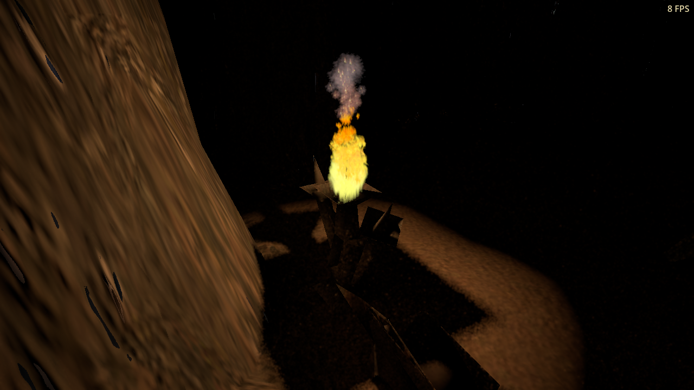

# Stable path-traced torchlight

Gentle torch and lava intensity changes can now retain a short responsive
history. Previously, a selected flickering light discarded the entire lighting
history every frame. Moving, recoloured, resized, replaced, newly lit and
extinguished sources still reset immediately. Still-scene accumulation remains
strict.

## Visible comparison

These clips use the same original brazier, camera, materials, light animation
and ray sequence in the Ingos cave `gz14k`. Only the temporal reuse policy
changes. They play the 96 captured updates at their fixed 60 Hz source rate.

| Previous strict resets | Bounded history |
| --- | --- |
| [Play strict comparison](strict.mp4) | [Play bounded comparison](bounded.mp4) |
|  |  |

GPU readbacks and PNG recording stall these runs. **The FPS overlay is not a
performance result.** The frozen flame particles keep the image comparison
repeatable; actual `LocalLighting` flame-energy flutter continues. Other local
lights and the legacy cave directional fill are disabled only for this
single-source measurement. This is a transport qualification, not a campaign
lighting art pass. A [DX12 capture](dx12-bounded.png) provides a backend check.

## Measured result

The fixture samples 4,888 illuminated geometric pixels for 96 updates per
policy. It measures linear HDR diffuse illumination before display conversion
and video encoding, normalized by the source's current energy. This separates
random fluctuation from the intended torch animation. A 192-frame progressive
image at fixed energy supplies an independent transport reference.

| Backend / source update rate | Temporal variance reduction | Brightness response gain | Effective history age |
| --- | ---: | ---: | ---: |
| vulkan-60hz | 68.6% | 89.5% | 3.00 |
| dx12-60hz | 68.5% | 89.5% | 3.00 |
| vulkan-30hz | 59.0% | 91.8% | 1.80 |
| vulkan-20hz | 46.1% | 93.2% | 1.42 |

The response gain is the normalized regression slope of measured image-mean
brightness against light energy. The retained flicker is slightly smoothed;
it is not frozen. At 60 Hz the diffuse relative RMSE falls from approximately
3.83% to 3.11%. The actual source's extinction produces zero residual diffuse
illumination on the next GPU frame in all four sequences. The GPU fixture also
checks the corresponding glossy history weights and immediate rejection.
These results do not establish the same noise reduction in every campaign view
or glossy reflection.

## Temporal policy and cost

All selected light positions, ranges, source sizes and hues must match, as must
the sun, sky and tracing region. A changed light's linear peak intensity must
remain within 10% of its previous value. Light identity changes are rejected by
the controller's existing collection key. The ordinary guide, material,
disocclusion and glossy-direction checks continue to apply.

For gentle intensity changes, the effective history-age cap is
`min(3, 1 / (1 - (2/3)^(60 * dt)))`. At 60 Hz at least one third of the estimate
is current; at 30 Hz it is five ninths. This preserves a bounded response time
under slower rendering. Older contributions decay exponentially: this is not a
literal three-frame sliding window. Stable light returns to the normal
responsive cap of eight. Still-scene mode retains its exact-change reset and
256-frame limit.

There are no new shaders, rays, bindings or buffers. The existing filter
consumes the smaller, potentially fractional age. Retaining history does
execute reprojection work that strict resets skipped, so it is not valid to
call the GPU improvement free. **Performance remains unqualified:** another
independent game benchmark was using the same GPU, and these capture sequences
perform synchronous readbacks. An uncontended end-to-end comparison remains
required, including the earlier authored-material changes.

The internal `--ei-strict-light-history` diagnostic restores the previous
reset behavior for comparisons. It does not change light animation. No
player-visible option or string was added.

## Validation and reproducibility

The final controller/GPU fixture passes 36 checks on native Vulkan and 36 on
the Windows DX12 export through Wine/VKD3D. It exercises all seven light slots,
independent intensity changes, projection/camera changes, progressive mode,
source replacement, hue/size/range changes, fractional GPU history ages and
extinction. Four original-torch sequences pass ten checks each. The existing
outdoor integration and cave regressions pass 14 and 12 checks respectively.
All eight processes exit zero; the final logs contain no script errors or
crash signatures. DX12 qualifies this backend through Wine/VKD3D, not native
Windows performance.

[Run records](runs.json) retain commands and isolated-profile settings.
[Summary and hashes](summary.json) identify code, exports, source data and media.
Every run keeps the cursor free, FPS visible and all audio volumes zero in an
isolated profile. The checked-in fixture reproduces the policy comparison;
`--pt-hz=30` and `--pt-hz=20` select slower fixed source updates, and `--pt-video`
saves every captured frame.

## What the source inventory changes about the lighting plan

The [original campaign inventory](original-light-inventory.json) finds seven
TORCH records in `gz14k` and fifteen in `gz16h`. The cave maps `gz5g`, `gz10g`
and `gz20g` have none. Scripted lights and emissive materials are outside this
inventory, so zero TORCH records does not prove that a map has no light source.
The fixture selects the existing `stto11` brazier with object identifier 4420.

This makes source placement and coverage a necessary part of authored interior
lighting. Removing the original cave fill everywhere would leave some areas
without a replacement. The next art pass needs calibrated sources and exposure,
with representative outdoor and interior views; this checkpoint does not make
those changes.
