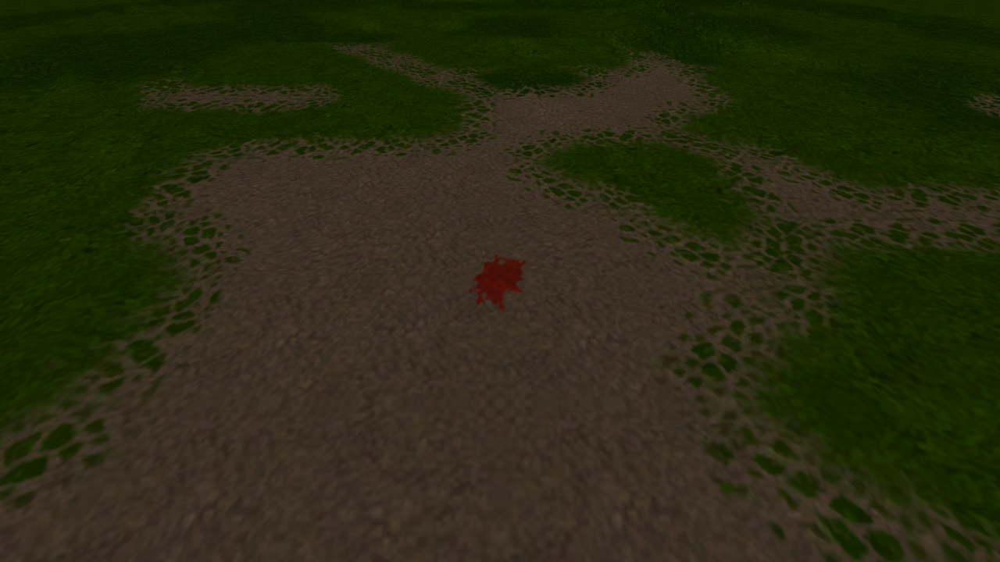

# Campaign traversal and animated ground marks — 2026-10-24

## Scope and provenance

This follow-up qualifies local, unpublished **1.28.0-experimental.2**.
Implementation commit: `528d820f38c9b1cb0dfce0da587dc1ef433674db`.
Game tree: `124309682bb038174c62fac95ab06d99865bd6ac`.
The published stable base remains 1.27.0. Neither published artifacts nor the
previous 1.28.0-experimental.1 preview were replaced.

The earlier NRD qualification measured independent camera routes and a player
loop near the starting ruins. Those routes did **not** reproduce the supplied
recording's downhill combat traversal. They establish the source-cache and NRD
results documented there, but do not establish that the sustained gameplay
collapse was fixed. A subsequent real player traversal reproduced it in both
1.27.0 and 1.28.0-experimental.1.

The supplied 1.27.0 recording and report were treated as evidence. The new
fixture starts the ordinary campaign with a separate simulation process,
walks the player through the ruins and downhill path, fights and loots the
wolf, two boars and two toads, reaches the beach, pauses, resumes and looks
back uphill. It uses normal movement and combat commands; the hero can take
damage and leaves wounds, blood and footprints. The final fixture requests
the known healing spell between fights when needed. It uses no teleportation
or invulnerability. AI can engage the later toads during the beach hold, so a
later explicit attack stage can finish immediately with an already dead enemy.

This is a route reconstructed from the recording's landmarks and authored
encounters, not a replay of the exact keyboard, mouse, random combat outcomes
or save. The fixed first-person and tactical camera directions make the test
repeatable; camera input itself is disabled. HUD, presentation effects, rain,
NPC simulation and the separate host remain active. The minimap artwork in the
local original-data installation differs from the recording's artwork.

Settings: 3840×2160, Ultra effects with the report's overrides (AA off,
shadow quality 2, ground contact off, depth of field off, water reflections 2),
PT on with responsive NRD, trace quality Low/50%, FSR and frame generation off,
no FPS cap or VSync. Rain is enabled after the first encounter; the clock
switches to Fast (55/27). The final still-scene stages deliberately select the
non-NRD accumulation mode. All development profiles are isolated, with a free
cursor, FPS displayed and all game audio muted.

GPU runs use GPU Lab automatic selection. Sustained traversal runs use heavy
jobs. Windows packages run through Wine/VKD3D on Linux; these measurements are
not native Windows or RTX 4090 Laptop qualification.

## Cause and change

`GroundMarks._update()` rotates blood marks throughout their lifetime.
`GroundMarkProjection.place()` previously clipped and subdivided their terrain
and floor geometry on every such tick. Several pools and splatters therefore
repeated expensive GDScript geometry work, even after their growth had ended.
Long frames demanded additional effect ticks, multiplying that cost further.

At a live slow location with 18 blood marks and 75 footprints, toggling only
`GroundMarks._process` twice produced these median frame times:

| State | Median frame time |
| --- | ---: |
| Before isolation | 352.481 ms |
| Mark updates stopped, first interval | 13.752 ms |
| Mark updates restored, first interval | 340.505 ms |
| Mark updates stopped, second interval | 14.011 ms |
| Mark updates restored, second interval | 336.191 ms |

Simulation, rendering, weather and NRD continued during these intervals.
Disabling ordinary game/HUD callbacks or snapshot polling did not give this
repeatable immediate recovery. Loading a checkpoint removed the transient
accumulation, so a fresh loaded scene alone was insufficient to reproduce it.

Animated blood now builds a receiving patch large enough for its final size
and every rotation. Shader projection updates its exact current rectangle
without rebuilding the patch. Floor/receiver changes, relevant surface options,
position/height changes or a larger required extent still rebuild geometry.
Authored growth, rotation, height clipping, terrain deformation, fading,
visibility and expiry remain active. Footprints and scorch marks keep their
existing static projection path. No save or protocol format changes are needed.

## Traversal results

The initial corrected candidate completed 121.37 metres, all five kills and
loots, and all 24 checks with zero inactive PT frames. On an RTX 3090 Ti its
median frame times were 16.989 ms at the ruins, 14.482 ms on the slope after
combat, 16.655 ms at the beach after combat and 16.645 ms after five kills.
The same late camera paused measured 16.273 ms. Thus the sustained collapse and
large pause/unpause difference were absent in this reproduction.

<!-- FINAL_COMPARISON -->

Readbacks for evidence screenshots occur outside measured stages. Their stalls
can remain in Godot's rolling `TIME_PROCESS` monitor after capture; the tables
use direct wall-clock frame intervals instead. Combat and intermediate holds
are not deterministic, so these are route comparisons, not identical-frame
comparisons. Initial compilation/loading hitches and shorter scene-refresh
spikes remain: the first candidate had a 917.9 ms first-movement hitch and
isolated travel frames around 150–180 ms. This fix does not establish that all
stutter has been eliminated.

## Appearance and regression checks

- Animated pigment versus the existing CPU-clipped rectangle: 24 checks each
  on Windows DX12, Linux Vulkan and OpenGL. Nine size/angle combinations per
  renderer remain visible and match the reference. The DX12 and Vulkan
  comparisons have no sampled pixels above the 0.03 RGB-difference threshold;
  OpenGL differences remain within the retained edge tolerance. Seventy growth
  and rotation ticks reuse the same receiving mesh. Surface changes rebuild it;
  fading and expiry retain their authored behaviour.
- Slope and raised-floor receivers, options, fading and lifetime: 13 checks
  each on the final Windows DX12 and Linux OpenGL packages.
- Deforming soft ground and disabling soft ground: three Vulkan checks.
- Save/reload of a real death pool: 18 rendered Vulkan checks, including age,
  growth, rotation, opacity, corpse removal, repeated replay and natural expiry.
- NRD initialization, dispatch, output, resize, still-scene switching, injected
  failure, fallback and resource release: 17 checks on each final DX12/Vulkan
  package.
- Both final packages pass script coverage, version, native-library and
  dependency-manifest audits. All six embedded Windows icon sizes match the
  approved artwork. The DirectX Agility runtime and NRD DLL imports pass the
  distribution checks. No original game assets or test saves are bundled.

The animation/soft-ground checks used the first candidate with the same game
code except its preview version string. The receiver, save/reload, NRD and
final route checks use the properly exported experimental.2 packages. Actual
EXE/PCK hashes and source provenance are retained separately from any metadata
inherited by the early candidate.

## Evidence and reproduction

[Run summaries](path-tracing-traversal-2026-10-24/summary.json), individual route
reports, fixture hashes and [package audit](path-tracing-traversal-2026-10-24/package-audit.json)
are retained alongside this document. The separate diagnostic isolation record
contains two obsolete fixture assertions about when looted nodes are freed;
its complete failure status is retained and it is not counted as a passing
qualification run. The route fixture now tests membership in the world unit
map, avoiding that timing assumption and freed-node lambda captures.

The retained orchestration scripts use workstation paths and require adapting
those paths for another checkout. Run graphical tools through GPU Lab with
automatic GPU selection. `recording_final_compare.py` runs the previous NRD
preview and final preview consecutively in one heavy job on the same GPU.

