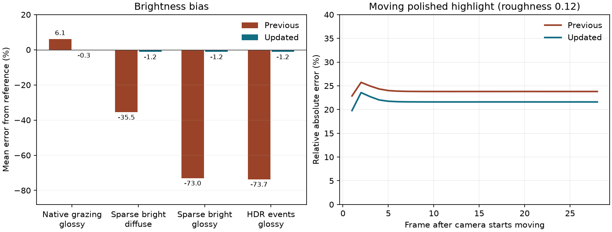

# Path-tracing variance reconstruction validation — 2026-10-22

Unreleased follow-up to `2f0c5e16`. Comparisons use the same RTX 3090 and a
saved export of that commit. DX12 tests run the Windows executable through
Wine/VKD3D; two native Linux Vulkan fixtures run with validation layers.
These results do not qualify native Windows or other GPU vendors.

The previous denoiser could repeatedly clip away legitimate light samples or
dark samples when a small current neighbourhood did not contain them. This
changed average brightness even after accumulation. Reconstruction now keeps
separate diffuse and glossy noise estimates and uses them to widen the history
clamp. Ray counts, quality resolutions and bounce limits are unchanged.
See the [integration document](../../integrations/path-tracing-experiment.md)
for the algorithm and resource layout.

## Brightness and noise

The native grazing-metal fixture uses one path sample per pixel, a constant
environment and thirty-two stationary frames. An independent hemisphere
integral gives **0.868462** expected red radiance. Raw radiance averages
**0.868576** in both builds. The filtered mean changes from **0.921467** to
**0.865976**: its error drops from **+6.10% to −0.29%**. Filtered red variance
also decreases from **0.001836 to 0.001341**, about 27%, versus **0.052768** raw
variance. This improves brightness accuracy and noise in this fixture together.

The new stochastic fixture feeds known distributions through the real compute
pipeline, independently of the integrator. Each case uses 160×90 pixels for
forty frames, with means averaged over the final eight frames. The expected
mean is analytical; it does not reuse the production clamp or variance formula.
The same deterministic random stream is used for the saved and updated builds.

| Distribution | Expected red | Previous diffuse / glossy error | Updated diffuse / glossy error |
| --- | ---: | ---: | ---: |
| 90% white, 10% black | 0.9 | +3.20% / +7.27% | −0.32% / −0.30% |
| 10% `(10, 2, 0.5)`, otherwise black | 1 | −35.54% / −73.02% | −1.21% / −1.19% |
| 10% `(40000, 8000, 2000)`, otherwise black | 4000 | −35.89% / −73.69% | −1.20% / −1.19% |
| Constant `(32000, 8000, 4000)` | 32000 | −0.050% / −0.012% | −0.049% / −0.048% |

The sparse bright fixture's finite raw sample itself averages 0.994010 rather
than exactly one. Its updated diffuse/glossy means are 0.987946/0.988116;
the table measures against the analytical mean, including that sample error.
Colour-ratio checks pass. The HDR test stores a maximum standard deviation
of 17,696 without overflow; storing its squared value in half precision would
overflow. Centred moments give exactly zero estimated noise for the constant
HDR input. Small half-float radiance rounding remains, as the last row shows.

Raw data: [previous stochastic signals](variance-qualified-baseline-signals/path-variance.json),
[updated DX12 signals](variance-qualified-dx12-signals/path-variance.json),
[updated Vulkan signals](variance-qualified-vulkan-signals/path-variance.json),
[previous native glossy](variance-qualified-baseline-glossy/path-glossy.json),
[updated native glossy](variance-qualified-dx12-glossy/path-glossy.json).
Native noise captures: [raw](variance-qualified-dx12-glossy/stationary-noise-raw.png),
[previous filtered](variance-qualified-baseline-glossy/stationary-noise-filtered.png),
[updated filtered](variance-qualified-dx12-glossy/stationary-noise-filtered.png).
PNG previews clamp HDR to 0–1; numerical measurements use floating-point images.

## Movement and disappearing light

Wider colour bounds need more selective glossy history during camera movement.
Temporal angular confidence is narrowed while retaining the existing spatial
kernel and independent diffuse history. The existing native moving-highlight
test uses a directional point sun, sixteen stationary frames, then twenty-eight
frames translating the camera by 0.04 m each. Its deterministic unfiltered
signal is the reference. Relative absolute error includes both blur and lag.

| Roughness | Previous error | Updated error | Change |
| --- | ---: | ---: | ---: |
| 0.12, polished | 23.91% | 21.67% | 9.4% lower |
| 0.35, broader highlight | 16.47% | 16.75% | 0.28 percentage points higher |

The broader highlight has a small regression; the change is not an improvement
for every moving material. Native Vulkan agrees closely, at 21.67% and 16.75%.
Material/depth rejection, separate history ages, orthographic translation,
129-frame continuation, the 256-frame limit and motion resets all still pass.

After the sparse bright input becomes fully black, a two-frame confirmation
of fully dark, well-supported neighbourhoods reduces history confidence.
Diffuse/glossy mean residue falls to approximately **4.1% of the former
analytical mean after six frames** and **0.41% after sixteen**. A noise-free
white-to-black change clears to below 1.2% in the first frame. Thin surfaces
and image edges with fewer than twenty accepted taps retain normal bounded
history. This is a response/noise tradeoff: the old clamp erased the noisy
light faster, but also removed most of its valid steady illumination.
Depth rejection and explicit resets discard unrelated radiance and variance.

## GPU and memory cost

The frozen river comparison uses a 1280×720 window, hidden units, water
reflections and frame generation off, and responsive accumulation. There are
zero eligible emissive triangles. Two rounds run in opposite orders, each
measuring ninety frames per case after warm-up. Values are ranges of the two
median GPU times for rays, reconstruction and copies; they exclude scene
builds, acceleration-structure updates and the main raster viewport.

| Mode | Previous RT pass, ms | Updated RT pass, ms |
| --- | ---: | ---: |
| 2 bounces, Low | 0.470–0.476 | 0.500–0.503 |
| 2 bounces, Medium | 2.286–2.483 | 2.417–2.552 |
| 2 bounces, High | 9.686–10.262 | 9.933–9.987 |
| 4 bounces, Low | 0.613–0.616 | 0.647–0.648 |
| 4 bounces, Medium | 3.116–3.354 | 3.178–3.308 |
| 4 bounces, High | 11.980–12.092 | 11.848–12.233 |

Low adds about 0.03 ms in this scene. Larger modes have overlapping ranges or
mixed movement; this is not evidence of a whole-frame FPS improvement. The
shared host also introduces CPU/scheduling variation. Timing distributions:
[previous](variance-baseline-dx12-performance/path-performance.json),
[updated](variance-qualified-dx12-performance/path-performance.json).

Two additional RG16F images store signed standard deviations: magnitude is
noise, sign records a dark neighbourhood. They add eight bytes per tracing
pixel and one history copy, without extra rays or compute dispatches. Total
lighting/guide/variance image storage is 104 bytes per tracing pixel:
**91.4 MiB at 720p High**, an increase of **7.0 MiB**, or **822.7 MiB at 4K
High**, an increase of **63.3 MiB**. These figures exclude scene textures,
acceleration structures and the separate water renderer. Resize and teardown
checks verify the new resources follow the existing target lifecycle.

## Integration and diagnostics

The updated build passed **331 assertions across thirteen recorded runs**.
Coverage includes stochastic signals and native glossy reconstruction on both
APIs; native path lighting, emissive sampling, grazing GGX energy, sloped
reprojection and receiver coverage; the shared conventional Scene RT device;
outdoor and cave scenes, animation, resizing and switching rendering modes;
and production frame generation with both path lighting and water RT active.
The two native Vulkan fixtures emitted no validation errors. Updated runs
had no shader errors, script errors or failed assertions. A known Wine
shutdown fault is recorded separately below.

Campaign captures: [river](variance-qualified-dx12-path_trace_live/river-path-4-still.png),
[cave](variance-qualified-dx12-path_trace_cave/cave-path-4-still.png).
Frame-generation [results](variance-qualified-dx12-fsr/rt-fsr.json) retain both
FPS counters through toggles, resize and pause/resume. The first interval
generated ninety frames and observed 179 presents; the
[HUD](variance-qualified-dx12-fsr/rt-and-fg.png) showed **82 FPS rendered /
164 FPS presented**. The [resized HUD](variance-qualified-dx12-fsr/rt-and-fg-resized.png)
showed **84 / 167 FPS**. These are observations from this run, not promised rates.

The saved baseline signal run and updated closed-room path-device run reproduced
the previously recorded Wine shutdown fault after the application's clean-exit
message, reading `0000000241BB6030` at `00006FFFFFC81448`. The other twelve
updated runs, including frame generation, did not record that fault.
Baseline Wine display warnings remain. Passing assertions and a zero runner
exit code do not establish clean native-Windows qualification. Per-run
diagnostics and counts are retained in [summary.json](summary.json).

All runs use isolated profiles, a free cursor, visible FPS and muted audio.
No player-facing text or options changed. Translation validation passed all
3,042 remake entries and dynamic-key coverage. The ten unchanged path shader
binaries reproduce with DXC 1.9.2609.5. Source hashes match the exported runtime.
Windows uses the qualified custom export template and approved icon; its EXE
hash matches the earlier icon-qualified export. [build.json](build.json)
records source and package hashes; the summary also records fixture hashes.

For reproduction, run the named fixtures through the existing `--tool`
interface described in the integration document. The new signal fixture takes
`--variance-baseline` when run against `2f0c5e16`; it records the old bias while
skipping new-only quality/resource assertions. The glossy fixture runs without
`--glossy-baseline` because that commit already has the packed material guides.

This remains a custom prototype denoiser. Spatial variance can confuse lighting
gradients with noise and becomes unreliable on thin or newly exposed surfaces
and extremely sparse lighting. Clamping is still biased. Primary-surface
reprojection has no object or reflected-hit motion vectors. The existing
bounded-scene, transmission, particle and material-authoring limitations remain.
Water keeps its separate renderer. No release was published.
