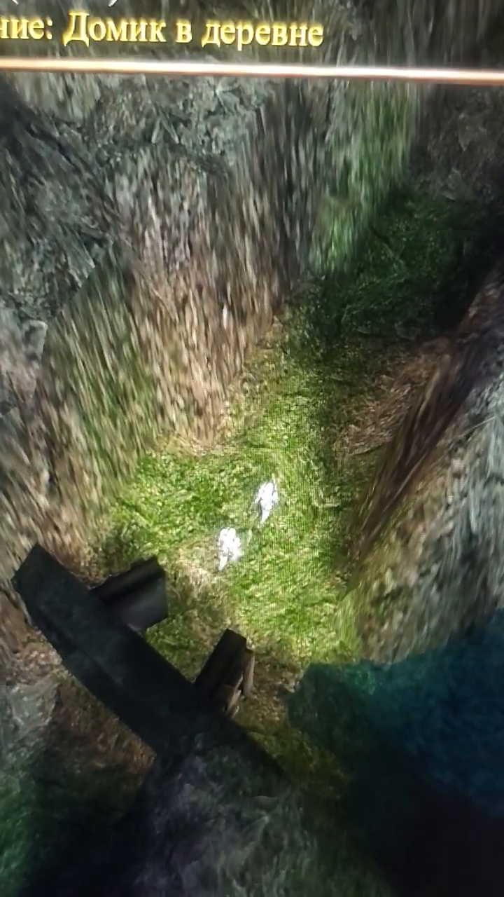
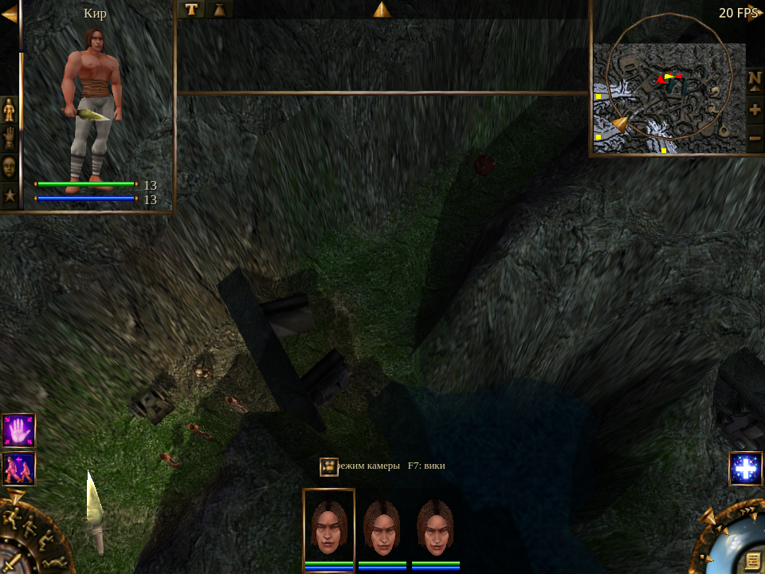
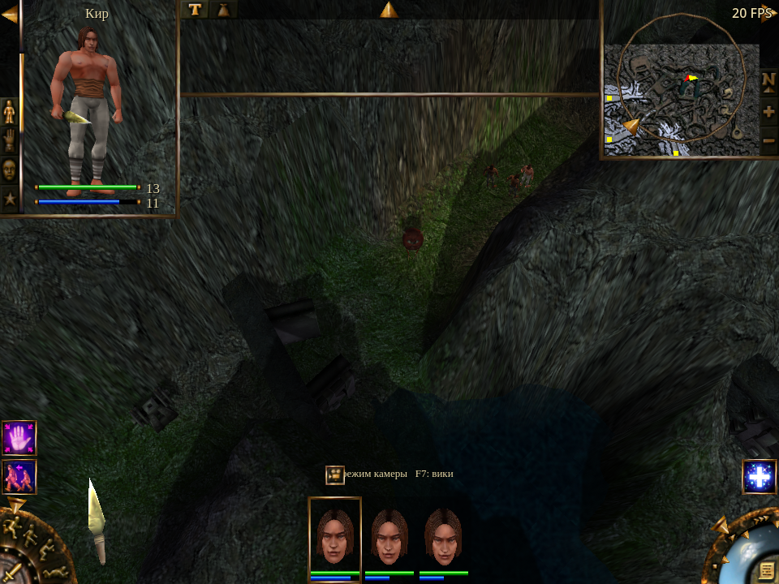

# LiA mine video follow-up — 2026-10-21

The supplied clip matches the **CDoorY gate, object 4306, near (129.515, 135.658) in LiA gz24k**. A prepared party crossed that passage without reproducing the severe slowdown. **The report remains unresolved; no gameplay fix is claimed.** Work continued in the existing `test/original-parity-expanded` worktree, preserving its earlier changes.

## What the video establishes

The approximately 16-second phone recording shows two bright party figures animating with very little apparent displacement just beyond the gate. The gate, adjacent plate, green corridor and water match the installed `zone24.mpr` / `zone24.mob` landmarks. The Russian quest text also identifies the LiA campaign. A camera pan must not be counted as character displacement.

The recording does not reveal a readable game version, FPS counter or simulation clock. It cannot distinguish slow authority ticks, failed movement/collision, or delayed displayed positions. The user is forwarding someone else's report and has no further version, save or reload information. Do not repeat that question.



[Video metadata and SHA-256](evidence.json) · [Independent landmark capture](gate-match.png). The source clip remains at `/home/llm2x/Downloads/баг-SnapYT.App.mp4`; the retained frame is unaltered.

## Prepared passage test

`tools/tests/mine_passage_presentation.gd` loads the actual mine and opens gate 4306. It retains all 62 authored actors, scripts and collision geometry and adds a fresh hero and two synthetic companions with independent save records. Hostility is explicitly neutralized to keep combat from killing the low-level test party; this also means the test does not qualify a combat workload. The three distinct starts are checked both in the saved data and after every full reload.

The real solo authority runs in a separate process. At a 20 FPS frontend cap, each group/follow and normal/accelerated combination runs for six simulation seconds, including command dispatch. The fixture waits for the new replica, the visible loading cover and post-load snapshots before timing. Screenshots are outside the measurement window. It measures replicated and displayed positions, actual animation-player progression, party health and elapsed wall time. It checks substantial progress and absence of a sustained display stall while simulation moves; a one-frame packet-to-draw gap alone is not treated as a stall.

Both platforms passed **101 movement/setup assertions**. Windows D3D12 under Wine exited without engine errors. Linux OpenGL exited 0 after its assertions, then logged **two GL texture-leak diagnostics** (349,524 bytes each). Explicit procedural-cache cleanup did not remove them. Linux is therefore retained as movement evidence with an unresolved renderer-shutdown diagnostic, not a clean overall run. No connection between those shutdown messages and the player's in-game slowdown has been established.

| Runtime | Order | Speed | Simulation / wall time | Measured FPS | Party displacement |
| --- | --- | --- | --- | --- | --- |
| Linux OpenGL | group | normal | 1.009× | 18.68 | 17.77–22.00 m |
| Linux OpenGL | group | accelerated | 2.127× | 19.16 | 17.77–19.63 m |
| Linux OpenGL | follow | normal | 1.001× | 20.01 | 17.77–18.40 m |
| Linux OpenGL | follow | accelerated | 2.088× | 20.16 | 17.67–18.48 m |
| Windows D3D12 / Wine | group | normal | 1.015× | 19.95 | 17.77–19.97 m |
| Windows D3D12 / Wine | group | accelerated | 2.044× | 20.09 | 17.77–22.00 m |
| Windows D3D12 / Wine | follow | normal | 1.011× | 20.06 | 15.03–17.77 m |
| Windows D3D12 / Wine | follow | accelerated | 2.055× | 20.04 | 17.77–18.39 m |

Displacement is endpoint distance over the six-simulation-second window, not constant running speed: several actors arrive before the interval ends. Accelerated solo time targets 55/27 (approximately 2.037×); snapshot sampling adds timing error.




[Linux measurements](linux-mine-passage-presentation.json) · [Linux result and diagnostics](linux-result.json) · [Linux log](linux-run.log) · [Windows measurements](windows-mine-passage-presentation.json) · [Windows result](windows-result.json) · [Windows log](windows-run.log).

## Scope and provenance

The reporter's party, equipment, wounds, spell effects, saved script state, graphics settings and machine remain unknown. Fresh actors and original-look settings are controlled inputs. This is a remake regression fixture, not an original-executable comparison or replay of the reporter's save. Windows runs under Wine. A passing control does not establish that the external report is fixed or invalid.

The source audit compared 465 GDScript/native-source/library files in the repository with the existing runtime staging: 464 match byte for byte; `src/game/ai.gd` differs only in comments. No production source or binaries were changed for this follow-up. [Source fingerprints](source-fingerprints.json) and executable/test-source hashes are retained in [evidence.json](evidence.json). The Windows fixture source precedes the final Linux-only teardown cleanup and removal of an unused alternate-gate argument; the measurement logic is identical.

[Fixture development records](fixture-development.json) retain rejected setup attempts separately. They include wrong campaign selection, combat contamination, duplicate synthetic hero records, absent base-campaign companion prototypes and sampling before the load settled. None is presented as a reproduced player defect. Earlier three-hero timing tests did not check that each actor restored its own distinct prepared position; this fixture adds that qualification.

## Reuse

The catalog entry is `commands/mine_passage_presentation_astral`, with rendered display required. Reuse the existing staged game and isolated runners from the handoff:

```sh
python3 /home/llm2x/Documents/EI/local/scratchpad/original-parity-20261020/fsr-first-use-20261020/test_linux.py mine_passage_presentation UNIQUE_TAG opengl3 --ei-path=/home/llm2x/Documents/EI/inspection/lost-in-astral/game
python3 /home/llm2x/Documents/EI/local/scratchpad/original-parity-20261020/fsr-first-use-20261020/test.py mine_passage_presentation UNIQUE_TAG d3d12 --ei-path=Z:/home/llm2x/Documents/EI/inspection/lost-in-astral/game
```

Use a fresh tag per run. Both runners create isolated profiles with a free cursor, FPS visible and all audio muted. The Linux runner correctly treats the retained shutdown diagnostics as a non-clean result. No normal player preferences were changed.

The next useful reproduction input is the reporter's save and exact build/settings, if they become available. Until then, preserve the gate identification and this control; do not invent a pathfinding, animation or clock fix from the video alone.
