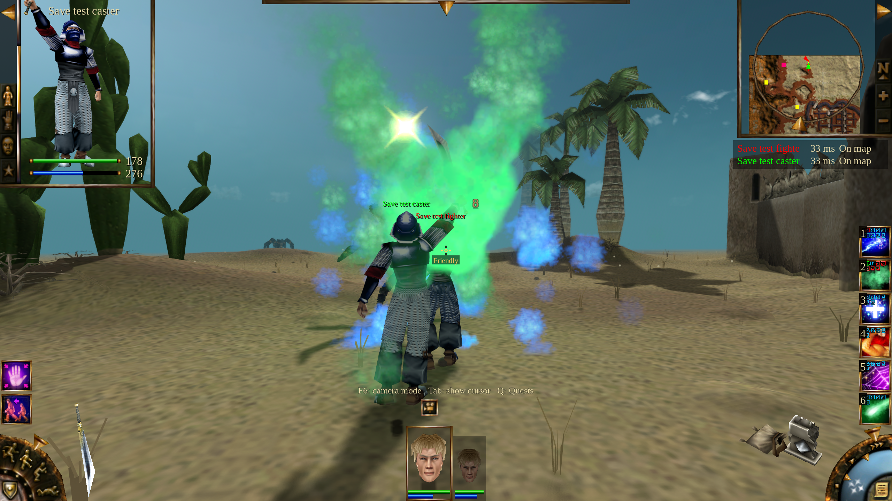
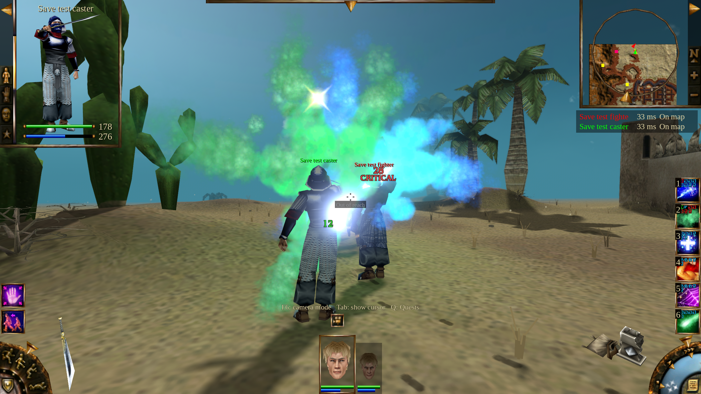

# Saved co-op performance investigation

Measured on 2026-10-19 using separate copies of both supplied saves. Original
files and archives were not changed. These runs exercise Linux/Vulkan, not the
reported Windows default renderer; they do not establish that the reported
long-session slowdown is fixed.

## Sustained stacked-cloud run

Two rendered ENet clients used the ordinary separate authority, Ultra graphics,
2× game speed and the default separate rendering thread. The owner rendered at
3840×2160 on an RTX 3090; the guest rendered at 2560×1440 on an RTX 3090 Ti using
a temporary second Xorg display. No system display configuration was replaced.

The run lasted **25 real minutes / 50 simulated minutes**. Both heroes retained
their saved attributes, weapons, armor, skills, spell runes, health and stamina
rules. Movement and attacks went through normal game commands. Isometric,
third-person and first-person views alternated with camera rotation.

| Recorded outcome | Owner | Guest caster |
| --- | ---: | ---: |
| Distance walked/run | 3479.9m | 3455.0m |
| Manual Acid Fog casts completed | 0 | 6 |
| Manual Lightning casts completed | 9 | 3 |
| Manual Weakness casts completed | 14 | 2 |
| Manual healing casts completed | 3 | 4 |
| Cast timeouts | 0 | 0 |
| Alive at end | Yes | Yes |

Four acid clouds overlapped at once. The guest produced 12 acid-cloud delivery
events from six completed casts with the saved spell configuration. Counts
distinguish requested input, started casts and delivered effects; equipment
autocasts are recorded separately from completed manual casts.

The pair killed 14 enemies and reached more than 200m from the starting point.
The reachable groups were exhausted after approximately 9.5 minutes; the
remaining time exercised traversal, camera changes and effect cleanup. Three
inaccessible enemies remained. This was not 25 minutes of continuous combat,
and this particular run did not change maps.

## Restart comparison

A separate three-minute run loaded the post-test checkpoint, walked normally
to the same final hero positions and restored the same camera poses. Both
views used the same runtime package and graphics settings. The last measured
intervals were:

| View | Warm run | Fresh matched run |
| --- | ---: | ---: |
| Owner 4K | 33.0 FPS | 37.7 FPS |
| Guest 1440p | 65.5 FPS | 66.0 FPS |

These are individual interval observations, not a controlled estimate of a
leak. Some validation processes overlapped the warm run, ambient particle
counts differed and the last intervals were not identical durations. The
owner's initial single-frame sample must not be compared with these sustained
intervals. Node counts stayed near 17,000, resources near 497, and temporary
effects returned near their idle counts; that does not rule out every source
of degradation.

The JSON files preserve all 30-second samples and reduced run manifests with
runtime and benchmark hashes. Earlier single-GPU 1080p evidence is retained as
`long-run-*`; it is a different workload. The failed approach-range run is
excluded: spell input attempts without delivered effects are not valid caster
load.

## Direct lifecycle retention check

A 70-minute run completed three online Trials tournaments, through rounds
28, 31 and 28, before opening the supplied campaign. The two rendered client
processes remained open throughout. This older driver created and freed its
screens directly, so it does **not** validate the normal menu transitions.
It also began before the overview-placement fix in
`../arena-board-visibility-20261019`: disappearing geometry invalidates its
Trials frame-rate samples as evidence of normal visible battle load.

Its narrower retention result remains useful. Each teardown returned both
clients to 16 nodes and 496 resources, with no retained old worlds or frame
callbacks. Asset caches grew as previously unseen creatures were displayed:

| After match | Owner cached meshes | Guest cached meshes | Owner video MiB | Guest video MiB |
| --- | ---: | ---: | ---: | ---: |
| 1 | 1733 | 1709 | 439 | 359 |
| 2 | 1881 | 1871 | 448 | 403 |
| 3 | 2027 | 2027 | 452 | 405 |

The campaign portion was ended after startup; it is not a second sustained
combat result. The driver and package hashes are retained in the accompanying
`direct-three-matches-*` receipts. These observations do not prove that all
caches are bounded or that Windows frame-rate degradation is resolved.

## Menu lifecycle validation

The replacement driver uses visible menu controls to host/join Trials, buy and
arrange units, scout, confirm exits, select campaign saves, travel, save, and
quit. `tools/benchmarks/run_menu_coop.py` freezes the driver source and records
both engine and package hashes. It uses the patched export engine; preliminary
stock-template smoke runs are excluded because they omitted the repository's
existing renderer fixes. An initial menu pass was also excluded after
concurrent external pointer input interrupted a confirmation, and a scouting
smoke pass exposed an incorrect attempt to recruit while the shop was hidden.
Those are test-driver failures, not demonstrated game regressions.

A corrected functional smoke check completed three rounds with scouting,
returned both clients through their leave confirmations, selected the supplied
host/guest saves, entered co-op, saved through the pause menu, and quit through
the normal menus. Both clients returned to 998 menu nodes and 497 resources,
with no retained old worlds or frame callbacks; all processes exited normally
and the input saves were unchanged. The campaign interval was stationary and
40 seconds long, so this checks ownership/cleanup only, not performance.
The `menu-smoke-*` receipts retain that distinction.

## Sustained menu run: valid combat, invalid quiet ending

The corrected menu driver completed three player matches (elimination in rounds
17, 19 and 18), then loaded the supplied campaign saves in the same two client
processes. Total wall time was **56 minutes 16 seconds**, including 30 minutes
in the campaign. Both clients used the same Ultra/2× settings and separate GPUs
described above. Original inputs were unchanged.

The campaign crossed four maps (`gz18h`, `gz15h`, `gz16h`, `gz17h`) through three
actual exit confirmations and travel-screen selections. The last area started
with 247 surviving enemies. Before the quiet-ending failure, the recorded
enemy counts fell by at least 31 across the visited areas.

| Living-party observation, through approximately 28:28 | Owner | Guest caster |
| --- | ---: | ---: |
| Distance travelled | 3023.8m | 3003.3m |
| Completed Acid Fog casts | 0 | 18 |
| Completed Lightning casts | 33 | 12 |
| Completed Weakness casts | 31 | 5 |
| Completed healing casts | 27 | 31 |
| Observed weapon attack serials | 197 | 207 |
| Cast timeouts | 0 | 0 |

The guest produced six overlapping acid-cloud effects. All three camera modes
were used with rotation. Combat was interspersed with exploration; the third
area was mostly cleared. A blocked route there was recovered with ordinary
movement along already traversed ground. The steering receipt preserves those
interventions. This was not 28 minutes of uninterrupted combat.

At 28:30 the old test logic forced both actors to idle for a comparison, despite
enemies still pursuing them. Both died. **The final 90 seconds and the resulting
dead-party checkpoint are excluded from living-party FPS comparisons.** The
high frame rates in the death view are not evidence of stable gameplay. Active
traversal no longer requests this forced idle or a defenseless timed retreat;
an explicitly requested quiet ending also checks party health and nearby enemies.
Restart comparisons use a separately verified safe checkpoint.

The normal save and confirmed menu exits still completed. Every match and the
campaign returned both clients to **998 nodes, 497 resources, zero old worlds
and zero frame callbacks**. Asset caches remained populated:

| After menu return | Owner cached meshes | Guest cached meshes | Owner video MiB | Guest video MiB |
| --- | ---: | ---: | ---: | ---: |
| Match 1 | 1036 | 1116 | 1529 | 912 |
| Match 2 | 1495 | 1469 | 1574 | 924 |
| Match 3 | 1631 | 1578 | 1578 | 958 |
| Campaign | 3539 | 3485 | 2080 | 1340 |

These figures include persistent framebuffer/asset allocations. They demonstrate
world cleanup, not that every allocation is bounded. One nonfatal JSON parse
warning occurred; the harness's shared coordination file used truncate/write
and now publishes snapshots atomically. The second GPU also reported software
thermal slowdown during part of the run. Clock/temperature receipts are retained,
and this run cannot support a controlled warm-versus-restart FPS claim.

The first two attempts at a safe, matched restart comparison were interrupted when optional scouting controls became
hidden during round changes. Both attempts are excluded. Scouting now skips
missing or hidden controls; required lobby, save and exit actions still fail
explicitly if unavailable. These are harness failures, not demonstrated game
regressions; the corresponding manifests and reasons are retained in
`menu-quiet-excluded-attempts.json`.

## Final session and stopping point

At the user's request, the third attempt ended after the current match and a
short campaign walk. No further restart comparison or performance run was
launched. The two clients completed three player matches (rounds 19, 17 and 17),
then 180 seconds in the supplied campaign and exited through the save/leave/main
menus. Total wall time was 29 minutes 12 seconds. Both characters remained alive
and both original input saves remained unchanged.

The planned quiet interval was changed to ordinary X11 ground clicks while the
camera followed each character. The owner travelled 28.4m and the guest 140.4m.
The launch manifest still records `stationary: true` and the raw samples still
say `settled`; **those labels must not be used to classify this final interval
as a stationary comparison**. The steering receipt records the change. There
was no combat during this short final walk; the sustained combat evidence is
the separate long run above.

Excluding the incomplete first sample, interval FPS ranged from 32.1–38.4 at
4K on the owner and 86.8–102.0 at 1440p on the guest. Positions, views and GPU
clocks varied. There is no matching fresh-restart control, so these values
cannot establish or rule out the reported progressive slowdown.

Every menu return again reached 998 nodes, 497 resources, zero retained old
worlds and zero frame listeners. Asset caches remained populated. Full receipts
are in `menu-final-*`. The reported Windows/default-renderer slowdown remains
**unconfirmed and unresolved**, not a passed regression test. The temporary
second-GPU display was removed after the tests; the normal desktop was untouched.
