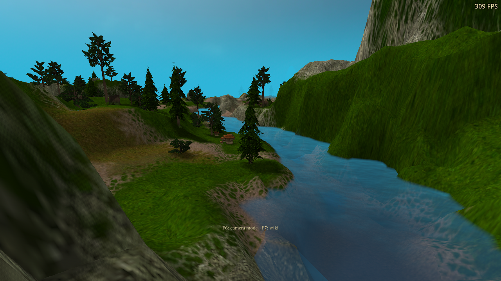
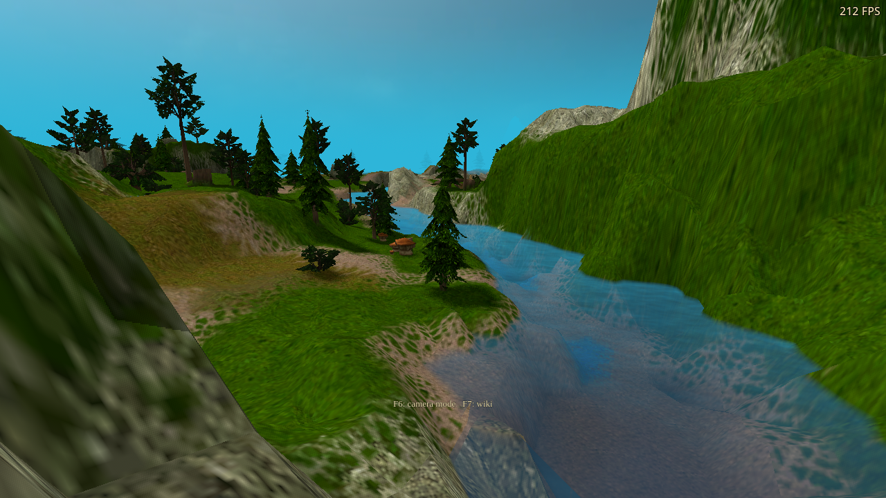
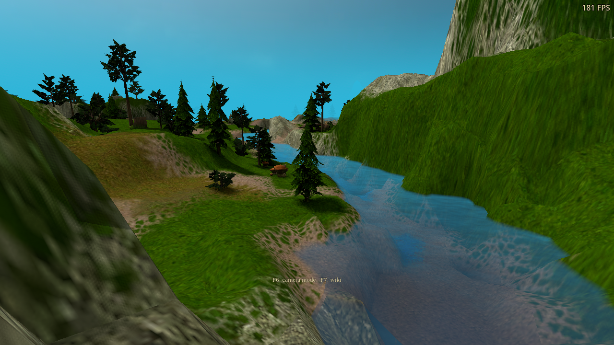
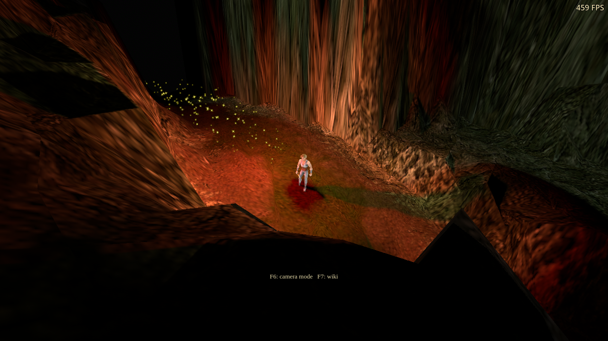
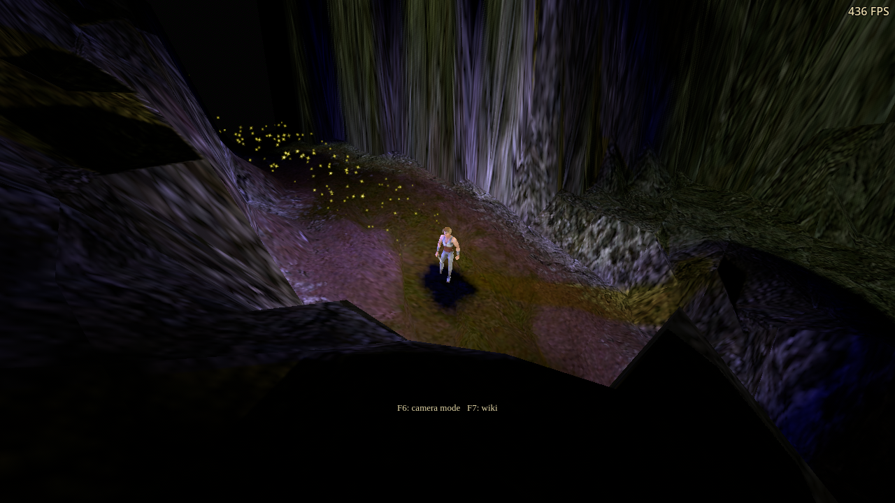
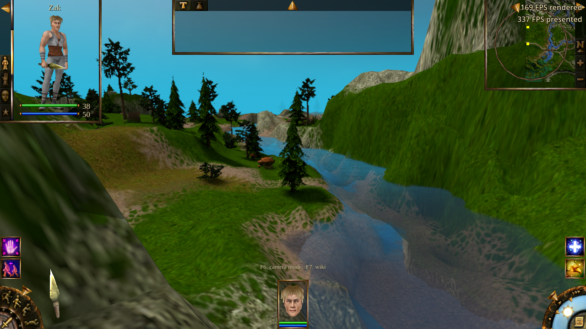
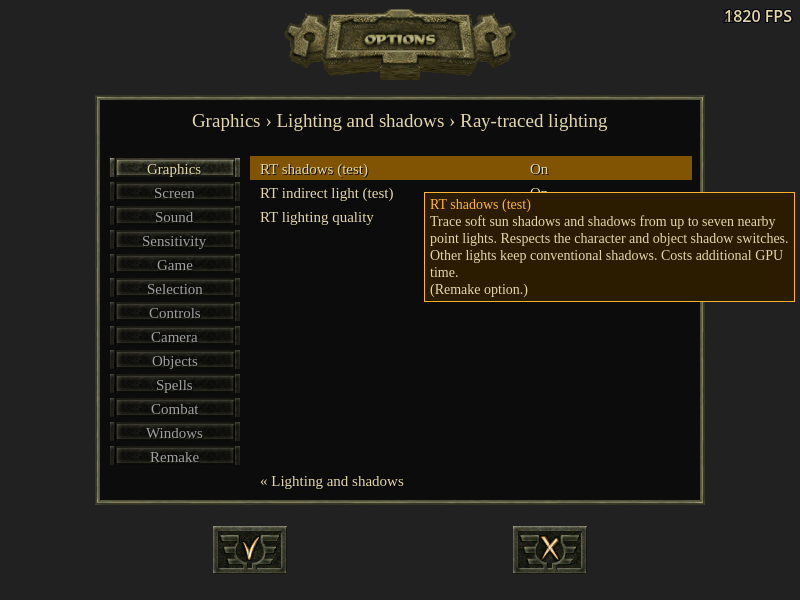
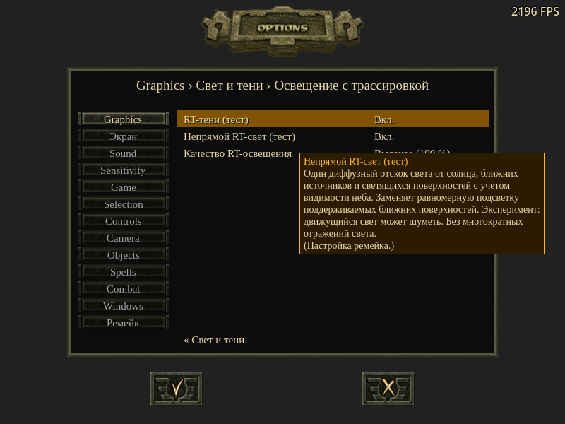
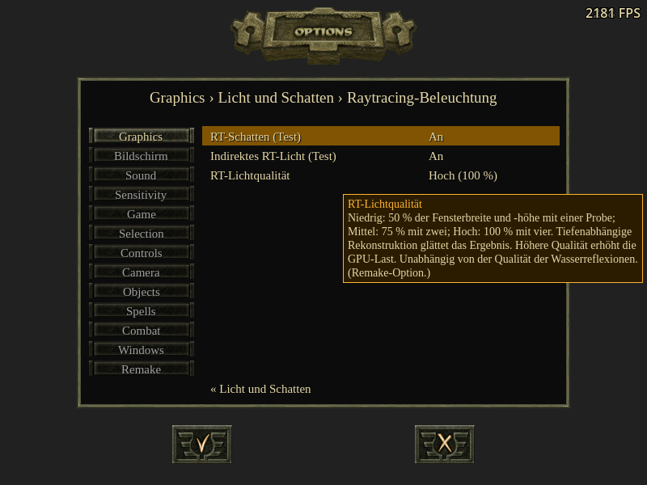

# Scene RT lighting validation — 2026-10-22

The unreleased development build implements main-view RT shadows and one-bounce
diffuse GI. See [controls and implementation limits](../../integrations/scene-raytracing-experiment.md).
The [summary manifest](summary.json) records source/runtime hashes and diagnostic
counts; each run directory contains its assertions, result data and diagnostic
extracts. These are development checks, not a public release qualification.

## Environment and results

RTX 3090, NVIDIA 580.178.04, Ubuntu 24.04.5 LTS, qualified Godot 4.7 engine.
Vulkan runs are native Linux. DX12 runs use the Windows export through Wine and
VKD3D-Proton 3.0.1. All runs use isolated profiles, free cursor, visible FPS and
muted audio. Native Windows, other GPU vendors and non-desktop platforms were
not qualified. Functional assertions passed in all 22 recorded runs, with the
diagnostic exceptions below.

| Coverage | Result |
| --- | --- |
| Device fixtures, Vulkan and DX12 | 17 assertions each: sun occlusion, red emissive and diffuse bounce, all seven local-light channels, finite light rays, opaque partitions, moving casters, disabled modes, stable texture bindings, resize and teardown |
| Alpha fixtures, Vulkan and DX12 | 9 assertions each: cutout and opaque geometry behave correctly in primary, shadow and indirect rays |
| River integration, Vulkan and DX12 | 32 assertions each: actual world-material changes, 50/75/100% targets, retained scene resources across quality changes, translated controls and conventional image restoration |
| Cave integration | 6 Vulkan / 8 DX12 assertions: no outdoor sky radiance, changing local-light colour reaches GI, animated/moving character updates; final DX12 also checks ambient effects restore without rewriting saved preferences |
| Material matrix, Vulkan and DX12 | 144 rendered variants, 470 assertions per API; terrain, figures, water, foliage and combinations of material/fog/weather/deformation features |
| Settings | 159 Vulkan / 160 OpenGL assertions: Apply/Cancel/persistence, pending quality enablement, unsupported-renderer controls, labels/choices/help fit EN/RU/DE at 1280×720 and 800×600 |
| Unsupported renderer | OpenGL keeps conventional lighting and ambient effects with saved RT settings enabled |
| FSR coexistence, DX12 | 62 assertions: water RT and scene shadows/GI together, real generated/presented counters, FPS overlay, Mirror/RT changes, resize, pause/resume |
| Existing water regressions | Vulkan device 25, filtering 69 and first-person 9 assertions passed with the shared backend changes |
| Localization | Full option matrix: 15,729 assertions; static checker: 3,034 translation entries, zero errors |
| Build | Editor import, Windows export and Linux pack export without errors; all eight scene and eight water shader binaries reproduce with DXC 1.9.2609 |

The final FSR run measured 90 generated frames and 180 presentations over a
90-rendered-frame interval. Its overlay displayed both rendered and presented
FPS while active, and the single FPS line while paused/disabled. First-use
shader preparation had to finish before generation became active. Those short
functional samples are not performance benchmarks.

The material matrix, initial Vulkan river and cave checks predate the final
stable-output optimization. The final device checks on both APIs, DX12 river,
cave and FSR checks, settings checks, performance runs and water regressions
exercise the stable-output implementation. The material shader itself did not
change during that optimization.

## Timing

`scene_raytrace_performance.gd` freezes the 1280×720 river camera, hides units,
turns off water reflections and frame generation, removes VSync/frame caps and
samples 90 steady-state frames per case in two reversed-order rounds. The scene
contains 116,008 unique triangles, 1,285 geometries, 1,420 instances and one
selected point light. Table values span the two round medians, not confidence
intervals. Loading, shader preparation and initial scene builds are excluded.

| Case | DX12 RT GPU pass | DX12 whole frame | Vulkan RT GPU pass | Vulkan whole frame |
| --- | ---: | ---: | ---: | ---: |
| Conventional | — | 2.94–2.98 ms | — | 1.75–2.12 ms |
| Shadows Low | 0.154–0.155 ms | 4.04–4.25 ms | 0.156–0.158 ms | 2.49–2.80 ms |
| GI Low | 0.185–0.186 ms | 3.98–4.31 ms | 0.185–0.186 ms | 2.51–2.60 ms |
| Both Low | 0.204–0.205 ms | 4.16–4.62 ms | 0.202–0.204 ms | 2.50–2.54 ms |
| Both Medium | 0.520–0.523 ms | 3.95–4.27 ms | 0.533–0.534 ms | 2.56–2.76 ms |
| Both High | 1.546 ms | 4.61–4.82 ms | 1.764–1.769 ms | 2.96–2.99 ms |

Raw measurements include p95, sample counts and controller CPU timing in
[DX12 data](dx12-scene-rt-stable-performance/scene-performance.json) and
[Vulkan data](linux-scene-rt-stable-performance/scene-performance.json).
The RT GPU timestamps include primary/shadow/GI dispatch, reconstruction and
history copies, but exclude acceleration-structure updates. The main viewport
GPU timing excludes the separate RT dispatch. The controller CPU bracket
includes script work and submission in safe render-thread mode; it is not a
pure CPU-kernel measurement.

Whole-frame time also depends on CPU work, scheduling and synchronization.
The lower Medium frame median in one DX12 round does not mean Medium is
cheaper: its RT GPU work is consistently greater than Low. These short runs on
a shared machine do not establish a general API ranking or a gameplay FPS
promise. Stable output textures avoid the earlier per-frame material-binding
invalidation; that optimization is included in every timing in this table.

## Diagnostics and qualification limits

- The isolated final Vulkan RT device run has no validation warnings or errors
  with Khronos layers 1.4.363.0. Godot prints translator notices for
  `OpTypeAccelerationStructureKHR` / `OpIgnoreIntersectionKHR`; native ray
  binaries execute and their GPU readbacks pass.
- The full Vulkan campaign reports ten
  `Undefined-Value-StorageImage-FormatMismatch-ImageView` warnings: a compute
  storage image at set 3/binding 0 declares RGBA16F but its view is R32_SFLOAT.
  The same ten warnings occur in the
  [RT-disabled baseline](linux-scene-rt-validation-baseline/diagnostics.txt),
  which confirms no scene RT resources exist. The isolated lighting shader
  uses set 0 and RGBA16F views. This warning remains unresolved; the full
  campaign is not claimed validation-clean.
- Wine logged a page fault after the game's `clean exit` in the final DX12
  device test and earlier material-matrix run, despite exit code zero and all
  assertions passing. The address/signature matches
  [the prior water-only run](prior-water-wine-shutdown.txt). These shutdown
  anomalies remain unresolved; a zero harness exit is not proof of a clean
  shutdown. Final DX12 river, cave, alpha, performance and FSR runs did not
  log that fault.
- DXVK also reports inability to parse display EDID/colorimetry metadata and
  uses blank metadata; other startup capability and sample-quality notices
  remain in the local raw logs. This is not a native D3D12 debug-layer result.

## Visual evidence

The river captures use the same frozen view: conventional lighting,
RT shadows Low, then RT shadows plus GI Low. They demonstrate material
integration; the FPS labels are individual snapshots, not the timing table.

The real cave fixture adds a test lamp and changes it from red to blue. Both
captures use the same RT settings; nearby indirect illumination changes too.

The final FSR capture includes water reflections and scene lighting, with both
FPS counters visible. The three settings captures exercise small-window help.

