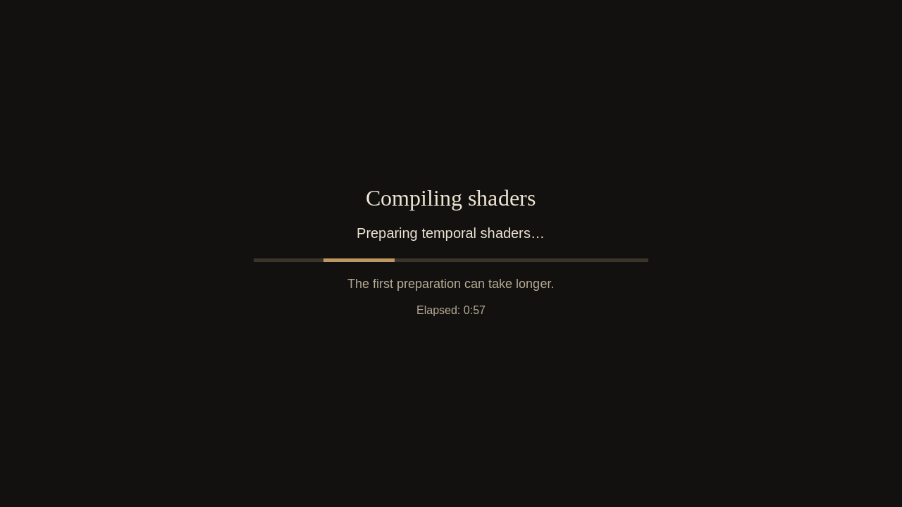

# Graphics preparation and integrated PT validation — 2026-10-23

All 28 selected suites passed, totaling 2,960 checks. This includes eight PT core
suites and six preparation suites on each backend. The original manifests are
preserved: some batches stopped at a failed fixture and their successful,
unaffected suites were retained; corrected paths were rerun in fresh profiles.
The [summary](summary.json) identifies the accepted suites and rejected runs.

## Result

The shared screen presents an opaque canvas before expensive work, reports real
material completions or an indeterminate phase with elapsed time, and stays until
the newly requested output is ready. Campaign/arena warmup, scene PT/RT, water
reflections, terrain changes, graphics detection, temporal upscaling and frame
generation are covered. Existing loading paths keep their dedicated progress UI.
See [graphics preparation](../../graphics-preparation.md) for ownership, input,
pause and completion rules.

The live DX12 cold FSR preparation took **57.638 seconds**. It retained the cover
and its single-player pause for **10,036 observed frames**, with no premature
clear and no gameplay-clock advance. Completion required six actual upscaler
evaluations. Frame generation subsequently initialized and produced six real
generated frames before its owner completed. Terrain settings held the same
screen for 10.443 seconds while their bounded work completed. These are observed
waits on this machine, not performance targets or a guarantee about another GPU.

English, Russian and German layouts were checked down to 640×480, including
material counts, long text, cancellation and indeterminate states. Translation
coverage reports 3,061 entries, 141 dynamic wiki keys and 179 dynamic arena keys,
with zero errors. The qualification runner's 21 CPU tests passed.

## Accepted runs

| Batch | Suites | Checks | Physical adapter |
| --- | ---: | ---: | --- |
| vulkan-core | 8 | 822 | RTX 3090 Ti |
| vulkan-ui | 3 | 420 | RTX 3090 |
| vulkan-settings | 1 | 44 | RTX 3090 Ti |
| vulkan-scene-water | 2 | 128 | RTX 3090 Ti |
| dx12-core-ui | 11 | 1,368 | RTX 3090 Ti |
| dx12-remaining | 3 | 178 | RTX 3090 |
| **Total** | **28** | **2,960** | |

The PT core covers device ownership, rigid/object and camera motion, deformation
history rejection, topology changes, detached live rendering, resolution changes,
controller recovery and sustained play. Both backends completed six stress cycles
and six save/load round trips across two campaign zones. Vulkan recorded 17,236
active PT frames and DX12 34,607; real instance and animated-pose updates occurred
on both. Memory growth stayed within the declared test budgets. The exact motion
fixture also compares accumulated pixels with known expected values and negative
controls, rather than treating any rendered frame as success.

Preparation checks include actual material draw completion under the cover,
scene request/device acknowledgments, quality/scale changes, cancellation and
failure recovery, planar and hardware water readiness, movement across authored
water levels without a modal cover, terrain work during an owned pause, actual SDK
readiness, and graphics detection interrupted by late preparation. Existing player
pauses are preserved. Failure injection is identified in each fixture's report.

## Corrections verified during integration

- Arena warmup previously could accept an older global post-draw event in the
  Separate rendering model. Completion now waits for the material's eligible
  submission and render-thread fence. The strict draw-order check passes on both
  backends.
- Graphics detection now discards partial timing batches interrupted by late
  preparation, then restarts after it ends. Newly created covers retain its
  Escape/controller cancellation and restore their input handlers on cleanup.
- Scene fixture observations now follow the actual screen through its finishing
  frames, with pixel readback, and let the deliberately injected failure enter
  its bounded retry. Water fixture baselines drain previously queued draws before
  requiring zero new campaign draws from canvas-only presentation. These fixture
  corrections did not change production rendering or relax output readiness.
- The virtual X11 display can report no active RandR monitor. The runner permits
  only the exact refresh-rate fallback diagnostic and its engine call site;
  other error sites still fail. GPU Lab's monitor configuration was not changed.

Rejected runs remain under `rejected/`; they do not contribute successful checks.
Every accepted run records its command, frozen input hashes, runtime settings,
physical GPU observations and structured report. Full local log paths and SHA-256
hashes are in the summary. Original aggregate failure status is retained where
only an unaffected subset was accepted.

## Build and scope

The final game package is candidate06, exported from
`7e54e5d6e853563dcecbf58ad32bea1dc20fd3a0`; subsequent changes are fixtures,
qualification tooling and documentation. Vulkan core used candidate05 at
`62853f16`, before the arena and graphics-detection fixes, which were exercised by
the final preparation runs. Source hashes and export logs are under
`build-and-review/`. The prior [PT qualification and performance evidence](../path-tracing-recovery-2026-10-23/README.md)
remains applicable to the unchanged PT implementation.

Native Linux used Vulkan/Separate. The Windows executable used DX12/Safe through
Wine/VKD3D, including the actual FSR SDK. Final preparation tests ran through the
shared GPU Lab pool on the RTX 3090 and RTX 3090 Ti; physical UUIDs are recorded
per batch. Earlier core qualification used the isolated GPU1 virtual display
before the shared-pool policy update. Profiles were isolated, muted, showed FPS
and kept the cursor free. The main desktop and player profiles were not used.

This qualifies these tested environments, not native Windows or every adapter.
An individual synchronous driver call can still stop indicator animation; the
preparation canvas is already visible when that call begins. No claim of faster
shader compilation or fully asynchronous creation is made. No release version or
published artifact is changed by this merge.
