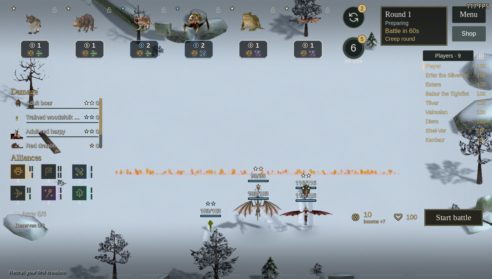
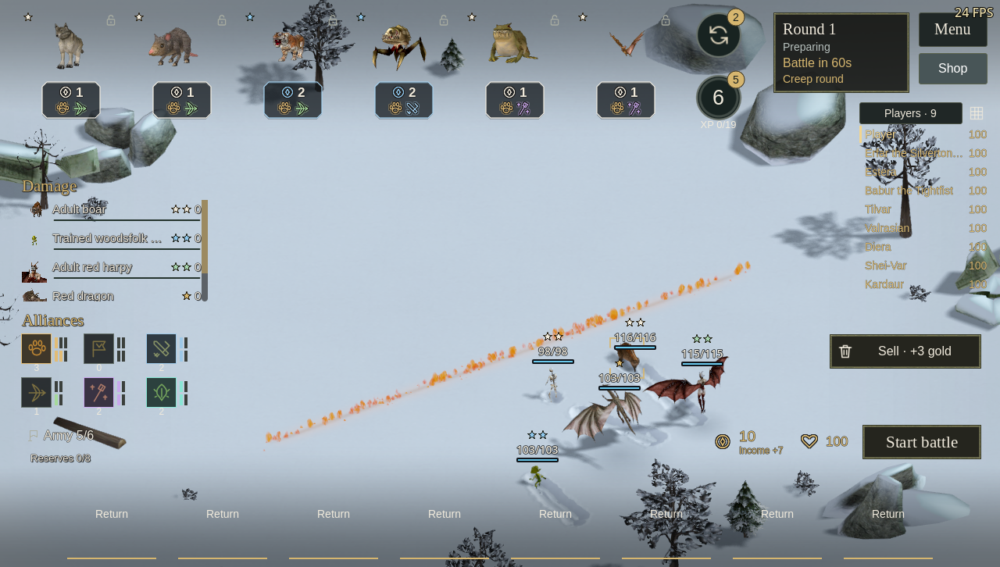
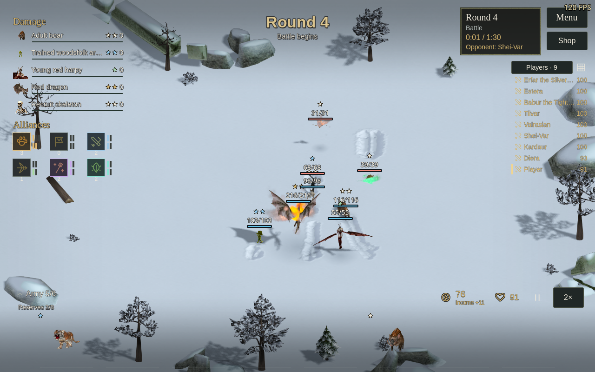

# Trials: balance depth and planning view — 19 October 2026

This is an unpublished 1.17.0 diagnostic. The roster remains 28 species with one
shop entry each and three ranks of the same creature. Prices contain 7/6/5/5/5
species at costs 1/2/3/4/5. This pass improves the measured return from completing
upgrades, reduces several spell outliers and brings weak early recruits closer
together. It is evidence for a better candidate, not proof of an optimal or fun meta.

## What changed

- Three-star health ×4.4 → ×5.0; weapon and offensive spell damage ×3.4 → ×4.0.
- Final-rank melee armor growth ×1.30 → ×1.65; other roles and earlier ranks
  retain their previous growth. Actual native flat armor and the existing Trials
  80% absorption cap remain in combat. Campaign data is unchanged.
- Unicorn healing receives 50% rather than 60% of the comparable spell budget.
- Species-specific health/damage adjustments cover wolf, rat, goblin, toad,
  skeleton, spider, armadillo, zombie, harpy, hyena, evileye, unicorn, dragon,
  wormhead and cyclops. Exact before/intermediate/final rules are included below.
- No additional shop species, duplicate price entries, changed shop odds, cheaper
  refreshes or free bot resources were introduced in this pass.

## Method and limits

All fights run the real native combat simulation, including typed flat armor,
attack/defense and hit rolls, parry, weapon cadence, movement/reach, spells,
regeneration and alliance bonuses. Persistent spells apply their actual pulses
as creatures move through them. They are not evaluated as raw tooltip DPS.

Three versions were measured: the initial species rebalance, an intermediate
candidate, and the final candidate. Each has 16 complete nine-seat tournaments:
eight seeds, each with two rotations of the four purchasing policies. Every policy
has 36 seats. Builds use identical seed/rotation schedules. Bots buy normal shop
offers with normal income, XP costs, refresh costs and copy rules. These are
heuristic policies, not optimal human play. Seats within a match, repeated snapshots
and repeated uses of a species are correlated; no population confidence interval
is implied by those sample counts. Four of the 16 games per version extend the
initial 12-game selection set; only those four have comparable detailed timing
records for every build. The final candidate was also inspected on these games.

A separate 1,584-fight suite compares every same-price pair at two and three stars
in three shared-support 4v4 contexts, over two seeds and both sides. Supports vary
between physical, fire and lightning pressure. The support lists avoid the two
compared species. Alliance thresholds and matchups deliberately affect the result;
these percentages are contextual scores, not universal unit win rates. A draw is
half a win. There are 72, 60 or 48 trials per form depending on the price tier.

A further 504 actual fights check promotion, equal-price three-gold comparisons,
and one nine-copy one-gold three-star against two five-gold one-stars. These
price-only fixtures omit search and XP costs and use unequal board slots; they
cannot establish economic equivalence on their own.

## Full-match spending policies

Mean finish is lower when better. Counts are over 36 seats per policy in each build.

| Policy | Mean finish, before → final | Wins | Top four |
| --- | ---: | ---: | ---: |
| Economy | 5.33 → 5.19 | 5 → 5 | 17 → 14 |
| Expansion | 4.58 → 5.31 | 3 → 4 | 17 → 15 |
| Evolution | 5.89 → 4.72 | 2 → 6 | 10 → 19 |
| Tempo | 4.19 → 4.78 | 6 → 1 | 20 → 16 |

The difference between the highest and lowest mean finishes falls from 1.69 to
0.58 places. Upgrade-focused play becomes competitive, while all four policies
still win. Tempo wins only once in the final sample but averages 4.78; more human
matches are needed before treating that as a weak strategy.

Every one of the 28 species is deployed in at least one match and appears after
round 16. Skeleton deployment expands from 5 to 11 matches, spider 11 to 16,
armadillo 12 to 15 and rat 11 to 13. Elemental deployment falls from 8 to 6;
its strong contextual score suggests that bot acquisition/selection and the
situational protection spell deserve examination before another stat buff.

## Armor-aware unit comparisons

| Species | Two-star contextual score | Three-star contextual score | Matches deployed / 16 |
| --- | ---: | ---: | ---: |
| Boars | 55.6% → 49.3% | 58.3% → 51.4% | 16 → 15 |
| Wolves | 37.5% → 40.3% | 44.4% → 52.1% | 14 → 15 |
| Rats | 38.9% → 50.0% | 43.8% → 52.1% | 11 → 13 |
| Bats | 50.7% → 51.4% | 56.2% → 48.6% | 16 → 16 |
| Goblins | 69.4% → 58.3% | 63.9% → 57.6% | 16 → 16 |
| Toads | 52.1% → 55.6% | 40.3% → 50.7% | 16 → 16 |
| Skeletons | 45.8% → 45.1% | 43.1% → 37.5% | 5 → 11 |
| Tigers | 39.2% → 45.0% | 52.5% → 50.0% | 16 → 16 |
| Spiders | 46.7% → 60.0% | 33.3% → 53.3% | 11 → 16 |
| Armadillos | 37.5% → 35.8% | 49.2% → 54.2% | 12 → 15 |
| Lizardmen | 59.2% → 54.2% | 50.8% → 49.2% | 16 → 15 |
| Woodsfolk | 48.3% → 45.8% | 50.0% → 43.3% | 16 → 16 |
| Zombies | 69.2% → 59.2% | 64.2% → 50.0% | 16 → 16 |
| Orc shamans | 57.3% → 56.2% | 29.2% → 39.6% | 16 → 16 |
| Trolls | 54.2% → 54.2% | 49.0% → 42.7% | 12 → 13 |
| Ogres | 45.8% → 41.7% | 54.2% → 56.2% | 16 → 15 |
| Harpies | 59.4% → 51.0% | 83.3% → 52.1% | 16 → 16 |
| Hyenas | 33.3% → 46.9% | 34.4% → 59.4% | 16 → 16 |
| Evileyes | 43.8% → 61.5% | 20.8% → 52.1% | 16 → 16 |
| Banshees | 56.2% → 51.0% | 39.6% → 31.2% | 16 → 16 |
| Unicorns | 55.2% → 47.9% | 79.2% → 41.7% | 16 → 16 |
| Wisps | 46.9% → 41.7% | 43.8% → 56.2% | 16 → 16 |
| Elementals | 47.9% → 47.9% | 66.7% → 68.8% | 8 → 6 |
| Dragons | 71.9% → 55.2% | 79.2% → 68.8% | 13 → 13 |
| Golems | 44.8% → 53.1% | 33.3% → 44.8% | 13 → 10 |
| Horrors | 37.5% → 35.4% | 52.1% → 45.8% | 16 → 15 |
| Wormheads | 56.2% → 47.9% | 60.4% → 58.3% | 15 → 15 |
| Cyclopes | 39.6% → 58.3% | 25.0% → 32.3% | 15 → 15 |

The intermediate candidate exposed an armor problem that raw damage scaling
would have missed: three-star golems fell to 15.6% in these contexts while
wormheads reached 83.3%. Stronger final-rank melee armor and a smaller wormhead
damage budget bring the final figures to 44.8% and 58.3% respectively. Golem and
horror are not dominant in the final mixed-support comparisons (44.8% and 45.8%).
That does not rule out strong compositions or matchups around them.

A final three-star golem has 793 health and 31.1025 general armor. The native
absorption call turns raw packets of 12/30/70 into 2.4/6/38.8975 damage under the
80% cap. It is therefore very resistant to small attacks while larger packets
still matter. The catalog records 84 forms × three packet sizes × seven damage
channels = 1,764 real absorption results. Typed defenses, accuracy, cadence and
regeneration remain visible in the evidence instead of being reduced to HP alone.

Three-star harpy moves from 83.3% to 52.1%; unicorn from 79.2% to 41.7%; evileye
from 20.8% to 52.1%. Remaining watch points include three-star banshee (31.2%),
cyclops (32.3%), skeleton (37.5%), and dragon/elemental (68.8% each). These are
not grounds for equalizing every form: the contexts have different support and
counter relationships, and the complete-match results also matter.

## Upgrade and pacing checks

| Fixture | Before W / D / total | Final W / D / total |
| --- | ---: | ---: |
| Promotion over previous form | 217 / 6 / 224 | 219 / 4 / 224 |
| One-gold two-star vs three-gold one-star | 65 / 2 / 140 | 78 / 0 / 140 |
| One-gold three-star vs two five-gold one-stars | 19 / 3 / 140 | 38 / 3 / 140 |

There are no timeouts in the 504-fight promotion/price suite. The adversarial
mixed-support suite still has 99 timeouts, down from 115; that remains a limitation
rather than being silently counted as a decisive result. Mean combat duration in
that suite is 31.69 vs 31.84 simulated seconds.

In the four comparable complete-match timing games there are 904 final boards
versus 889 baseline boards. All final boards end in defeat, with no timeouts;
baseline has two stalemates. Median combat is 23.60 vs 23.43 simulated seconds,
and the 90th percentile is 36.85 vs 37.02 seconds. Mean tournament length is 28.69
rounds (range 26–33), compared with 29.44 (27–32). These are simulated pacing
measurements, not frame-rate or real-time performance measurements.

## Roster size and acquisition

Thirteen species occupy the two opening price tiers. At level four, a particular
one-gold species has a per-slot chance of 55% / 7. Starting with one copy and
buying whole five-slot refreshes, the exact expected refresh spend for eight more
copies is **41.53 gold**, plus eight gold for the recruits. This assumes a fixed
level and ignores free round shops and the value of other useful purchases.

After 5/10/20 paid refreshes the chance of finding at least two copies of that
species is 59.51% / 91.20% / 99.73%; finding eight is 0.05% / 4.00% / 53.19%.
This separates the relatively accessible first upgrade from the final-rank
investment. The calculation uses whole-shop stopping probabilities, not expected
slots divided by five. Current price distribution and odds are retained rather
than reducing variety to make upgrades automatic.

## Planning view

The camera fits the playable ground and tall creatures at a closer 34-degree
default tilt. Manual camera input survives round transitions. Procedural snow
mounds and pebbles are excluded from Trials at all qualities, while campaign
cover preferences and authored perimeter scenery remain unchanged.

The forward deployment edge uses one low fire emitter. The original animated
atlas is drawn as tapered upright flames whose bases stay on the snow, rather
than particles rising away from it. Reduced brightness, soft contact shading and
a narrow warm reflection connect it to the ground. Particle count is bounded. It has no combat world, lights, sounds, scorch marks or
collision. Scouting/overview/combat remove the old emitter and update the snow
materials, including deformed footprint sectors. No side or rear box edges are drawn.

## Reproduction and evidence

Run `python3 docs/validation/trials-balance-depth-2026-10-19/analyze.py` to regenerate
[summary.json](trials-balance-depth-2026-10-19/summary.json). Raw catalogs, complete
match histories, mixed-support results, promotion fixtures and frozen rules are in
[before](trials-balance-depth-2026-10-19/before/),
[intermediate-a](trials-balance-depth-2026-10-19/intermediate-a/) and
[final](trials-balance-depth-2026-10-19/final/).
The benchmark command-line arguments and fixture definitions are documented in
[tools/benchmarks](../../tools/benchmarks/README.md).

Final combat regressions pass for species (2,154 checks), roster (1,515), economy
(590), alliances (602), bot planner (21), online state (80), tournament (157) and
readability (51). The tournament regression resolves 195 native boards. Catalog
and star fixtures also exit successfully; [checks.json](trials-balance-depth-2026-10-19/checks.json)
records all ten exits. Translation coverage checks 2,809 entries and dynamic wiki
and arena keys with no errors. Rendered UI checks and package hashes are recorded
with the final diagnostic below.

This work does not reproduce or resolve the separately reported long-session
Windows co-op FPS degradation. It does not resume the stopped performance experiment.

## Final rendered and package verification

- Grounded fire: **123 checks on each of Mobile/Vulkan, Forward+/Vulkan and
  Compatibility/OpenGL**. These cover anchored flame bases, capped particle count,
  material copies, camera orbit, overview, repeated scouting, combat removal and
  toggling soft particles. No shader or engine errors were recorded. OpenGL had
  a slow initial compilation period; this run is not an FPS measurement.
- Localized UI: **572 English, 569 Russian, 569 German checks**. All 84 forms fit
  the compact inspector at the tested 1280-wide sizes. Native English combat
  starts through the worker and uses the normal 2× speed control; camera pose is
  retained and the planning fire is absent from combat.
- The actual staged Linux executable/PCK passed **2,154 species checks**. The
  archive contains that exact pair and its matching native libraries. Saved player
  settings are preserved; every test used an isolated muted profile with a free
  cursor and FPS display.

[Rendered check results](trials-balance-depth-2026-10-19/ui-checks.json),
[build metadata](trials-balance-depth-2026-10-19/build-metadata.json),
[build hashes](trials-balance-depth-2026-10-19/build-hashes.json),
[logs](trials-balance-depth-2026-10-19/logs/).

Localized inspector captures:
[English](trials-balance-depth-2026-10-19/screenshots/en-inspector.png),
[Russian](trials-balance-depth-2026-10-19/screenshots/ru-inspector.png),
[German](trials-balance-depth-2026-10-19/screenshots/de-inspector.png).
