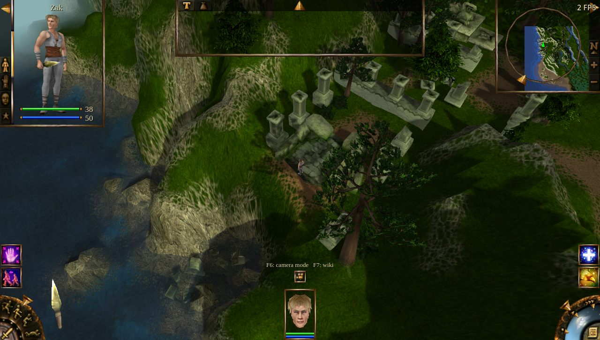
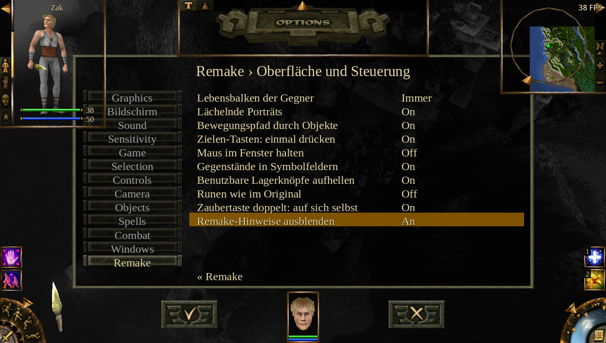
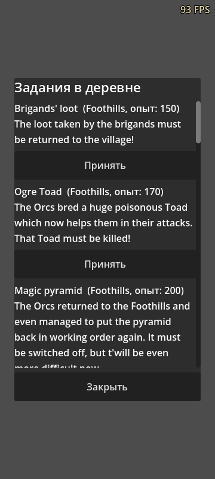
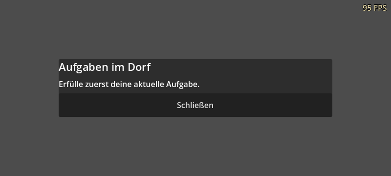
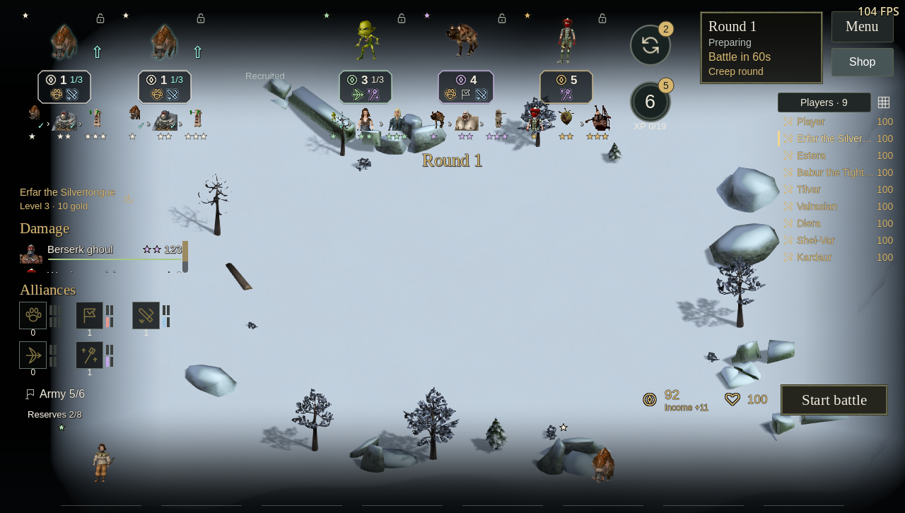

# UI hints, quest-window bounds and shop ownership

Local working-tree validation on 2026-10-19, on top of `e0abbb1e`.
Version metadata remains 1.17.0; nothing was published.

## Changes

- Initial isometric play shows the camera-mode and context-wiki shortcuts, using
  the same lower-screen style as direct control. Remapping either key updates
  the hint. Direct-control guides also include the wiki shortcut.
- **Remake → Interface and controls → Hide remake hints** defaults to Off.
  Turning it On hides the additional control guides in all camera modes, including
  the direct interaction key prompt, while preserving the crosshair and normal
  item/button tooltips. Existing direct-guide detail preferences remain separate.
- New profiles default enemy health bars to **Always**. Saved Off/Auto/Always
  choices and the existing conditions for showing a bar are unchanged.
- Village quest offers scroll within the available HUD area. Accepting and
  reopening a quest shrinks/recenters the panel, with Close outside the scroll
  area. Touch targets account for the viewport/canvas scale.
- The Trials spectator heading belongs to the sidebar's vertical layout, below
  the actual shop bounds and the space for hovered names. Evolution portraits
  show a check for an owned form and a compact count for multiple copies. The
  local shop retains local ownership while watching another company.

## Reproduction of issue 46

The old `SideQuestPanel` from HEAD was loaded alongside the new game pack and
fed the same twelve original village offers at an 800×360 viewport with a
776×336 safe area. Its offer panel extended to `(-268, -913)` with size
`560×1850`. After accepting/reopening, its bounds were `(-268, -34.5, 560, 93)`:
most of the window was above/left of the viewport. This reproduces the geometry
failure described in [issue #46](https://github.com/TheWWWorm/CursedLands/issues/46).
See [the baseline log](quest-legacy.log).

The corrected panel was exercised using actual native quest offers and injected
screen-touch/drag events: scroll, accept, reopen, Close, and rotation while open.
The accept callback in this focused fixture records the command and marks the
quest active; it does not run an entire quest or briefing.

## Checks

| Check | Passed |
| --- | ---: |
| Drawn shortcut guides, remapping, defaults, option localization and saved preferences | 42 |
| Quest panel with touch gestures and portrait/landscape resizing | 86 |
| Existing native health-bar visibility regression | 25 |
| Trials English rendered UI, including duplicate markers and native combat | 87 |
| Trials Russian rendered UI | 83 |
| Trials German rendered UI | 83 |

All checks passed with no script/runtime errors. Translation validation covered
2753 entries, 141 dynamic wiki keys and 151 dynamic arena keys, with zero errors.
The editor/export parse and `git diff --check` also passed.

The remake UI was switched through EN/RU/DE against the installed English game
data. Native quest descriptions retain the supplied archive language; they are
not translated by these changes. The native desktop tests used Linux/Vulkan
and the existing patched engine. Phone layouts were exercised at 360×800 and
800×360, plus 1280×800. Some initial desktop windows were clamped by the window
manager to 1280×726, as recorded in capture logs. This pass did not run on an
Android browser or a Windows machine, and did not restart the performance soak.

Russian/German Trials layout checks preceded the final touch-target adjustment;
their Trials source was unchanged. The final pack was used for the English
Trials, all hint/quest tests and the health-bar regression. See
[build metadata](build-manifest.json) for hashes and the diagnostic archive.

## Selected captures

## Development preferences

The workspace and repository AGENTS.md now require isolated development/test
profiles with `confine_mouse=0`, `show_fps=1`, and all three audio volumes at 0
(`volume_sfx`, `volume_stream`, `volume_voice`). These were set before launching
the runs after that instruction arrived. Normal player defaults were not changed
for these development preferences.
