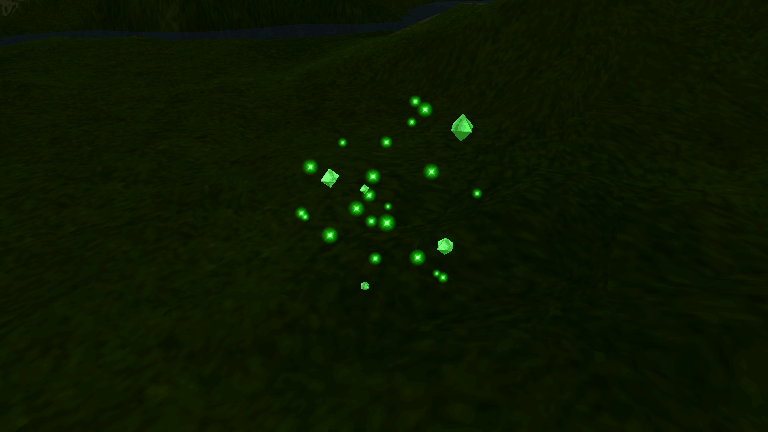

# Wisp native ambient effect and crystal visibility

Validated on 2026-10-18, following the projectile-origin work in
[the earlier report](../creature-projectiles-wisp-2026-10-18/).

The missing visual component was the original wisp's ambient particle emitter.
The green droplets in the earlier inspection were body-hit blood particles.
Moving those droplets among crystals did not restore the missing effect. That
experimental redistribution and the experimental whole-body attachment override
are absent from this change. Native blood and spell attachments remain intact.

## Original executable evidence

Source: original English `game.exe`, SHA-256
`d0fc0bb2acf45f0e59fae89e55c16a59848ffa89fb68feee9f298a680b660ad8`.
REA/Ghidra 12.1.4 read the original without changing it; the session was closed
when investigation finished. See [native evidence](native-evidence.json),
[attachment evidence](attachment-evidence.json) and the retained disassembly.

Observed in the shipped binary:

- Figure creation at `0x667e80` compares the model mask with `unmowi` at
  `0x794db0`, creates `CParticle` type `0x204d`, attaches the figure, scales it
  by `0.05 / k128`, and selects attachment 0, the whole-figure centre.
- The factory case at `0x48836f` selects additive blending, carrier/bone flags,
  selector 0, one initial spawn attempt, a 300-particle cap, and the `Stun` atlas
  (`0x78ae28`). Its callbacks are `0x495fb0` and `0x4961b0`.
- Spawn uses atlas frame 3, a ten-attempt rejection sample in a unit ball,
  and a radius of `0.8 * carrier_radius`. Every new star gets a fresh position
  around the figure centre. Stars start at zero size and transparent white.
- Updates make stars opaque white with independently flickering size:
  emitter size 0.05, a persistent random multiplier in [0.7, 1.3], and a new
  multiplier in [0.8, 1.2] each tick. Their positions do not move after birth.
- Gait 3 changes emission to four attempts and particle life to five ticks;
  other gaits use one attempt and twenty ticks. The tick is 55 ms. Loss of the
  carrier/death stops emission and lets particles drain.
- Part lookup at `0x516a80` accepts a name prefix. The original `bd` lookup
  therefore resolves the first authored numbered body part, `bd00`, on wisps.
  Exact-name-only lookup in the remake lost their body-hit particles and used
  a fallback position for attached magic.

The port uses those native parameters and the original texture. Existing
per-emitter random streams remain in use; it does not reproduce the original
engine's shared RNG ordering across unrelated emitters.

## Independent callback replay

[replay_wisp_native.py](../../../tools/tests/replay_wisp_native.py) executes the
original x86 spawn/update instructions under Unicorn 2.1.4. Only the supplied
carrier bounds, gait/death state, RNG values and attachment boundary are stubbed.
The original x87 arithmetic, rejection loop, lifetime, position and colour
instructions execute. This is callback replay, not a run of the complete game.

Sixteen cases include walking, running, death, missing carrier, movement after
birth and ten consecutive rejected samples. The native outputs are committed as
[a fixture](../../../tools/tests/fixtures/wisp_native_callbacks.json).
`wisp_native_callbacks.gd` compares 369 callback steps, including return values,
random consumption and emission/attachment state: **4,428 checks, zero failures**.
Float comparison tolerance is 0.000002 for the engine's float32 vector storage.

To regenerate, install `unicorn==2.1.4` and `pefile==2024.8.26` in an isolated
Python environment and run:

```sh
python tools/tests/replay_wisp_native.py /path/to/original/game.exe
```

## Integration and visual result

Each registered world wisp automatically receives one ambient emitter. Registry
changes cover loaded units, new spawns and reused arena replicas. Death stops and
drains it; revival restores it; removal releases its registration. Fog and hidden
figures hide the stars, including a dying hidden carrier. Living wisps retain
ambient stars between arena battles. Authority worlds with presentation disabled
and standalone model previews do not receive world particles.

The separate crystal-surface enhancement is an intentional remake treatment,
not a claim about original material rendering. It replaces the earlier round
billboards with a staggered pulse on the five original deforming crystal meshes.
Facets, texture alpha, skin colours, animation and selection geometry remain.
Added surface shine fades with the original death animation. No point lights or
extra crystal meshes are added; bloom is unnecessary for visibility.



[Hot-wisp casting/impact capture](hot-wisp-combat.png) exercises the existing
fire-arrow effect separately from ambient glow and green body-hit blood.

## Verification

Linux, Godot 4.7, RTX 3090. Locale rows use the original EN/RU/DE data archives.
All three native family members are covered: `WillowispM1`, `WillowispM3`,
`WillowispM5`.

| Check | Result |
| --- | --- |
| Native callback replay comparison | 4,428 passed |
| Ambient integration, distribution, movement, lifetime and combat, Forward+/EN | 438 passed |
| Same ambient checks, Compatibility/RU | 438 passed |
| Same ambient checks, Mobile/DE | 438 passed |
| Crystal silhouettes, pulses, grass/night contrast, occlusion, invisibility, death and preview refresh | 49 passed per renderer/locale, 147 total |
| Attachment audit: 47 monster rigs, 389 prototype variants | 1,739 passed |
| Creature projectile-origin regression | 182 passed |
| Original FIG geometry regression | 952 passed, 112 models |
| Production wound/alpha GPU contract | 206 passed |
| Translation coverage | 2,687 entries plus dynamic wiki/arena keys; zero errors |

The attachment audit found the numbered-body prefix mismatch only in `unmowi`
among those 47 rigs. This is evidence about that attachment rule, not a claim
that every original creature effect has been exhaustively verified.

Rendered tests explicitly settle their paused viewport and disable camera
physics interpolation before advancing manual particle ticks. An initial test
capture before that setup hid the first emitter; the final results above use
correctly initialized cameras. Wound comparisons hold the new pulse time steady
so animation cannot create a false material difference.

No player-visible text or settings were added. No release/version change or
publication is part of this fix.
